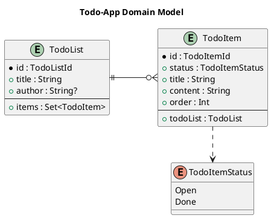

# 2. Domain Entities and Schema - Kiwi Server

This chapter introduces Entities, how to model and migrate them,
and how to represent their data using Entity Schema and Fieldset objects.

## Entities

Entity classes model the core domain of an application.
They define the data, state, operations, and relations to other entities within the system.  
Instances of an entity class can be persisted, managed, and queried using an EntityManager.

> According to
> the [JPA specification](https://jakarta.ee/specifications/persistence/3.2/jakarta-persistence-spec-3.2):  
> "An entity is a lightweight persistent domain object. The primary programming artifact is the entity class.
> An entity class may make use of auxiliary classes that serve as helper classes or that are used to represent the
> state of the entity."

In the Kiwi-Server Framework, entity classes should extend the abstract `BaseEntity<ID>` base class, and have a
dedicated ID class extending the abstract `EntityId` class:

- `BaseEntity<ID : EntityId>` is a JPA `@MappedSuperclass` declaring the `id` attribute as an `@EmbeddedId`, mapped to
  the `id` column of the entity table. Two entities are equal if they have the same ID, so entities can be safely used
  in sets and as map keys, even before they have been persisted.
- `EntityId` wraps the numeric `Long` value of an ID in a type-safe class. Each entity has its own ID class, which
  must be annotated as `@Embeddable` and must have a single constructor accepting the `Long` value. This prevents
  mixing up IDs of different entity types at compile-time.

Entity IDs are generated by the server as Snowflake IDs using `EntityId.generate<ID>()`, before the entity is
persisted. See [Appendix: "Snowflake IDs"](./99-appendix.md) for details on the Snowflake ID format, and how
universally unique Entity IDs are generated.

The `EntityId` class provides the following functions:

- `EntityId.generate<ID>()` generates a new unique ID of the given ID type
- `EntityId.fromValue<ID>(Long)` wraps a numeric value in the given ID type
- `EntityId.fromString<ID>(String)` parses a base32-encoded string (or a numeric string) into the given ID type
- `toString()` returns the base32-encoded string representation of the ID, which is also used to represent IDs in
  JSON data and URLs
- `value` returns the underlying numeric `Long` value, and `cast<ID>()` converts the ID into another ID type with the
  same value

Data and relations of an entity are stored in fields of the entity class, which are annotated with JPA annotations to
configure how entity instances are mapped from and to rows in the relational database.

This model of annotations is available as
the [JPA Static Metamodel](https://jakarta.ee/specifications/persistence/3.2/jakarta-persistence-spec-3.2#a6072),
which is generated at compile-time by
the [Hibernate Processor](https://docs.jboss.org/hibernate/orm/7.0/introduction/html_single/Hibernate_Introduction.html#generator)
(`org.hibernate.orm:hibernate-processor`, see
[Chapter 1: "Set up a new Project Application"](./01-introduction.md#set-up-a-new-project-application) for the setup).

### Entity model

For the example todo-list application (see [Chapter 1: "Introduction"](./01-introduction.md) for setup), define a
simple domain model with two entities:



- The `TodoList` entity, identified by a `TodoListId`, has a `title` and an optional `author` attribute, and a
  one-to-many relation to a set of `TodoItem` entities
- The `TodoItem` entity, identified by a `TodoItemId`, has a `status`, a `title`, a `content` and an `order`
  attribute, and a many-to-one relation to one parent `TodoList` entity

This is the domain model of the demo application in the Kiwi-Server repository (`demo/todo-app`), which you can use as
a reference implementation for this guide.

<!--
Note: If you can't see the class diagram in your Markdown viewer, install
a [PlantUML plugin](https://plantuml.com/en-dark/running) if available,
or copy-paste the diagram code into the
[PlantUML online editor](https://editor.plantuml.com/uml/SoWkIImgAStDuL9NyCmhJYqgKGZ8ISmh2VNrKKZ9J4mlIinLo4WjIkLoICrB0Ie30000).
-->

### Entity classes

This model can be implemented in the example application like this:

```kotlin
// Entities are located in the `domain` package
package com.example.domain

// Use Kiwi API classes
import de.kiwi.api.domain.*
// Use JPA annotations for persistence mapping
import jakarta.persistence.*

// (1) Define a dedicated ID type for TodoList
@Embeddable // Contains the `id` column attribute
class TodoListId(value: Long) : EntityId(value)

// (2) Define the TodoList entity
@Entity
@Table(name = "todo_list") // Map to database table
class TodoList(
    id: TodoListId,

    @Column(name = "title", nullable = false, length = 255)
    var title: String, // Map to database column: title VARCHAR(255) NOT NULL

    @Column(name = "author", nullable = true, length = 255)
    val author: String?, // Map to database column: author VARCHAR(255) NULL
) : BaseEntity<TodoListId>(id) { // Inherit from BaseEntity with dedicated TodoListId type
    // -> Inherits database column: id BIGINT NOT NULL PRIMARY KEY

    @OneToMany(mappedBy = "todoList", orphanRemoval = true) // Inverse side of bidirectional mapping
    val items: MutableSet<TodoItem> = HashSet()

    // Helper functions maintaining the inverse side of the relation
    fun addItem(item: TodoItem) = items.add(item)
    fun removeItem(item: TodoItem) = items.remove(item)
    fun orderedItemList() = items.sortedBy { it.order }
}

// (3) Define a dedicated ID type for TodoItem
@Embeddable
class TodoItemId(value: Long) : EntityId(value)

// (4) Define the TodoItem entity
@Entity
@Table(name = "todo_item") // Map to database table
class TodoItem(
    id: TodoItemId,

    @Enumerated(EnumType.STRING)
    @Column(name = "status", nullable = false)
    var status: TodoItemStatus, // Map to database column: status ENUM('Open', 'Done') NOT NULL

    @ManyToOne(optional = false)
    @JoinColumn(name = "todo_list_id", nullable = false)
    var todoList: TodoList, // Map to database column:
    // todo_list_id BIGINT NOT NULL REFERENCES todo_list (id)

    @Column(name = "title", nullable = false, length = 255)
    var title: String, // Map to database column: title VARCHAR(255) NOT NULL

    @Column(name = "content", nullable = false, columnDefinition = "text")
    var content: String, // Map to database column: content TEXT NOT NULL

    @Column(name = "order_index", nullable = false)
    var order: Int, // Map to database column: order_index INTEGER NOT NULL
) : BaseEntity<TodoItemId>(id) // Inherits from BaseEntity with dedicated TodoItemId type
// -> Inherits database column: id BIGINT NOT NULL PRIMARY KEY

// (5) Define the status values of a TodoItem
enum class TodoItemStatus { Open, Done }
```

> Note: Hibernate requires entity classes to be open (non-final) and have a no-arg constructor to create lazy-loading
> proxies. The Kotlin `allOpen` and `plugin.jpa` compiler plugins, configured
> in [Chapter 1](./01-introduction.md#set-up-a-new-project-application),
> take care of this for all classes annotated with `@Entity`, `@Embeddable` and `@MappedSuperclass`.

When compiling the application module, the Hibernate Processor will generate a static metamodel for the defined entity
classes. These generated metamodel classes will appear in the build directory (`build/generated/source/kapt/main/`),
declared in the same package as their corresponding entity classes.

For the example `TodoItem` entity class above, the generated `TodoItem_` metamodel class will look like this:

```java
// Declared in same package as TodoItem entity
package com.example.domain;

// Static model "TodoItem_" for "TodoItem" entity, generated by annotation processor
@StaticMetamodel(TodoItem.class)
@Generated("org.hibernate.processor.HibernateProcessor")
public abstract class TodoItem_ extends de.kiwi.api.domain.BaseEntity_ {
    // Static attribute names, can be used for compile-safe lookup by property name
    public static final String STATUS = "status";
    public static final String TODO_LIST = "todoList";
    public static final String TITLE = "title";
    public static final String CONTENT = "content";
    public static final String ORDER = "order";

    // Static metamodel attributes, can be used in JPA Criteria queries and Specifications
    // IMPORTANT NOTE: These attributes are initialized on startup by the JPA persistence unit
    // If you run code in an environment without an initialized JPA/Hibernate EntityManagerFactory,
    // these fields will be `null` and referencing them will lead to Exceptions!
    // See: Java Volatile keyword, https://www.baeldung.com/java-volatile
    public static volatile EntityType<TodoItem> class_;
    public static volatile SingularAttribute<TodoItem, TodoItemStatus> status;
    public static volatile SingularAttribute<TodoItem, TodoList> todoList;
    public static volatile SingularAttribute<TodoItem, String> title;
    public static volatile SingularAttribute<TodoItem, String> content;
    public static volatile SingularAttribute<TodoItem, Integer> order;
}
```

The metamodel attributes are used for type-safe JPA Criteria queries, for example in `Specification`s, generic entity
filters, access control rules, and analytical reports
(see [Chapter 4: "Database Querying and Access-Control"](./04-querying-access-control.md)).
The `id` attribute is inherited from `BaseEntity_`, so `TodoItem_.id` refers to the `@EmbeddedId` of the entity.
The `BaseEntity_` and `EntityId_` metamodel classes are part of the `kiwi-api` module.

Entity schemas, introduced [below](#entity-schema-and-fieldsets), don't use the metamodel, but Kotlin property
references like `TodoItem::title`.

### PersistableBaseEntity

Spring Data repositories decide whether to `persist` or to `merge` an entity in `save()` by checking if the entity is
new. As entities extending `BaseEntity` always have an assigned ID, Spring Data considers them as existing, and
`save()` merges them, which issues an additional `SELECT` before inserting a new row.

For entities that are created in large numbers, `PersistableBaseEntity<ID>` avoids this additional query. It extends
`BaseEntity<ID>` and implements Spring Data's `Persistable<ID>` interface. Call the protected `markAsNew()` function
when creating a new instance, so the following `save()` inserts the entity directly:

```kotlin
@Embeddable
class LogEntryId(value: Long) : EntityId(value)

@Entity
@Table(name = "log_entry")
class LogEntry(
    id: LogEntryId,

    @Column(name = "message", nullable = false, columnDefinition = "text")
    val message: String,
) : PersistableBaseEntity<LogEntryId>(id) {
    // Implement Persistable.getId() using the ID of BaseEntity
    override fun getId() = id

    companion object {
        fun create(message: String) = LogEntry(
            id = EntityId.generate<LogEntryId>(),
            message = message,
        ).apply {
            // Mark the new instance, so repository.save(entry) issues an INSERT without a previous SELECT
            markAsNew()
        }
    }
}
```

The Kiwi Audit-Log module uses this base class for its audit-log entries. For most entities, `BaseEntity` is
sufficient. Note that the generic create commands (see
[Chapter 3: "Generic Commands and Queries"](./03-application-command-query.md#generic-commands-and-queries)) persist
entities marked with `markAsNew()` using `EntityManager.persist`, and all other entities using `EntityManager.merge`.

## Database Migration

When trying to run the application immediately after declaring the entity classes,
Hibernate will throw an Exception on startup:

```
Caused by: org.hibernate.tool.schema.spi.SchemaManagementException: Schema-validation: missing table [todo_item]
```

This exception occurs when `spring.jpa.hibernate.ddl-auto` is set to `validate`, as it was
in [Chapter 1](./01-introduction.md#set-up-a-new-project-application).
This configuration validates that the database schema is compatible with the entities declared in the application
persistence unit.

### Liquibase ChangeSet

Kiwi-Server uses [Liquibase migrations](https://docs.liquibase.com/) to migrate an evolving database schema. Liquibase
is integrated into Spring Boot (using `spring-boot-starter-liquibase`), which allows the application to manage
upgrades of the database schema version on startup.

To add a new database migration, create a Liquibase changelog file in `src/main/resources/db/changelog/`.  
For this example, name the file `db.example-01.yaml`. This will contain the first version of the example-application
database schema:

```yaml
## Changelog of first application database schema version
databaseChangeLog:
  ## (1) First changeset in changelog
  - changeSet:
      # Changeset is identified by ID and Author
      id: initial-schema
      author: your-name-here
      changes:
        ## (2) Create the "todo_list" table
        # The table name and columns *must* match the mapping specified
        # by the JPA @Table/@Column/... annotations in the entity class
        - createTable:
            tableName: todo_list
            columns:
              - column:
                  name: id
                  type: bigint
                  constraints: { nullable: false, primaryKey: true }
              - column:
                  name: title
                  type: varchar(255)
                  constraints: { nullable: false }
              - column:
                  name: author
                  type: varchar(255)
        ## (3) Create the "todo_item" table
        - createTable:
            tableName: todo_item
            columns:
              - column:
                  name: id
                  type: bigint
                  constraints: { nullable: false, primaryKey: true }
              - column:
                  # This column is mapped to the @ManyToOne todoList relation
                  name: todo_list_id
                  type: bigint
                  constraints:
                    nullable: false
                    foreignKeyName: fk_todo_item_todo_list
                    referencedTableName: todo_list
                    referencedColumnNames: id
                    deleteCascade: true
              - column:
                  name: title
                  type: varchar(255)
                  constraints: { nullable: false }
              - column:
                  name: content
                  type: text
                  constraints: { nullable: false }
              - column:
                  name: order_index
                  type: integer
                  constraints: { nullable: false }
              - column:
                  # Enum values are stored by name, see @Enumerated(EnumType.STRING)
                  name: status
                  type: enum('Open', 'Done')
                  constraints: { nullable: false }
```

> Note: The `enum(...)` column type is specific to MySQL and MariaDB. For other databases, like PostgreSQL, use a
> `varchar` column instead.

Finally, include the new migration file in the master changelog file
`src/main/resources/db/changelog/db.changelog-master.yaml`, which was created in
[Chapter 1](./01-introduction.md#set-up-a-new-project-application):

```yaml
# Master changelog in db.changelog-master.yaml file
databaseChangeLog:
  ## Kiwi module database migrations included previously
  - include: { file: "classpath:db/changelog/db.storage-master.xml" }
  - include: { file: "classpath:db/changelog/db.audit-log-master.xml" }
  ## (1) Include the new changelog file in the master changelog,
  # located in same directory as master changelog file
  - include: { relativeToChangelogFile: true, file: "db.example-01.yaml" }
```

The Kiwi module changelogs are included first, as application tables may reference tables of the Kiwi modules.

### Database ChangeLog

When the application is started now, the pending database migration will be executed on startup.  
Check the output logs as the application starts:

```
Reading from mydatabase.DATABASECHANGELOG
Running Changeset: db/changelog/db.example-01.yaml::initial-schema::your-name-here
Table todo_list created
Table todo_item created
ChangeSet db/changelog/db.example-01.yaml::initial-schema::your-name-here ran successfully in [...]ms

UPDATE SUMMARY
Run:                          1
Previously run:             [...]
Filtered out:               [...]
-------------------------------
Total change sets:          [...]

Update summary generated
Update command completed successfully.
Liquibase: Update has been successful. Rows affected: 1
```

The tables mapped to entity classes have successfully been created.
The executed migrations have been appended to the `DATABASECHANGELOG` table.

Hibernate will now successfully validate the database schema:

```
Initialized JPA EntityManagerFactory for persistence unit 'default'
[...]
Tomcat started on port 8080 (http) with context path '/'
Started ExampleApplicationKt in [...] seconds (process running for [...])
```

If you have a connection to the test database, you can verify that all tables exist using the database console:

```
mysql> show tables;
+-----------------------+
| Tables_in_mydatabase  |
+-----------------------+
| DATABASECHANGELOG     |
| DATABASECHANGELOGLOCK |
| kiwi_audit_log        |
| kiwi_file             |
| todo_item             |
| todo_list             |
+-----------------------+
6 rows in set (0.00 sec)
```

- The Kiwi Audit-Log module created the `kiwi_audit_log` table
- The Kiwi Storage module created the `kiwi_file` table
- The new migration file `db.example-01.yaml` created the `todo_item` and `todo_list` tables
- Liquibase itself created and uses the `DATABASECHANGELOG` and `DATABASECHANGELOGLOCK` tables
    - Executed migrations are stored in `DATABASECHANGELOG`, only new migrations are executed on startup
    - The table `DATABASECHANGELOGLOCK` is used to ensure multiple migrations don't happen at the same time

The database is now ready to store and query entity data.

> Note: When entities change, new entities are added, or entities are deleted, the database schema *must* be changed
> accordingly. Hibernate helps in this process by validating that the database schema is compatible with the declared
> entities.  
> Don't modify changeSets that have already been executed, as Liquibase detects changed checksums and fails on
> startup. Instead, add a new changeSet to migrate the database to a new version of the schema.  
> You can use IDE tools like [JPA Buddy](https://jpa-buddy.com/) to generate part of the database changelogs
> automatically using a [Liquibase Diff](https://docs.liquibase.com/commands/inspection/diff.html).

## Entity Schema and Fieldsets

An Entity Schema in Kiwi-Server is a definition of how to represent entity data using hierarchical JSON
data-structures.

EntitySchema instances are global singleton objects
(see [Kotlin: "Object declarations"](https://kotlinlang.org/docs/object-declarations.html)) that define column fields,
to-one relation fields, to-many relation fields, and to-many-map relation fields.
Fields are defined by declaring delegated properties on the respective EntitySchema object.

- Value fields are represented by `ColumnField` objects
- To-one relation fields are represented by `ToOneField` objects
- To-many collection relation fields are represented by `ToManyField` objects
- To-many map (key-value collection) relation fields are represented by `ToManyMapField` objects
- Fields of entity subclasses are represented by `SubtypeField` objects

As an advanced feature, EntitySchema can define fine-grained rules controlling which fields are allowed to be
accessed, see [Chapter 4: "Field Access Control"](./04-querying-access-control.md#field-access-control).

Kiwi discovers EntitySchema and FieldsetsAvailable objects (see below) on startup by scanning the packages of your
application, i.e. the package of your `@SpringBootApplication` class and its sub-packages, as well as packages
declared by `@EntityScan` or `@ComponentScan`. Only public objects are registered, and each entity class should have
only one EntitySchema. The registered schemas and fieldsets are used, for example, by the generic entity endpoints and
the OpenAPI documentation.

For an overview class diagram of EntitySchema classes,
see [Appendix: "EntitySchema class diagram"](./99-appendix.md).

### ColumnField

The ColumnField class represents JSON value fields defined for an EntitySchema.
ColumnField fields can be declared using the `by column(...)` delegate, which accepts a Kotlin property reference or a
column selector, and optionally a column type.

- `by column(Entity::property)` declares a column for an entity property, with an identity column type passing the
  property value as-is
- `by column(Entity::property, type)` declares a column for an entity property, formatted using the given ColumnType
- `by column(selector)` and `by column(selector, type)` declare a column using an explicit
  [ColumnSelector](#columnselector)

The nullability of a column is derived from the Kotlin type of the property: `column<String?>(TodoList::author)` is a
nullable column, while `column<String>(TodoList::title)` is not.

Additional delegates offer convenience methods to declare commonly used columns with special selectors and attributes:

- `by entityId()` declares the primary key column for entities extending `BaseEntity`, formatting the `EntityId` as a
  base32 string
- `by parentEntityId(Entity::relation)` declares a column containing the `EntityId` of an entity referenced in a
  many-to-one or one-to-one relation, without joining the referenced entity table
- `by primaryKey(Entity::property)` declares a primary key column for entities with other ID types
- `by foreignKey(Entity::relation, Related::key)` declares a column containing a key attribute of a related entity
- `by entityType()` and `by entityDiscriminator()` declare columns containing the simple class name or the
  `@DiscriminatorValue` of the entity, useful for entity inheritance hierarchies
- `by alwaysNullColumn<T>()` declares a read-only column that is always `null`
- `by multiselect(selector1, selector2, ...) { value1, value2, ... -> combined }` declares a column selecting multiple
  values, which are combined into one value, and `by multiselectMap("key" to selector, ...)` combines them into a map

An instance of ColumnField has the following properties:

- Its associated `fieldName` string, which is the name of the delegated property
- A boolean flag indicating if this column is a `primaryKey`, uniquely identifying its associated entity
- A boolean flag indicating if this column is `nullable`
- A `ColumnSelector` object associating the `ColumnField` object with an attribute value of the underlying entity
- A `ColumnType` object formatting the entity attribute value into a serializable representation, and providing a
  `ColumnFilterSet` of filter operators available for filtering when querying entities

#### ColumnType

The ColumnType interface determines how an entity attribute value is represented in a data structure, how data values
can be parsed back into attribute values, and which operators can be applied to the column when querying
entities (see [Chapter 4: "Column Filters"](./04-querying-access-control.md#column-filters)).

Attribute values of entities are passed to the ColumnType of their associated ColumnField to be formatted, resulting in
a formatted value. This formatted value can then be passed to the [Jackson library](https://www.baeldung.com/jackson) to
serialize the values as JSON data structures.

For common types, Kiwi pre-defines a set of ColumnTypes:

- `IdentityColumnType`, which can be instantiated using `ColumnType.identity<T>()`, simply passes the attribute value
  as-is without applying any transformation
    - This type is commonly used for simple value types, such as strings, numbers or booleans, which can be directly
      mapped to JSON values
    - This is the default ColumnType used for ColumnFields declared `by column(...)`, unless another ColumnType is
      explicitly specified
- `EntityIdColumnType`, which can be instantiated using `ColumnType.entityId<ID : EntityId>()`, handles formatting and
  parsing of specific EntityId subclasses
    - Entity IDs are represented as strings using base32 encoding,
      see [Appendix: "Snowflake IDs"](./99-appendix.md)
- `EnumColumnType`, which can be instantiated using `ColumnType.enum<E : Enum<E>>()`, handles formatting and parsing
  specific enum classes using enum member names
    - Enums are represented as strings, based on their enum member name
- `StringifyColumnType`, which can be instantiated using `ColumnType.stringify(parseString)`, formats values using
  `toString()`, and parses them using the given function
- `EntityClassNameType` and `EntityDiscriminatorValueType`, respectively, extract the simple Java class name and the
  entity `@DiscriminatorValue` annotation value from the given entity class value
- `IsoLocalDateType`, `IsoLocalTimeType`, and `IsoLocalDateTimeType` respectively map `LocalDate`, `LocalTime` and
  `LocalDateTime` values to [ISO-8601](https://en.wikipedia.org/wiki/ISO_8601) formatted strings
- `DataSizeType`, `UriType`, `UuidType`, `BigDecimalType`, and `BigIntegerType` are basic column types for the
  respective types `DataSize`, `URI`, `UUID`, `BigDecimal` and `BigInteger`
- `LikeStringColumnType` passes strings as-is, and additionally supports pattern-matching filter operators
- `BasicColumnType` and `ReadOnlyColumnType` are base types for custom column types specific to individual
  applications

Existing column types can be adapted using infix functions:

- `type map { ... }` transforms the formatted value, e.g. `ColumnType.map<String> { it.take(140) }` to shorten a
  string; `ColumnType.map<T> { ... }` is a shortcut for `ColumnType.identity<T>() map { ... }`
- `type validate validation` applies a [Validation](#entity-validation) when parsing values;
  `ColumnType.validate<T>(validation)` is the shortcut for identity types
- `type withFilters filterSet` replaces the set of filter operators supported by the column
- `type pipe otherType` chains two column types

Creating custom column types, or deriving new column types from existing instances, is covered under the advanced topics
in [Chapter 8: "Custom ColumnTypes"](./08-advanced.md#custom-columntypes).

#### ColumnSelector

The ColumnSelector interface is responsible for reading, writing, and selecting attribute values of entities, both from
entity instances and within JPA Criteria queries.

Kiwi provides these standard selector implementations:

- `AttributeSelector`, which can be instantiated using the `attribute(...)` selector function, selects the value of an
  entity attribute using an attribute path of up to five nested Kotlin property references, for example
  `attribute(TodoItem::todoList, TodoList::title)`. This is the selector used by `by column(Entity::property)`.
- `ComputedSelector`, which can be instantiated using the `computed(...)` selector function, computes an attribute
  value from an entity using an `EntityComputation`, which provides both a Kotlin function and an equivalent Criteria
  expression
- `EntityTypeSelector`, used by the `by entityType()` and `by entityDiscriminator()` delegate functions, selects the
  runtime Java class of the entity
- `MultiValueSelector` and `NullSelector`, used by the `multiselect(...)` and `alwaysNullColumn()` delegates

A column is read-only if it selects an immutable (`val`) property, or if it uses a computed or another
non-attribute selector. These columns can be selected, but writing a value to them will not work.

For example, the schemas defined [below](#define-an-entityschema) could declare additional columns using a nested
attribute path and a computation:

```kotlin
// Computation of the number of items of a TodoList,
// either from a loaded entity, or as an SQL expression within a Criteria query
object TodoListItemCount : EntityComputation<TodoList, Int> {
    override fun compute(entity: TodoList): Int =
        entity.items.size

    override fun CriteriaBuilder.select(fromEntity: Path<TodoList>): Expression<Int> =
        size(fromEntity[TodoList_.items])
}

object TodoListSchema : EntitySchema<TodoList>() {
    // [...]
    // Column computing the number of items in the TodoList
    val itemCount by column(computed(TodoListItemCount))
}

object TodoItemSchema : EntitySchema<TodoItem>() {
    // [...]
    // Column selecting the title of the parent TodoList, via path TodoItem.todoList.title
    val listTitle by column(attribute(TodoItem::todoList, TodoList::title))
}
```

### ToOneField

The ToOneField class represents JSON fields referencing one object of another EntitySchema.
ToOneField fields can be declared using the `by toOne(...)` delegate, which accepts a Kotlin property reference of a
to-one relation, and the referenced schema.

An instance of ToOneField has the following properties:

- Its associated `fieldName` string
- A boolean flag indicating if this relation is `nullable`, derived from the Kotlin type of the property
- A reference to the foreign schema of the `toOne` relation
- The `attribute` property reference to the foreign entity of the relation

### ToManyField

ToManyField/ToManyMapField represents a JSON field referencing a collection of objects of another EntitySchema.
ToManyField represents a reference to a list of values, and ToManyMapField represents a reference to a collection of
key-value pairs.
ToManyField/ToManyMapField fields can be declared using the `by toMany(...)` delegate, which accepts a Kotlin property
reference of a collection or map relation, and the referenced schema or key- and value-schemata.

An instance of ToManyField has the following properties:

- Its associated `fieldName` string
- A reference to the foreign schema of the `toMany` relation
- The `attribute` property reference to the list, set, or collection of foreign entities of the relation

An instance of ToManyMapField has the following properties:

- Its associated `fieldName` string
- A reference to the foreign key- and value-schema of the keys and values of the `toManyKeys`/`toManyValues` relation
- The `attribute` property reference to the map of foreign entity keys/values of the relation

### SubtypeField

For entity inheritance hierarchies, the `by subtype(...)` delegate declares a SubtypeField, which references an
EntitySchema of an entity subclass. Fields of the subtype schema are only present for entities of the respective
subclass. For example, a `Publication` entity with the subclasses `Book` and `Magazine` can declare the subtype schemas
as nested objects:

```kotlin
object PublicationSchema : EntitySchema<Publication>() {
    val id by entityId()
    val type by entityType() // Simple class name: "Book" or "Magazine"
    val title by column(Publication::title)
    val book by subtype(BookSubtype)
    val magazine by subtype(MagazineSubtype)

    object BookSubtype : EntitySchema<Book>() {
        val isbn by column(Book::isbn)
    }

    object MagazineSubtype : EntitySchema<Magazine>() {
        val lastPublishedOn by column(Magazine::lastPublishedOn, IsoLocalDateType)
    }
}
```

### Define an EntitySchema

To define an entity schema for an entity of class `E`, declare a singleton `object` inheriting from `EntitySchema<E>`.
Within this object, properties declared `by column(...)`, `by toOne(...)`, `by toMany(...)`, or by one of the other
delegates will be registered as schema fields.

EntitySchema objects define how entities can be queried and processed into a JSON data-structure representation
that can be serialized, deserialized, and used to represent the entity outside the application.
Optionally, an EntitySchema can override `defaultSort` to define the sort order used when querying entities without
an explicit sort order.

The EntitySchema objects for the example todo-app entities defined above can be implemented like this:

```kotlin
// Located in `domain.schema` package
package com.example.domain.schema

// Use Kiwi API classes
import de.kiwi.api.schema.ColumnType
import de.kiwi.api.schema.EntitySchema
// References domain classes
import com.example.domain.*

// (1) Define an EntitySchema for TodoList entity
object TodoListSchema : EntitySchema<TodoList>() {
    // Field "id" is a ColumnField<TodoList, TodoListId, String>
    // Associated with property BaseEntity::id
    val id by entityId()

    // Field "title" is a ColumnField<TodoList, String, String>
    // Associated with property TodoList::title
    val title by column<String>(TodoList::title)

    // Field "author" is a nullable ColumnField<TodoList, String?, String?>
    // Associated with property TodoList::author
    val author by column<String?>(TodoList::author)

    // Field "items" is a ToManyField<TodoList, MutableSet<TodoItem>, TodoItem, TodoItem>
    // Associated with property TodoList::items, references TodoItemSchema
    val items by toMany(TodoList::items, TodoItemSchema)
}

// (2) Define an EntitySchema for TodoItem entity
object TodoItemSchema : EntitySchema<TodoItem>() {
    // Field "id" is a ColumnField<TodoItem, TodoItemId, String>
    // Associated with property BaseEntity::id
    val id by entityId()

    // Field "list" is a ToOneField<TodoItem, TodoList>
    // Associated with property TodoItem::todoList, references TodoListSchema
    val list by toOne(TodoItem::todoList, TodoListSchema)

    // Field "listId" is a ColumnField<TodoItem, TodoListId, String>
    // Associated with the ID of the parent TodoList, without joining the todo_list table
    val listId by parentEntityId(TodoItem::todoList)

    // Fields "title" and "content" are ColumnField<TodoItem, String, String>
    val title by column<String>(TodoItem::title)
    val content by column<String>(TodoItem::content)

    // Field "status" is a ColumnField<TodoItem, TodoItemStatus, String>
    // The enum value is represented by its name
    val status by column<TodoItemStatus, String>(TodoItem::status, type = ColumnType.enum())

    // Field "order" is a ColumnField<TodoItem, Int, Int>
    val order by column<Int>(TodoItem::order)
}
```

This EntitySchema defines a JSON data structure for representing entities.
A corresponding type definition in TypeScript would look like this:

```typescript
// Alias types used for Entity IDs, with nominal marking of ID subtype
type TodoListId = string & { idType: "TodoList" }
type TodoItemId = string & { idType: "TodoItem" }

// JSON objects matching TodoListSchema
interface ITodoList {
  id?: TodoListId
  title?: string
  author?: string | null
  items?: Array<ITodoItem>
}

// JSON objects matching TodoItemSchema
interface ITodoItem {
  id?: TodoItemId
  list?: ITodoList
  listId?: TodoListId
  title?: string
  content?: string
  status?: "Open" | "Done"
  order?: number
}
```

As a feature, Kiwi-Server can generate these TypeScript source files for you.
See [Chapter 7: "Frontend Code-Generation"](./07-testing.md#frontend-code-generation) for more information on
source-code generation for EntitySchema declarations.

### Fieldsets

A fieldset is a named object, referencing an entity schema that determines which fields of the
referenced schema should be included in the JSON data structure. An entity schema should have a corresponding singleton
object defining its available fieldsets, with each entity schema having a "default" fieldset.
Fieldset objects are defined by delegated properties declared on the respective FieldsetsAvailable object,
executing a fieldset-definition builder function upon initialization.

See [Chapter 4: "Database Querying and Access-Control"](./04-querying-access-control.md) on using fieldsets when
querying entity data from the database using the QuerySchemaService.

### Define available fieldsets

To define the fieldsets available for an entity schema, declare a singleton `object` inheriting from
`FieldsetsAvailable` and pass the EntitySchema singleton as the supertype constructor parameter.
Within this object, properties declared `by defineFieldset { ... }` will be registered as named fieldsets, using the
property name as fieldset name.

The builder function passed to `defineFieldset` determines which column fields, to-one relation fields, and
to-many/to-many-map fields will be included in the fieldset. Every fieldset is initialized empty, and fields can be
included or later excluded within the builder function.

Methods to modify which fields are included or excluded are:

- `extendsFieldset(Fieldset<E>)` includes all fields included in the other fieldset passed as the parameter
- `includeAllColumns()` includes all ColumnField fields declared in the EntitySchema; note that this does not include
  ToOneField, ToManyField, ToManyMapField, or SubtypeField fields
- `includePrimaryKeys()` includes all ColumnField fields declared in the EntitySchema that are marked with the
  `primaryKey` flag
- `include(vararg ColumnField<E>)` includes the given ColumnField fields passed as parameters
- `includeToOne(ToOneField<E, R>, fieldset: Fieldset<R>)` includes the given to-one relation, using the referenced
  foreign fieldset to extract values from the referenced foreign entity
- `includeToMany(ToManyField<E, R>, fieldset: Fieldset<R>)` includes the given to-many collection relation, using the
  referenced fieldset to extract values from the referenced foreign entity collection items
- `includeToMany(ToManyMapField<E, K, V>, Pair<Fieldset<K>, Fieldset<V>>)` includes the given to-many-map collection
  relation, using the referenced key- and value-fieldsets to extract keys and values from the referenced foreign
  entity key-value map entries
- `includeSubtype(SubtypeField<E, C>, fieldset: Fieldset<C>)` includes the fields of an entity subclass
- `excludeAllToOne()` excludes all to-one relation fields previously included
- `excludeAllToMany()` excludes all to-many and to-many-map relation fields previously included
- `excludeAllSubtypes()` excludes all subtype fields previously included
- `exclude(vararg EntitySchemaField<E>)` excludes the given fields (ColumnFields, ToOneFields, ToManyFields,
  ToManyMapFields, or SubtypeFields) if previously included

Instead of a referenced fieldset, `includeToOne`, `includeToMany` and `includeSubtype` also accept a builder function,
which defines an anonymous fieldset for the referenced entity inline, e.g.
`includeToOne(TodoItemSchema.list) { include(TodoListSchema.id, TodoListSchema.title) }`.

The FieldsetsAvailable objects for the example todo-app entity schemata defined above can be implemented like this:

```kotlin
// Continue in same file as EntitySchema declarations
package com.example.domain.schema

// See above, "Define an EntitySchema"
object TodoListSchema : EntitySchema<TodoList>() { /* [...] */ }
object TodoItemSchema : EntitySchema<TodoItem>() { /* [...] */ }

// (1) Define named fieldsets available for TodoList, based on TodoListSchema
object TodoListFieldsets : FieldsetsAvailable<TodoList>(TodoListSchema) {
    // (2) Default fieldset is required, must override abstract property
    override val default by defineFieldset {
        // Includes TodoListSchema.id, TodoListSchema.title, TodoListSchema.author
        includeAllColumns()
    }

    // (3) Details fieldset, representing entity with child entities
    val details by defineFieldset {
        // Includes all columns from default fieldset
        extendsFieldset(default)
        // Includes TodoListSchema.items to-many relation,
        // using TodoItem-fieldset "short" to represent items in collection
        includeToMany(TodoListSchema.items, TodoItemFieldsets.short)
    }

    // (4) Fieldset representing the order of the items in a list
    val itemsOrder by defineFieldset {
        include(TodoListSchema.id)
        includeToMany(TodoListSchema.items, TodoItemFieldsets.order)
    }

    // More fieldsets can be defined here ...
}

// (5) Define named fieldsets available for TodoItem, based on TodoItemSchema
object TodoItemFieldsets : FieldsetsAvailable<TodoItem>(TodoItemSchema) {
    // (6) Default fieldset is required, must override abstract property
    override val default by defineFieldset {
        // Includes id, listId, title, content, status and order of TodoItemSchema
        includeAllColumns()
    }

    // (7) Short fieldset, used to represent items within their list
    val short by defineFieldset {
        // Includes fields from default fieldset, except for the redundant listId
        extendsFieldset(default)
        exclude(TodoItemSchema.listId)
    }

    // (8) Fieldset only representing the order of an item
    val order by defineFieldset {
        include(TodoItemSchema.id, TodoItemSchema.order)
    }

    // More fieldsets can be defined here ...
}
```

Fieldset names are case-insensitive: `TodoItemFieldsets["short"]` returns the fieldset of the given name or `null`,
and `TodoItemFieldsets.require("short")` throws a `NoSuchFieldset` exception if no fieldset with the given name exists.

Further delegates are available in FieldsetsAvailable objects: `by singleColumnFieldset(column)` defines a fieldset
representing an entity by the value of a single column instead of an object, for example to represent a to-many
relation as a list of IDs. An existing fieldset can be extended into a new fieldset using
`fieldset.extend { ... }`.

> Important note: It is possible to define an infinite recursion using fieldsets with a bidirectional relation.  
> If you do this, using the fieldset will crash with a *StackOverflowError* one way or another. Please be cautious!  
> Fieldsets requested through the generic entity endpoints are validated against cycles and a maximum nesting depth,
> see the `kiwi.fieldset-validation.*` properties in
> [Chapter 5: "Configuration Properties"](./05-infrastructure-integration.md#configuration-properties).

These fieldsets define JSON data structures for representing entities with specific fields.
A corresponding type definition in TypeScript would look like this:

```typescript
// Alias types used for Entity IDs, with nominal marking of ID subtype
type TodoListId = string & { idType: "TodoList" }
type TodoItemId = string & { idType: "TodoItem" }

// JSON object matching TodoListFieldsets.default
interface ITodoListDefault {
  id: TodoListId
  title: string
  author: string | null
}

// JSON object matching TodoListFieldsets.details
interface ITodoListDetails extends ITodoListDefault {
  items: Array<ITodoItemShort>
}

// JSON object matching TodoItemFieldsets.short
interface ITodoItemShort {
  id: TodoItemId
  title: string
  content: string
  status: "Open" | "Done"
  order: number
}

// JSON object matching TodoItemFieldsets.default
interface ITodoItemDefault extends ITodoItemShort {
  listId: TodoListId
}
```

As a feature, Kiwi-Server can generate these TypeScript source files for you.
See [Chapter 7: "Frontend Code-Generation"](./07-testing.md#frontend-code-generation) for more information on
source-code generation for entity schema.

### Extracting entity data using Fieldsets

Fieldset objects can be used to extract data structures from entities.

Data structures are assembled using a FieldsetSerializer implementation.
Kiwi provides two implementations out of the box:

- `BasicFieldsetSerializer`, representing entity data using Java collections:
    * `LinkedHashMap` for objects
    * `ArrayList` for lists
    * Simple POJOs for column values
- `JsonFieldsetSerializer`, representing entity data using Jackson 3 JSON nodes (package `tools.jackson.databind`):
    * `ObjectNode` for objects
    * `ArrayNode` for lists
    * `JsonNode` wrapping column values

To extract data from an entity instance, use the extract methods on a specific fieldset:

- `fun Fieldset<E>.extract(E, UserDescriptor? = null): Any?` extracts entity data and assembles data structures using
  the _BasicFieldsetSerializer_, returning plain Java collections and objects
- `fun Fieldset<E>.extractJson(E, UserDescriptor? = null): JsonNode` extracts entity data and assembles data structures
  using the _JsonFieldsetSerializer_, returning a JsonNode representation of the entity
- `fun <N> Fieldset<E>.extract(E, FieldsetSerializer<N>, UserDescriptor? = null): N` extracts entity data and
  assembles data structures using the given FieldsetSerializer, returning a serialized representation determined by
  the serializer type

The optional `UserDescriptor` parameter is used to evaluate
[field access control](./04-querying-access-control.md#field-access-control) rules of the schema.

A fieldset also implements the `DetailsProvider` interface (`toDetails(value, user)`), so it can be used to provide
the details of domain events in the audit log, see
[Chapter 3](./03-application-command-query.md#commands-queries-and-events). If no `UserDescriptor` is given, the
current user is obtained from the global `UserDescriptorProvider`.

### Dynamic fieldsets

While most cases use named fieldsets, statically declared in FieldsetsAvailable objects, it is possible to dynamically
define a fieldset on the fly. The name of these dynamic fieldsets will contain a UUID (`<anonymous-...>`), marking them
as ephemeral and representing their anonymous identity.

A dynamic fieldset can be defined anywhere like this:

```kotlin
// Build dynamic fieldset for TodoItem entities,
// including the fields TodoItemSchema.id and TodoItemSchema.title
val exampleDynamicFieldset = TodoItemSchema.buildFieldset {
    include(TodoItemSchema.id, TodoItemSchema.title)
}

// Example usage: Load TodoItem, extract objects using dynamic fieldset
val exampleItem: TodoItem = TODO("Load TodoItem from database ...")
val exampleItemData = exampleDynamicFieldset.extractJson(exampleItem)
println(exampleItemData) // => { "id": "...", "title": "..." }
```

Clients of the generic entity endpoints can also request dynamic fieldsets using the `_fields` query parameter,
see [Chapter 6: "Generic Entity Endpoints"](./06-web-mvc-endpoints.md#generic-entity-endpoints) and
[Chapter 8: "Dynamic Fieldset Syntax"](./08-advanced.md#dynamic-fieldset-syntax).

## Entity Validation

Kiwi supports validation of entity fields using the `Validation<T>` interface.
An instance of a Validation accepts an input value, and either returns a successful validation with an output value, or
rejects the input value with a reason why the validation failed, represented as a `Validation.Result<T>`
(either `Validation.Result.Valid` or `Validation.Result.Invalid`).

Validation instances can also be used like functions using the `invoke` operator with an input value, returning the
validated value upon validation success or throwing a `ValidationFailed` exception on failure. `ValidationFailed` is a
`DomainException` with status "Bad Request" (see
[Chapter 6: "Exception Handling"](./06-web-mvc-endpoints.md#exception-handling)).

Additionally, an instance of a validation can be associated with a specific entity property, binding the validation to
the field of a specific entity type. This is used to automatically apply validations to ColumnFields,
see ["Auto Column Validation"](#auto-column-validation).

Validation is a functional interface, so custom validations can be declared using a lambda:

```kotlin
val validPriority = Validation<Int> { value ->
    if (value in 1..5) Validation.valid(value)
    else Validation.invalid("invalid-priority")
}
```

Kiwi provides helper functions to define and combine validations:

- `Validation.assert<T>(reason: String) { value -> Boolean }` defines a validation that passes input values to the
  given predicate function. If the function returns true, a success result is returned. Otherwise, a failure result
  with the given reason is returned
- `Validation.map<T> { value -> T }` defines a validation that passes input values to the given mapper function, and
  always returns a success result with the mapped result value
- `infix fun <T> Validation<T>.and(Validation<T>): Validation<T>` defines a validation that combines two validations,
  applying them one after another (`de.kiwi.api.domain.and`)
- `val <T> Validation<T>.orNull: Validation<T?>` defines a validation that accepts null input values, or otherwise
  passes on the non-null input value
- `val <T> Validation<T>.notNull: Validation<T?>` defines a validation that rejects null input values, or otherwise
  passes on the non-null input value
- `fun <T> KProperty<T>.validateColumn(): Validation<T>` defines a validation associated with the entity property,
  which checks the constraints of its JPA `@Column` annotation: Null values are rejected unless the column and the
  Kotlin property are nullable, and strings must not exceed the column `length` (or the maximum length of `text`
  column definitions)
- `Validation.alwaysValid<T>()`, `Validation.alwaysInvalid<T>(reason)`, `Validation.valid(value)` and
  `Validation.invalid<T>(reason)` create constant validations and results

Kiwi also provides a set of standard validators in the Validation companion object `Validation.Validators`:

- `Validation.notEmpty` validates that the given input string value is not empty
- `Validation.notBlank` validates that the given input string value is not blank, i.e. not only whitespace
- `Validation.validEmail` validates that the given input string value is a valid e-mail address
- `Validation.toUppercase` is a validation mapping the given input string value to uppercase
- `Validation.toLowercase` is a validation mapping the given input string value to lowercase
- `Validation.maxLength(Int)` validates that the given input string value is not longer than the given max length
- `Validation.matchesRegex(reason: String, Regex)` validates that the given input string value matches the given regular
  expression
- `Validation.nullIf((T) -> Boolean)` is a validation mapping the given input value to null if the predicate function
  returns true
- `Validation.nullIfEmpty` is a validation mapping the given input string value to null if the string is empty
- `Validation.nullIfBlank` is a validation mapping the given input string value to null if the string is blank, i.e.
  only contains whitespace
- `Validation.nullUnlessPositive` is a validation mapping the given input integer value to null if it is zero or
  negative

### Declaring validations

By convention, validations for a specific entity class are declared within the class `companion object`.
Validations can be composed of multiple validations to validate all aspects of a value.

The entities of the example todo-application can be extended like this to include validations:

```kotlin
// Located in `domain` package
package com.example.domain

// Use Kiwi API classes, including the `and` infix function
import de.kiwi.api.domain.*
// Use Kiwi standard validators
import de.kiwi.api.domain.Validation.Validators.notBlank
// Use JPA annotations for persistence mapping
import jakarta.persistence.*

// [...]

@Entity
@Table(name = "todo_list")
class TodoList(
    id: TodoListId,

    @Column(name = "title", nullable = false, length = 255)
    var title: String,

    @Column(name = "author", nullable = true, length = 255)
    val author: String?,
) : BaseEntity<TodoListId>(id) {

    // [...] items relation and helper functions omitted

    // NEW: Companion object of TodoList entity class
    companion object {
        // (1) Define validations for TodoList entity fields
        // Validate title property:
        //  1. Associated with "title" field, not nullable, max length = 255
        //  2. Must not be blank, i.e. empty or only containing whitespace
        //  3. Remove leading and trailing whitespace
        val validTitle = TodoList::title.validateColumn() and notBlank and Validation.map { it.trim() }

        // (2) Static factory for creating TodoList entity instances
        fun create(title: String, author: String?) = TodoList(
            // Generate unique TodoListId for new entity instance
            id = EntityId.generate<TodoListId>(),
            // Validate given title value before passing title to constructor
            // -> Will throw a ValidationFailed exception if given title is invalid
            title = validTitle(title),
            author = author,
        )
    }
}

@Entity
@Table(name = "todo_item")
class TodoItem(
    // [...] Constructor properties omitted, see above
) : BaseEntity<TodoItemId>(id) {

    // NEW: Companion object of TodoItem entity class
    companion object {
        // (1) Define validations for TodoItem entity fields
        // Validate title property: Not nullable, max length = 255, not blank, trimmed
        val validTitle = TodoItem::title.validateColumn() and notBlank and Validation.map { it.trim() }

        // Validate content property: Not nullable, max length of a TEXT column
        val validContent = TodoItem::content.validateColumn()

        // (2) Static factory for creating TodoItem entity instances
        fun create(list: TodoList, title: String, content: String) = TodoItem(
            // Generate unique TodoItemId for new entity instance
            id = EntityId.generate<TodoItemId>(),
            status = TodoItemStatus.Open,
            todoList = list,
            // Validate given title and content before passing values to constructor
            // -> Will throw a ValidationFailed exception if a given value is invalid
            title = validTitle(title),
            content = validContent(content),
            // Append the new item to the end of the list
            order = list.items.size,
        )
    }
}
```

> Note: The `fun create(...)` pattern within an entity `companion object`, as seen above, will be used throughout the
> rest of this guide, and is part of the conventions for applications built using Kiwi-Server.
> [Chapter 3: "DomainResult Convention"](./03-application-command-query.md#domainresult-convention) extends this
> pattern to record domain events.

### Auto Column Validation

When a validation is declared as a property on an entity companion object using `KProperty<*>.validateColumn()`, it
automatically becomes eligible for automatic validation lookup. The validation is associated with the property, and
this association is kept when combining validations using `and`.

Kiwi looks up these validations when parsing column values from JSON data in generic create- and update-commands:
For a ColumnField with an attribute selector, Kiwi searches the companion object of the entity class declaring the
selected property for a non-nullable property of type `Validation` that is associated with the selected property, and
applies it to the parsed value. For nested attribute paths, the last property of the path is used. Columns with
computed or other selectors are not validated automatically.

For the example above, a `by schema(TodoListSchema.title)` property of a generic create-command will automatically
apply the `TodoList.validTitle` validation when the command is bound to the JSON body. A failed validation is reported
as an `EntityFieldInvalid` error naming the entity field and the reason of the failure.

See [Chapter 3: "Generic Create, Update and Delete"](./03-application-command-query.md#generic-create-update-and-delete)
for how auto column validation is used with create- and update-commands.

---

After this chapter, your example todo-application has defined entities, their database mapping and migration,
entity data validation, and a schema for data-structures representing entity data.

Next up, [Chapter 3: "Application Commands, Queries and Events"](./03-application-command-query.md) is about defining
the commands, queries, and events of the application, to add interactions, business logic, and use-cases to your
application.
