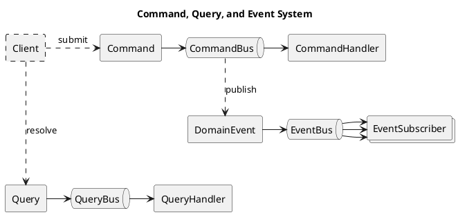
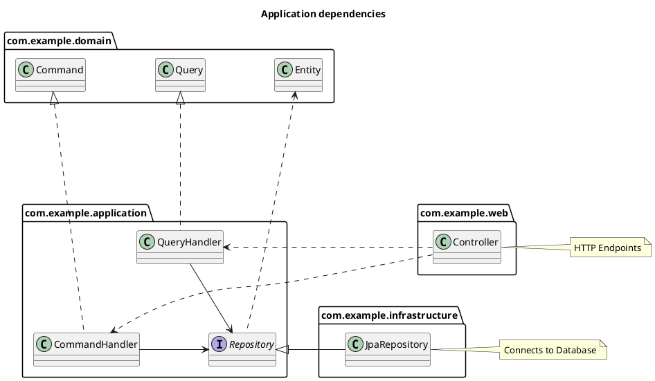

# 3. Application Commands, Queries and Events - Kiwi Server

This chapter introduces commands, queries and events, and how to implement application logic and use-cases.

## Commands, Queries and Events

Interaction with the application core is defined using commands, queries and events.

Kiwi-Server follows
the [Command-Query Responsibility Segregation](https://en.wikipedia.org/wiki/Command_Query_Responsibility_Segregation)
principle: Read-only queries accessing the state of the system are strictly separated from read-write commands changing
the state of the system.

- Queries are resolved by the **QueryBus**.  
  The QueryBus handles cross-cutting concerns, and forwards queries to their associated QueryHandler.
  The result of the handler is returned from the QueryBus.

- Commands are submitted to the **CommandBus**.  
  The CommandBus handles cross-cutting concerns, and forwards commands to their associated CommandHandler.
  This CommandHandler returns a collection of DomainEvents alongside a result value as a DomainResult.
  Emitted events are published onto the EventBus after handling the command, but before the result is returned
  from the CommandBus. The DomainResult of the handler is returned from the CommandBus.

- DomainEvents are emitted when handling Commands and published onto the **EventBus** by the CommandBus.  
  The EventBus logs the events using an AuditLoggerService, and forwards events to matching EventSubscribers.
  EventSubscribers may emit follow-up events, which are published recursively until all events are processed.

This diagram shows an overview of the command-, query-, and event-system:



The Kiwi API (`de.kiwi.api.domain`) provides the base classes for these interactions:

- `Command<R>` is the base class of all commands, where `R` is the type of the result value returned by the command
  handler. Use `Command<Unit>` for commands without a result value.
- `Query<R>` is the base class of all queries, where `R` is the type of the query result.
- `DomainEvent` is the base class of all events. Events are _auditable_: They have an `eventName` (the class name), an
  `occurredOn` timestamp, a `severity`, and `details`, which are written to the audit log
  (see [Chapter 5: "Audit Log"](./05-infrastructure-integration.md#audit-log)). The `details` are usually extracted
  from the event subject using a fieldset when the event is created, i.e. they are a snapshot of the entity at the time
  the event occurred. Alternatively, `SubjectDomainEvent<T>` extracts the details of its `subject` lazily, using a
  `detailsProvider` such as a fieldset. Its optional `user` constructor parameter is passed to the details provider
  for field access control; without it, the current user of the global `UserDescriptorProvider` is used.

Commands and queries can additionally implement the `Authorized` interface, which declares a `preAuthorize(user)`
function called before the command or query is handled, and an optional `postAuthorize(result, user)` function called
with the result. To deny access, these functions throw a `DomainException`, usually an `AccessDenied` exception.

For the example todo-application, first define the following commands, queries, and events:

```kotlin
// Commands and events belong to the application domain core
package com.example.domain.command

import com.example.domain.*
import com.example.domain.schema.TodoItemFieldsets
import com.example.domain.schema.TodoListFieldsets
import de.kiwi.api.domain.Command
import de.kiwi.api.domain.DomainEvent
import tools.jackson.databind.JsonNode

// (1) Declare the command to create a new TodoList entity,
// returning a JSON representation of the new entity
data class CreateTodoList(val title: String) : Command<JsonNode>()

// (2) Declare the command to create a new TodoItem entity, which belongs to a specific TodoList
data class CreateTodoItem(
    val listId: TodoListId,
    val title: String,
    val content: String,
) : Command<JsonNode>()

// (3) Declare the command to move a TodoItem entity into another TodoList, without a result value
data class MoveTodoItemToList(val itemId: TodoItemId, val targetListId: TodoListId) : Command<Unit>()

// (4) Declare the event emitted when a new TodoList entity has been created
data class TodoListCreated(val todoList: TodoList) : DomainEvent() {
    // Use default TodoList-fieldset to serialize details data for audit-log
    override val details = TodoListFieldsets.default.extract(todoList)
}

// (5) Declare the event emitted when a new TodoItem entity has been created
data class TodoItemCreated(val todoItem: TodoItem) : DomainEvent() {
    // Use default TodoItem-fieldset to serialize details data for audit-log
    override val details = TodoItemFieldsets.default.extract(todoItem)
}

// (6) Declare the event emitted when a TodoItem entity has been moved into another TodoList
data class TodoItemMovedToList(
    val todoItem: TodoItem,
    val sourceList: TodoList,
    val targetList: TodoList,
) : DomainEvent() {
    override val details = mapOf(
        "item" to TodoItemFieldsets.default.extract(todoItem),
        "sourceList" to TodoListFieldsets.default.extract(sourceList),
        "targetList" to TodoListFieldsets.default.extract(targetList),
    )
}
```

```kotlin
// Queries belong to the application domain core
package com.example.domain.query

import com.example.domain.TodoListId
import de.kiwi.api.domain.Query
import tools.jackson.databind.JsonNode

// (7) Declare the query for retrieving JSON data representing all TodoList entities
class GetTodoLists : Query<List<JsonNode>>()

// (8) Declare the query for retrieving JSON data representing all TodoItems that belong to a specific TodoList
data class GetTodoItems(val listId: TodoListId) : Query<List<JsonNode>>()
```

These declarations define how the system can be interacted with,
providing methods for accessing data using queries or changing state using commands.

By default, commands are executed within a read-write transaction, and queries within a read-only transaction.
Commands and queries can override the `transactional` and `readOnly` properties to change this, see
["Transactions"](#transactions).

> Note: The commands and queries declared above offer _no inherent authorization or access-control_ by themselves.
> These features will be discussed in [Chapter 4: "Access Control"](./04-querying-access-control.md#access-control).

The following sections will explain how these commands and queries can be handled, and implement the application logic
of the example todo-application.

## Repository- and Service-Interfaces

The application layer of a project should define the core functionality and use-cases of the application,
and depends on the classes defined in the application domain.

For access to external resources, like querying and persisting entities in a database or communicating with external
system like e-mails or external APIs, repository- and service interfaces should be defined in the application layer.
This design follows the ["Dependency Inversion Principle"](https://en.wikipedia.org/wiki/Dependency_inversion_principle)
to ensure all dependencies in the application point inwards, from the outer infrastructure to the inner application core
and domain.

The domain, application and infrastructure layers should adhere to the following pattern:

- The domain layer does not depend on anything but itself, defining the core domain entities, structure, and entity
  logic
- The application layer defines command-/query-handlers, event-subscribers, and repository-/service-interfaces that
  depend on and define logic for the core domain
- The infrastructure layer depends on the core domain and provides implementations for interfaces required by the
  domain layer
- The web layer depends on the core domain and submits commands/queries to the application layer to respond to web
  requests



<!--
Note: If you can't see the class diagram in your Markdown viewer, install
a [PlantUML plugin](https://plantuml.com/en-dark/running) if available,
or copy-paste the diagram code into the
[PlantUML online editor](https://editor.plantuml.com/uml/SoWkIImgAStDuL9NyCmhJYqgKGZ8ISmh2VNrKKZ9J4mlIinLo4WjIkLoICrB0Ie30000).
-->

For the example todo-application,
declare
[Spring-Data Repository Interfaces](https://docs.spring.io/spring-data/jpa/reference/repositories/definition.html)
for the entities previously defined in [Chapter 2: "Entities"](./02-domain-schema.md#entities).
Spring Boot automatically scans the package of your `@SpringBootApplication` class and its sub-packages for these
interfaces, and creates repository beans without requiring an explicit implementation.

```kotlin
// Service interfaces belong to the application layer
package com.example.application

// Reference previously defined domain entity classes
import com.example.domain.*
// Use Spring-Data JPA for repository interfaces
import org.springframework.data.jpa.repository.JpaRepository
import org.springframework.data.jpa.repository.JpaSpecificationExecutor
import org.springframework.stereotype.Repository

// (1) Declare a standard repository for TodoList entities
@Repository
interface TodoListRepository : JpaRepository<TodoList, TodoListId>

// (2) Declare a repository for TodoItem entities, supporting queries using Specifications
@Repository
interface TodoItemRepository : JpaRepository<TodoItem, TodoItemId>, JpaSpecificationExecutor<TodoItem>
```

If your application logic requires specific entity queries, you can
declare
[Spring-Data Query Methods](https://docs.spring.io/spring-data/jpa/reference/repositories/query-methods-details.html)
to define queries for the given repository.

If your application logic requires flexible, programmatic queries, you can extend the repository interface from
[JpaSpecificationExecutor](https://docs.spring.io/spring-data/jpa/reference/jpa/specifications.html) to use
Specifications for executing programmatically generated queries.

The Kiwi API provides the extension function `repository.requireById(id)` (`de.kiwi.api.util.requireById`), which
loads an entity by its ID, or throws an `EntityNotFound` exception (resulting in an HTTP 404 response) if the entity
does not exist.

## User-Descriptor Interface

The UserDescriptor is an interface representing a user authentication in the system, implemented by the underlying
authentication mechanism. Instances don't have to be bound to a specific user entity or authentication method, but
rather the _concept_ of someone or something being authenticated within the system.

An instance of a UserDescriptor provides the following attributes about the user authentication:

- A **username** String, which should be a unique handle tied to the user's identity
- An **identity** value of any type, uniquely identifying the user
- An optional **userId** number, which may be a unique numeric identifier if the underlying user identity supports this
- An **authenticated** Boolean flag, indicating if the user is successfully authenticated or unauthenticated/anonymous
- A set of **roles** assigned to the user, most importantly among them potentially the very important `"ADMIN"` role
  (`Roles.ADMIN`), which is checked by the `isAdmin` property
- The underlying **principal** of the authentication, which is an object specific to the actual UserDescriptor
  implementation, e.g. a Spring Security `Jwt` or `UserDetails` object

Roles can be checked using `hasRole(role)`, `hasAnyRole(...)` and `hasAllRoles(...)`, which compare role names
case-insensitively. The extension functions `requireAuthorization { ... }`, `requireAdminOr { ... }` and
`requireAdmin()` throw an `AccessDenied` exception if the given condition is not satisfied.

For every command- or query-execution, a UserDescriptor instance _must_ be given
associating the execution with a user responsible for it.
The UserDescriptor should be used to determine authorization of queries and commands.
Fine-grained authorization functionality is discussed
in [Chapter 4: "Access Control"](./04-querying-access-control.md#access-control).

The `UserDescriptorProvider` interface, provided as a bean by Kiwi-Server Framework, provides access to a UserDescriptor
instance representing the currently authenticated user using `currentUser()`.
How exactly the currently authenticated user is determined depends on the specific UserDescriptorProvider
implementation, which is discussed
in [Chapter 5: "Spring Security Integration"](./05-infrastructure-integration.md#spring-security-integration).

There are two global instances of the UserDescriptor interface, intended for special use:

- The `UserDescriptor.SYSTEM` is a system-internal user descriptor, **bypassing normal authorization** and acting like a
  system-wide root superuser: Its role checks `hasRole`, `hasAnyRole` and `hasAllRoles` always succeed. Most access-
  and authorization-related security checks are *disabled* when using this specific descriptor instance.
  > **WARNING**: Be *very* careful when using this UserDescriptor, as it may potentially lead to security
  > vulnerabilities when this descriptor is used to authenticate user-initiated requests!
- The `UserDescriptor.ANONYMOUS` is a special user descriptor used by default when no authenticated user can be
  associated with the current request, i.e. no authentication has been used. It does not have any roles or permissions,
  its username is always `"ANONYMOUS"`, and its `authenticated` flag is **false**.

## Command-, Query- and Event-Handlers

These handlers contain the _main application use-case logic_, and are responsible for loading, modifying, and
representing entities and entity operations. Handlers should be instantiated as beans, automatically registering them
with the command-, query- and event-bus systems, and allowing them to autowire other beans using service- or
repository-interfaces.

When implementing handlers, the following rules apply:

- Each Query class _must_ have _exactly one_ corresponding QueryHandler bean
- Each Command class _must_ have _exactly one_ corresponding CommandHandler bean
- Each DomainEvent class _can_ have _any number_ of EventSubscriber beans listening to corresponding events

A handler is associated with the command, query or event class given as its first type argument, and also handles
subclasses of this class. If no handler is found when a command is submitted or a query is resolved, the bus throws an
`AssertionError`. The buses don't check for ambiguous handlers: if several handlers match a command or query, the first
registered one is used. Kiwi provides the handlers for generic entity queries and analytical report queries itself.

> Note: Kiwi-Server offers tooling support to assert at unit-test time that each declared Query class has a
> corresponding QueryHandler bean available, and each declared Command class has a corresponding CommandHandler
> available. See [Chapter 7: "Command- and Query-Verification"](./07-testing.md#command--and-query-verification) for
> a guide on tests verifying command- and query-handler integrity.

In the example todo-app, the following commands and queries are declared by the domain:

- Query "GetTodoLists": Should return all lists
- Query "GetTodoItems": Should return all items that belong to one list
- Command "CreateTodoList": Should create a new list
- Command "CreateTodoItem": Should add a new item to a list
- Command "MoveTodoItemToList": Should move an item from its list into another list

In the application layer, corresponding handler beans are created that implement the functionality advertised by the
declared query- and command-classes.

### Implementing Command-Handlers

Command-handlers implement the `CommandHandler<C, R>` interface, where `C` is the handled command class and `R` its
result type, to define the logic executed when the corresponding command is submitted to the command-bus.

By convention, the handle-method of a command-handler should use the `DomainResult.invoke(...)` function to execute
commands within an _event-recorder scope_, using the syntax `DomainResult { record -> ... }`.
Within this scope, the `record` event-recorder variable can record events that occur while the command-handler logic is
being executed. The result of this scope, which is the return value of the callback alongside the recorded events, is
returned as a `DomainResult<T>` instance that can be destructured into a result
value of type `T` and the previously recorded events as a `List<DomainEvent>`
(see ["DomainResult"](#domainresult)).

The domain-events recorded and returned from the command-handler method are automatically published onto the
event-bus.

```kotlin
// Command- and Query-Handlers, and Event-Subscribers, belong to the application layer
package com.example.application

// Reference previously defined domain entities, commands, and fieldsets
import com.example.domain.*
import com.example.domain.command.*
import com.example.domain.schema.*
// Use Kiwi-Server API classes
import de.kiwi.api.application.command.CommandHandler
import de.kiwi.api.domain.DomainResult
import de.kiwi.api.domain.UserDescriptor
import de.kiwi.api.generic.EntityCreated
import de.kiwi.api.util.requireById
// Use Spring-Core to scan for classes to instantiate as beans
import org.springframework.stereotype.Component
// Use Jackson 3 JSON data structures
import tools.jackson.databind.JsonNode

// (1) Declare handler for CreateTodoList command, returning a JsonNode result
@Component
class CreateTodoListHandler(
    // (1.1) Autowire the TodoListRepository
    private val todoListRepository: TodoListRepository,
) : CommandHandler<CreateTodoList, JsonNode> {
    // (1.2) Implementation of method executed to handle a CreateTodoList command.
    // This method is wrapped in a DomainResult { ... } callback, within which events
    // that occur while handling the command can be recorded and returned using the
    // "record" event-recorder variable parameter.
    override fun handle(command: CreateTodoList, user: UserDescriptor) = DomainResult { record ->
        // (1.3) Instantiate and persist a new TodoList entity, using data from the command
        val list = todoListRepository.save(
            TodoList.create(title = command.title, author = user.username)
        )

        // (1.4) Record events emitted when handling the command
        record(TodoListCreated(list)) // Project specific event
        record(EntityCreated.fromEntity(list, fieldset = TodoListFieldsets.default)) // Framework general event

        // (1.5) Serialize and return a JSON data-structure, representing the newly created entity
        TodoListFieldsets.default.extractJson(list)
    }
}

// (2) Declare handler for CreateTodoItem command
@Component
class CreateTodoItemHandler(
    // (2.1) Autowire both the TodoListRepository and TodoItemRepository
    private val todoListRepository: TodoListRepository,
    private val todoItemRepository: TodoItemRepository,
) : CommandHandler<CreateTodoItem, JsonNode> {
    override fun handle(command: CreateTodoItem, user: UserDescriptor) = DomainResult { record ->
        // (2.2) Load parent TodoList entity required for creating a new TodoItem
        // -> Throws EntityNotFound if no TodoList with the given ID exists
        val list = todoListRepository.requireById(command.listId)

        // (2.3) Instantiate and persist a new TodoItem entity,
        // then ensure the integrity of the bidirectional relation
        val item = todoItemRepository.save(
            TodoItem.create(list, title = command.title, content = command.content)
        )
        list.addItem(item) // Ensure list and item reference each other

        // (2.4) Record events emitted when handling this command
        record(TodoItemCreated(item)) // Project specific event
        record(EntityCreated.fromEntity(item, fieldset = TodoItemFieldsets.default)) // Framework general event

        // (2.5) Serialize and return a JSON data-structure, representing the newly created entity
        TodoItemFieldsets.default.extractJson(item)
    }
}

// (3) Declare handler for MoveTodoItemToList command, without a result value
@Component
class MoveTodoItemToListHandler(
    // (3.1) Autowire the TodoItemRepository and TodoListRepository
    private val todoItemRepository: TodoItemRepository,
    private val todoListRepository: TodoListRepository,
) : CommandHandler<MoveTodoItemToList, Unit> {
    override fun handle(command: MoveTodoItemToList, user: UserDescriptor) = DomainResult { record ->
        // (3.2) Load the entities required by the command
        val item = todoItemRepository.requireById(command.itemId)
        val targetList = todoListRepository.requireById(command.targetListId)

        // (3.3) Modify the entity state, and record a corresponding event.
        // Note: The changes applied to loaded entities are automatically saved
        // when the JPA transaction initiated by execution of the command is committed
        val sourceList = item.todoList
        if (sourceList != targetList) {
            sourceList.removeItem(item)
            targetList.addItem(item)
            item.todoList = targetList
            record(TodoItemMovedToList(item, sourceList = sourceList, targetList = targetList))
        }
    }
}
```

> Note: The above example implementation is manually implementing the command data-structures, entity handling and
> logic. Kiwi-Server offers generic base classes to simplify common CRUD (Create, Read, Update, Delete) operations.  
> See ["Generic Commands and Queries"](#generic-commands-and-queries) up ahead for a simplified version of these
> commands.

### Implementing Query-Handlers

Query-handlers implement the `QueryHandler<Q, R>` interface, where `Q` is the handled query class and `R` its result
type, to define the logic when queries are resolved by the query-bus.

For the example todo-application, a new JPA query method is added to the todo-item repository,
allowing the repository to query all TodoItem entities that belong to a specific list.
Spring-Data JPA automatically provides an implementation for this new query method based on the `@Query` and `@Param`
annotations.

```kotlin
// [...] amend TodoList/TodoItem repositories code module

// Extend existing TodoItem repository interface
@Repository
interface TodoItemRepository : JpaRepository<TodoItem, TodoItemId>, JpaSpecificationExecutor<TodoItem> {

    // (1) Add new JPA query method to TodoItem repository:
    // Find all items that belong to a list with the given ID, in the order of the list
    @Query("select i from TodoItem i where i.todoList.id = :listId order by i.order")
    fun findByList(@Param("listId") listId: TodoListId): List<TodoItem>
}
```

Using repositories and entity fieldsets, the required query-handlers can be implemented like this:

```kotlin
// [...] continue from the previous command/query-handlers code module
import com.example.domain.query.*
import de.kiwi.api.application.query.QueryHandler

// (1) Declare handler for GetTodoLists query
@Component
class GetTodoListsHandler(
    // Autowire TodoListRepository bean
    private val todoListRepository: TodoListRepository,
) : QueryHandler<GetTodoLists, List<JsonNode>> {
    override fun handle(query: GetTodoLists, user: UserDescriptor): List<JsonNode> {
        // Load all TodoList entities,
        // then extract JSON data using a fieldset
        return todoListRepository.findAll()
            .map { list -> TodoListFieldsets.default.extractJson(list) }
    }
}

// (2) Declare handler for GetTodoItems query
@Component
class GetTodoItemsHandler(
    // Autowire TodoItemRepository bean
    private val todoItemRepository: TodoItemRepository,
) : QueryHandler<GetTodoItems, List<JsonNode>> {
    override fun handle(query: GetTodoItems, user: UserDescriptor): List<JsonNode> {
        // Load TodoItem entities that belong to list,
        // then extract JSON data using a fieldset
        return todoItemRepository.findByList(query.listId)
            .map { item -> TodoItemFieldsets.default.extractJson(item) }
    }
}
```

These basic query handler implementations use JPA repositories to query entities from the database, map the query
results to entity objects, and then extract JSON data structures from the loaded entity objects.
While this approach _technically works_, it is inefficient due to the double-mapping overhead and potentially
encountering the [N+1 Problem](https://www.baeldung.com/spring-hibernate-n1-problem)
when loading nested to-many relations.

For reduced overhead and consistent performance when querying entities with relations, Kiwi-Server provides the
**QuerySchemaService**. Using this service, entity data for fieldsets can be directly loaded from the database using an
efficient custom querying algorithm.

Using the QuerySchemaService, the query-handlers can be refactored like this:

```kotlin
// Additional imports
import de.kiwi.api.schema.QuerySchemaService
import de.kiwi.api.util.where
import org.springframework.data.domain.Sort
import org.springframework.data.jpa.domain.Specification

// (1) Refactor GetTodoLists query-handler
@Component
class GetTodoListsHandler(
    // Autowire QuerySchemaService bean
    private val querySchemaService: QuerySchemaService,
) : QueryHandler<GetTodoLists, List<JsonNode>> {

    override fun handle(query: GetTodoLists, user: UserDescriptor): List<JsonNode> {
        // Uses the target fieldset for selection
        return querySchemaService.findAll(
            fieldset = TodoListFieldsets.default, // Query "default" TodoList fieldset
            specification = Specification.unrestricted(), // No WHERE-condition in SQL query
            user = user, // Apply field access control rules for the user
        )
    }
}

// (2) Refactor GetTodoItems query-handler
@Component
class GetTodoItemsHandler(
    // Autowire QuerySchemaService bean
    private val querySchemaService: QuerySchemaService,
) : QueryHandler<GetTodoItems, List<JsonNode>> {

    override fun handle(query: GetTodoItems, user: UserDescriptor): List<JsonNode> {
        // Uses the target fieldset for selection,
        // and a specification for filtering
        return querySchemaService.findAll(
            fieldset = TodoItemFieldsets.default, // Query "default" TodoItem fieldset
            specification = where { item ->
                // JPA Specification, SQL equivalent to:
                // "FROM TodoItem item WHERE item.todoList.id = :listId"
                equal(item[TodoItem_.todoList][TodoList_.id], query.listId)
            },
            sort = Sort.by(TodoItem_.ORDER), // ORDER BY item.order
            user = user,
        )
    }
}
```

The `where { ... }` function (`de.kiwi.api.util.where`) creates a `Specification` with the JPA `CriteriaBuilder` as
receiver, so builder functions like `equal(...)` can be called directly.

> Note: The above example implementation is _manually_ implementing the query data-structures, entity handling, and
> querying. The Kiwi-Server Framework offers generic base classes to simplify common CRUD (Create, Read, Update, Delete)
> operations. See ["Generic Commands and Queries"](#generic-commands-and-queries) later in this chapter for a simplified
> version of these queries.

For more information on the QuerySchemaService interface,
see [Chapter 4: "Database Querying and Access-Control"](./04-querying-access-control.md) and
optionally [Chapter 8: "Advanced Features"](./08-advanced.md).

### Implementing Event-Subscribers

When commands are handled, events occur and are emitted, recorded, and published to the event-bus.
EventSubscriber beans can listen to these events, and execute before the command-handling transaction finishes.
This can be used to trigger side effects, validate or update entity data, or cause follow-up processing steps to occur.
If an event subscriber throws an exception, the whole command fails and its transaction is rolled back.

An `EventSubscriber<E>` handles events of the class `E` (and its subclasses), and returns a `DomainResult<Unit>`
containing follow-up events, which are published onto the event-bus as well
(see ["Event recursion"](#event-recursion)). If multiple subscribers listen to the same event, they are executed in
ascending order of their `order` property (default `0`).

By convention, event subscribers should state the policy they represent using their class name as "when (event)
then (effect)".

For the example todo-application, an EventSubscriber is defined that logs a console message when a TodoItem has been
moved into another list:

```kotlin
// [...] continue from the previous command/query-handlers code module
import de.kiwi.api.application.event.EventSubscriber
import de.kiwi.api.util.slf4j

// (1) Create slf4j Logger for TodoItem-related log messages
private val log = slf4j<TodoItem>()

// (2) Declare EventSubscriber listening to the TodoItemMovedToList event
@Component
class WhenTodoItemMovedToListThenLogMessage : EventSubscriber<TodoItemMovedToList> {
    override fun handle(event: TodoItemMovedToList, user: UserDescriptor) = DomainResult {
        // (2.1) Log message to console when a TodoItem is moved,
        // without recording any follow-up events
        val item = event.todoItem.title
        log.info("TodoItem [$item] moved from [${event.sourceList.title}] to [${event.targetList.title}]")
    }
}
```

More useful event subscribers can use service interfaces like the MailSenderService
or FileStorageService to interact with external systems when an event is emitted by the handling of a command.

## Command-, Query- and Event-Bus

The bus systems act as a mediator between the outer infrastructure and the inner core of the application.
As such, the bus implementations handle cross-cutting concerns when processing commands, queries, and events.

The bus interfaces are part of the Kiwi API:

- `CommandBus.submit(command, user)` returns the `DomainResult<R>` of the command, including all events published
  while handling the command
- `QueryBus.resolve(query, user)` returns the result `R` of the query
- `EventBus.publish(events, user)` publishes events, and returns the follow-up events emitted by event subscribers

The `KiwiBusAutoConfiguration` of the `kiwi-framework` module creates the standard implementations of the buses. Each
bus is composed of a chain of decorators, each handling one concern before delegating to the next one.

The standard CommandBus is composed like this:

```
BeanAwareCommandBus                     Registers all CommandHandler beans on startup
└─ AuditingCommandBus                   Passes DomainExceptions to the AuditLoggerService
   └─ TransactionalCommandBus           Executes the command within a transaction
      └─ EventPublishingCommandBus      Publishes the recorded events onto the EventBus
         └─ AuthorizedCommandBus        Calls preAuthorize/postAuthorize of Authorized commands
            └─ BasicCommandBus          Forwards the command to its CommandHandler
```

The standard CommandBus implementation runs in order of execution:

1. Begin a read-write transaction, unless the command declares otherwise
2. Check for command-level authorization before command handling (`preAuthorize`)
3. Forward the command to its associated handler
4. Check for command-level authorization after command handling (`postAuthorize`), if the result value is not `null`
5. Publish events that were emitted while handling the command onto the EventBus
    - With this step, the EventBus runs as a subsystem of the CommandBus execution, still within the command transaction
    - Follow-up events returned by EventBus are added to the final DomainResult
6. Commit the transaction, or rollback on error
7. If a `DomainException` has been thrown by any of the steps above, pass it to the AuditLoggerService and rethrow it
8. Return the DomainResult containing the result-value and events emitted by handling the command

The command bus itself doesn't audit-log successful commands: these are documented by the events they emit, which the
event bus audit-logs (see below). Only `DomainException`s are passed to the AuditLoggerService, other exceptions (e.g.
an `AssertionError` for a missing handler) are not audit-logged.

The `AuditingCommandBus` runs outside the command transaction, so errors are audit-logged after the transaction of
the failed command has been rolled back. The persistent audit log of the Kiwi Audit-Log module writes errors in a new,
separate transaction (`TransactionService.writeNew`), which is committed even if the failed command was dispatched
within an outer transaction that is rolled back afterward. Events are audit-logged within the command transaction
instead, so they are only persisted if the command succeeds.

The standard QueryBus is composed like this:

```
BeanAwareQueryBus                       Registers all QueryHandler beans on startup
└─ TransactionalQueryBus                Executes the query within a (read-only) transaction
   └─ AuthorizedQueryBus                Calls preAuthorize/postAuthorize of Authorized queries
      └─ BasicQueryBus                  Forwards the query to its QueryHandler
```

Unlike the command bus, the query bus neither publishes events nor audit-logs exceptions.

The standard QueryBus implementation runs in order of execution:

1. Begin a read-only transaction, unless the query declares otherwise
2. Check for query-level authorization before query handling (`preAuthorize`)
3. Forward the query to its associated handler
4. Check for query-level authorization after query handling (`postAuthorize`), if the result is not `null`
5. Commit the transaction, or rollback on error
6. Return the result of handling the query

The standard EventBus is composed like this:

```
BeanAwareEventBus                       Registers all EventSubscriber beans on startup
└─ RecursiveEventBus                    Publishes follow-up events recursively
   └─ AuditingEventBus                  Passes all events to the AuditLoggerService
      └─ BasicEventBus                  Forwards the events to their EventSubscribers
```

The standard EventBus implementation runs in order of execution:

1. Pass the published events to the AuditLoggerService, before any subscriber handles them
2. For each event, forward the event to all matching EventSubscribers, in the order of the subscribers
3. Recursively publish all follow-up events emitted by the EventSubscribers, repeating steps 1 to 3 for each round of
   follow-up events, so follow-up events are audit-logged as well
4. Return all events emitted by EventSubscribers, flattening recursive follow-up events

The decorators are only included if the corresponding feature is enabled:

- The auditing decorators, if audit logging is enabled (`kiwi.audit-log.enabled`, enabled by default)
- The transactional decorators, if transactions are enabled (`kiwi.command-bus.transactional`,
  `kiwi.query-bus.transactional`)
- The bean-aware decorators, if handler beans are registered automatically (`kiwi.command-bus.register-handler-beans`,
  `kiwi.query-bus.register-handler-beans`, `kiwi.event-bus.register-subscriber-beans`)

### Submitting commands and resolving queries

As an example, the bus system could be used like this to submit commands and resolve queries:

```kotlin
// Declare ApplicationRunner bean that runs on application startup
@Component
class ExampleRunner(
    // Autowire QueryBus and CommandBus beans
    private val queryBus: QueryBus,
    private val commandBus: CommandBus,
) : ApplicationRunner {

    override fun run(args: ApplicationArguments) {
        // Use anonymous user-descriptor for command/query examples
        val user = UserDescriptor.ANONYMOUS

        // Submit command to create a new TodoList entity
        // => Command returns JSON result value and DomainEvent events
        val command = CreateTodoList(title = "First List")
        val commandResult = commandBus.submit(command, user)
        println("Submitted CreateTodoList, result: $commandResult")
        // This will print:
        // >> Submitted CreateTodoList, result: DomainResult(
        // >>  value={"id":"...","title":"First List","author":"ANONYMOUS"},
        // >>  events=[
        // >>   TodoListCreated(todoList=...),
        // >>   EntityCreated(entityId=..., entityType=class com.example.domain.TodoList, createdDetails={...})
        // >>  ]
        // >> )

        // Execute query to get all TodoList entities
        // => Query returns list of JSON objects representing all TodoList entities
        val query = GetTodoLists()
        val queryResult = queryBus.resolve(query, user)
        println("Resolved GetTodoLists, result: $queryResult")
        // This will print:
        // >> Resolved GetTodoLists, result: [{"id":"...","title":"First List","author":"ANONYMOUS"}]
    }
}
```

For the convenience of clients using the command- and query-bus, the `CommandQueryBus` class combines the
functionality of both submitting commands and resolving queries, delegating the operations to their respective bus.
Its `dispatch(commandOrQuery, user)` function submits a command or resolves a query, and returns only the result value.

Using this simplification, the above example can be refactored:

```kotlin
@Component
class ExampleRunner(
    // Only autowire one bean, providing functionality for CommandBus and QueryBus
    private val bus: CommandQueryBus,
) : ApplicationRunner {

    override fun run(args: ApplicationArguments) {
        val user = UserDescriptor.ANONYMOUS

        // Submit the command, returning the DomainResult with events
        val command = CreateTodoList(title = "First List")
        val commandResult = bus.submit(command, user)
        println("Submitted CreateTodoList, result: $commandResult")

        // Dispatch the query, returning the result value
        val queryResult = bus.dispatch(GetTodoLists(), user)
        println("Resolved GetTodoLists, result: $queryResult")
    }
}
```

> Note: As `CommandQueryBus` implements both the `CommandBus` and the `QueryBus` interface, the application context
> contains two beans of each of these types. The actual buses are declared as `@Primary` beans, so injecting
> `CommandBus` or `QueryBus` selects the actual bus, while the `CommandQueryBus` is only injected where it is requested
> explicitly by its own type.

### Transactions

The buses execute commands and queries within transactions, using the `TransactionService` interface of the Kiwi API.
The Kiwi auto-configuration provides an implementation based on Spring's `PlatformTransactionManager`. If no
transaction manager exists, the buses execute commands and queries without transactions.

Commands and queries implement the `Transactional` interface, which determines how they are executed:

- `transactional` (default `true`): If `false`, the command or query is executed without a transaction
- `readOnly` (default `false` for commands, `true` for queries): If `true`, a read-only transaction is used

The isolation level of read-only and read-write transactions is configured with the properties
`kiwi.transactions.read-isolation` and `kiwi.transactions.write-isolation` (default: the database default), see
[Chapter 5: "Transactions"](./05-infrastructure-integration.md#transactions).

```kotlin
// A command that is executed without a transaction, e.g. because it only calls an external system
class SendTestMail(val recipient: String) : Command<Unit>() {
    override val transactional = false
}
```

Transactions use the default Spring propagation behavior: If a transaction is already active, for example when a
command is submitted from a method annotated with Spring's `@Transactional`, or within a transactional test, the
command joins this transaction. Event subscribers are executed in the transaction of the command, and any exception
thrown by the handler or a subscriber rolls back the whole transaction.

You can also use the `TransactionService` bean in your own code to execute functions within a transaction:

```kotlin
@Component
class TodoListStatistics(
    private val transactionService: TransactionService,
    private val todoListRepository: TodoListRepository,
) {
    // Execute within a read-only transaction; use transactionService.write { ... } for read-write transactions
    fun countLists(): Long = transactionService.read { todoListRepository.count() }
}
```

### Event recursion

Event subscribers may record follow-up events, which are published onto the event bus again, possibly causing further
follow-up events. The event bus publishes all follow-up events of one round together, and repeats this until no more
events are emitted.

To protect against cyclic subscribers, the number of recursive rounds is limited by the property
`kiwi.event-bus.max-recursion-depth` (default `10`). If this depth is exceeded, the event bus throws the unchecked
`EventRecursionDepthExceeded` exception, and the command bus fails the command with an `IllegalStateException`
("Exceeded recursion depth [10] while handling Command: ..."). The command transaction is rolled back in this case.

### Bus configuration properties

The buses are configured using the following properties:

| Property                                    | Default | Description                                                  |
|---------------------------------------------|---------|--------------------------------------------------------------|
| `kiwi.command-bus.enable-caching`           | `true`  | Cache the handler lookup by command class                    |
| `kiwi.command-bus.transactional`            | `true`  | Execute commands within transactions                         |
| `kiwi.command-bus.register-handler-beans`   | `true`  | Register all `CommandHandler` beans on startup               |
| `kiwi.query-bus.enable-caching`             | `true`  | Cache the handler lookup by query class                      |
| `kiwi.query-bus.transactional`              | `true`  | Execute queries within transactions                          |
| `kiwi.query-bus.register-handler-beans`     | `true`  | Register all `QueryHandler` beans on startup                 |
| `kiwi.event-bus.enable-caching`             | `true`  | Cache the subscriber lookup by event class                   |
| `kiwi.event-bus.max-recursion-depth`        | `10`    | Maximum number of recursive follow-up event rounds           |
| `kiwi.event-bus.register-subscriber-beans`  | `true`  | Register all `EventSubscriber` beans on startup              |
| `kiwi.audit-log.enabled`                    | `true`  | Audit-log events and domain exceptions of commands           |
| `kiwi.audit-log.console`                    | `false` | Additionally log audit-log entries to the console            |

For example, to allow deeper event recursion and to print the audit-log to the console during development:

```yaml
kiwi:
  event-bus:
    max-recursion-depth: 20
  audit-log:
    console: true
```

The audit-log decorators pass events and exceptions to all `AuditLoggerService` beans, e.g. the persistent audit log
of the Kiwi Audit-Log module, see [Chapter 5: "Audit Log"](./05-infrastructure-integration.md#audit-log). For a
reference of all Kiwi properties, see
[Chapter 5: "Configuration Properties"](./05-infrastructure-integration.md#configuration-properties).

### Replacing the buses

Each bus bean of `KiwiBusAutoConfiguration` is only created if the application doesn't declare its own bean of type
`EventBus`, `CommandBus` or `QueryBus`. The `CommandQueryBus` bean then delegates to the application's buses.
Declare your own bus as `@Primary` bean, like the standard buses: Otherwise, the application context contains two
beans of type `CommandBus` (or `QueryBus`), your bus and the `CommandQueryBus`, and injecting the bus by type fails.

The decorator classes of the standard buses are public classes in the packages
`de.kiwi.framework.infrastructure.bus.command`, `.query` and `.event`, so you can compose your own bus from them and
add your own decorators. For example, a command bus that logs the duration of each command:

```kotlin
private val log = slf4j<TimingCommandBus>()

// (1) Decorator logging the duration of each command, delegating everything else
class TimingCommandBus(
    private val delegate: CommandBus.Configurable,
) : CommandBus.Configurable by delegate {
    override fun <C : Command<R>, R> submit(command: C, user: UserDescriptor): DomainResult<R> {
        val start = System.nanoTime()
        try {
            return delegate.submit(command, user)
        } finally {
            val millis = (System.nanoTime() - start) / 1_000_000
            log.info("Command ${command.javaClass.simpleName} took $millis ms")
        }
    }
}

@Configuration
class CommandBusConfiguration {
    // (2) Replace the standard CommandBus, primary over the CommandQueryBus implementing CommandBus as well
    @Bean
    @Primary
    fun commandBus(eventBus: EventBus, transactionService: TransactionService): CommandBus {
        var bus: CommandBus.Configurable = BasicCommandBus(enableCaching = true)
        bus = AuthorizedCommandBus(bus)
        bus = EventPublishingCommandBus(eventBus, bus)
        bus = TimingCommandBus(bus)
        bus = TransactionalCommandBus(transactionService, bus)
        // (3) Register all CommandHandler beans on startup
        return BeanAwareCommandBus(bus)
    }
}
```

Note that a replaced bus only contains the decorators you add yourself: The example above does not audit-log domain
exceptions, as it omits the `AuditingCommandBus` (add it around the `TransactionalCommandBus`, so that errors are
audit-logged after the rollback), and without the `BeanAwareCommandBus` no handler beans would be registered.

## Generic Commands and Queries

Using the command- and query-system as described above would require much redundant and unnecessary code for the
different entities of a project. Each entity would require basic querying by filter, by ID, or by parameters,
with pagination and sorting. Most entities would require mostly similar create-, update-, and delete-commands.
Furthermore, the data structures defined by the commands and queries would mostly resemble the fields already defined
by the corresponding EntitySchema, leading to yet more redundancy.

To address this common CRUD functionality, Kiwi-Server offers generic queries and commands that streamline
development and offer some implicit integration by automatically registering to corresponding HTTP endpoints.

Kiwi discovers generic command and query classes on startup by scanning the packages of your application: the package
of your `@SpringBootApplication` class and its sub-packages, and packages declared by `@EntityScan` or
`@ComponentScan`. Generic command and query classes must not be abstract, and must provide a no-argument constructor,
as a new instance is created for every request.

Each entity class may have at most one generic query class, and one create-, update- and delete-command class each.
If multiple classes are found for the same entity and method, the application fails to start with an
`IllegalStateException` listing the duplicate classes. On startup, Kiwi logs the generic classes found per entity:

```
Entity [com.example.domain.TodoList]: Generic Query = [com.example.domain.query.TodoListQuery], Create = [...], ...
```

See [Chapter 6: "Generic Entity Endpoints"](./06-web-mvc-endpoints.md#generic-entity-endpoints)
for more information on Web MVC mapping, and how generic commands and queries are implicitly mapped onto the REST API.

### Generic Entity Query

Kiwi provides the abstract GenericEntityQuery class, which represents the querying operation for a specific entity
class. This query operation must provide a target fieldset, and may provide either an entity ID to query a single
entity, or provide an entity-filter, pagination, and sorting to query a page of entities. The result of the query is a
`PageResult<JsonNode>`.

For the example todo-app, the previously defined queries can be replaced with generic entity queries:

```kotlin
// Queries belong to the application domain core
package com.example.domain.query

import com.example.domain.*
import de.kiwi.api.domain.EntityId
import de.kiwi.api.domain.UserDescriptor
import de.kiwi.api.generic.GenericEntityQuery
import org.springframework.data.jpa.domain.Specification

// (1) Declare generic query for TodoList-entities
// => Maps to HTTP `GET /TodoList`
// => Maps to HTTP `GET /TodoList/{id}`
class TodoListQuery : GenericEntityQuery<TodoList>() {
    // Filter entities inheriting from BaseEntity by ID
    override fun filterById(id: EntityId): Specification<TodoList> = baseEntityFilter(id, TodoList_.id)
    override fun preAuthorize(user: UserDescriptor) = Unit // Omit authorization
}

// (2) Declare generic query for TodoItem-entities
// => Maps to HTTP `GET /TodoItem`
// => Maps to HTTP `GET /TodoItem/{id}`
class TodoItemQuery : GenericEntityQuery<TodoItem>() {
    override fun filterById(id: EntityId): Specification<TodoItem> = baseEntityFilter(id, TodoItem_.id)
    override fun preAuthorize(user: UserDescriptor) = Unit // Omit authorization
}
```

All generic entity query classes are handled by the same predefined GenericEntityQueryHandler,
which internally uses the QuerySchemaService to resolve the entity queries.
Because of this, no dedicated query-handler needs to be implemented for generic entity queries.

The generic entity endpoints set the properties `id`, `filter`, `pagination` and `fieldset` of the query from the HTTP
request; `totalLimit` is not set by the endpoints. A generic query can also be resolved programmatically:

```kotlin
val query = TodoItemQuery().apply {
    fieldset = TodoItemFieldsets.short
    pagination = PageRequest.of(0, 20, Sort.by(TodoItem_.ORDER))
}
val page: PageResult<JsonNode> = bus.dispatch(query, user)
```

Generic entity queries can restrict the queried entities using `accessControl` and `customFilter(user)`.
See [Chapter 4: "Database Querying and Access-Control"](./04-querying-access-control.md) for more information
and features on generic entity queries like filtering, pagination, sorting, and access control.

### Generic Create, Update and Delete

Generic create, update, and delete commands can be used to represent the most common operations when interacting with
entities: Creating new entities, modifying their state, and deleting them from the system.
These generic commands follow REST conventions, and use the previously defined EntitySchema system to access
and parse data required for processing the command.

All generic commands extend `GenericEntityCommand<E>`, which is a `Command<JsonNode>` implementing `Authorized`, and
must define the `detailsProvider` used to represent the entity in the command result and in the generic events:

- `GenericCreate<E>` creates a new entity from the JSON request body. The ID of the created entity is its
  `BaseEntity.id` by default; override `entityId(entity)` for entities not extending `BaseEntity`.
- `GenericUpdate<E, ID>` updates the entity with the ID `entityId` using the JSON request body, as a patch
- `GenericDelete<E, ID>` deletes the entity with the ID `entityId`

#### Body properties

Create and update commands declare the properties of their JSON request body explicitly, as Kotlin properties using
one of the following delegates. The declared properties define which JSON keys are accepted, which are required, and
how their values are parsed; they are also used for the `_schema` metadata, the OpenAPI documentation and the frontend
code generation.

- `by schema(Schema.column)` parses the value of a `ColumnField` of the entity schema using its column type, and
  applies the validations associated with the column (see
  [Chapter 2: "Auto Column Validation"](./02-domain-schema.md#auto-column-validation)). The JSON key is the column
  field name. Columns of subtype schemas can be used as well. Read-only columns, like the primary key or columns of
  `val` entity properties, can be declared to parse their value for the command handler, but can't be patched (see
  below). Use `subtype(...)` for `entityType()` and `entityDiscriminator()` columns.
- `by property<T>()` deserializes a value of type `T` using Jackson, for data that is not part of the entity schema.
  The JSON key is the property name, or the key given as `property<T>("key")`.
- `by reference(Schema.toOne)` parses the `EntityId` of the entity referenced by a `ToOneField`, using the ID type of
  the referenced entity. The JSON key is the relation field name. The command only contains the ID: Loading the
  referenced entity is up to the command handler.
- `by references(Schema.toMany)` parses a JSON array of `EntityId`s of the entities referenced by a `ToManyField`
- `by subtype(Schema.type)` selects the entity class to create, by the value of an `entityType()` or
  `entityDiscriminator()` column. The selectable classes are the non-abstract entity classes of the schema and of its
  `subtype(...)` schemas.

The type of the declared property determines whether the property is required: In create commands, a property of a
non-null type is required, a property of a nullable type is `null` if its key is absent. The delegates accept the
following modifiers:

- `.optional()` makes the property type nullable, and thus the property optional
- `.default(value)` uses the given value if the key is absent in a create command
- `.validate(validation)` validates non-null values, e.g. of `property<T>()` properties

A JSON `null` is only accepted by properties of a nullable type, which (for `schema` and `reference` properties) also
refer to a nullable column or relation.

When a generic command is dispatched by the generic entity endpoints, it is bound to the JSON request body using
`bind(json, objectMapper)` before it is handled. Binding parses all declared properties at once: If any value is
invalid or missing, or the body contains a key that is not declared by the command, binding fails with a single
`EntityBodyInvalid` exception (HTTP 400, code `entity-body-invalid`), which lists all field errors in its `errors`
argument, such as `entity-field-missing-value`, `entity-field-invalid` or `entity-field-unknown`.
Use `bind` as well to dispatch generic commands programmatically, or in tests.

Update commands are patches: Their properties are only set if their key is present in the JSON body, and reading a
property that is absent fails. Command handlers apply the present properties using the following methods:

- `update.isPatched(update::property)` checks whether the key of a property is present
- `update.ifPatched(update::property) { value -> ... }` executes the callback if the key is present, possibly with a
  `null` value; `ifPatchedNotNull` only executes it for non-null values
- `update.patchFields(entity, update::title, ...)` writes the present values of the given `schema(...)` properties
  directly to the entity. Patching is always explicit: Only the given properties are written.

Using a command contrary to its declaration is a server-side programming error, which fails with
`GenericCommandMisconfigured` and results in `500 Internal Server Error`: Patching a read-only column or a property
that is not a `schema(...)` property, reading a property that is absent in the update, or reading the properties of an
unbound command. `patchFields` checks the given properties before writing any value, also if their keys are absent, so
a misconfigured handler fails on every request, e.g. in its first test.

Commands are discovered and instantiated once at startup: Invalid declarations, like `schema(...)` properties of
entity type columns or two properties using the same JSON key, fail the application startup. If the name of a `schema(...)`, `reference(...)` or
`subtype(...)` property differs from the schema field name, which is used as JSON key, a warning is logged.

For the example todo-app, the previously defined commands can be replaced with generic entity commands:

```kotlin
// Commands, queries and events belong to the application domain core
package com.example.domain.command

import com.example.domain.*
import com.example.domain.schema.*
import de.kiwi.api.domain.DomainEvent
import de.kiwi.api.domain.UserDescriptor
import de.kiwi.api.generic.GenericCreate
import de.kiwi.api.generic.GenericDelete
import de.kiwi.api.generic.GenericUpdate

// (1) Declare generic create command for TodoList-entities
// => Maps to HTTP `POST /TodoList`
class CreateTodoList : GenericCreate<TodoList>() {
    override val detailsProvider = TodoListFieldsets.default // Use fieldset for result value
    val title by schema(TodoListSchema.title) // Required JSON key "title"
    override fun preAuthorize(user: UserDescriptor) = Unit // Authorization omitted
}

// (2) Declare generic update command for TodoList-entities
// => Maps to HTTP `PATCH /TodoList/{id}`
class UpdateTodoList : GenericUpdate<TodoList, TodoListId>() {
    override val detailsProvider = TodoListFieldsets.default
    val title by schema(TodoListSchema.title) // Optional JSON key "title", as updates are patches
    override fun preAuthorize(user: UserDescriptor) = Unit
}

// (3) Declare generic delete command for TodoList-entities
// => Maps to HTTP `DELETE /TodoList/{id}`
class DeleteTodoList : GenericDelete<TodoList, TodoListId>() {
    override val detailsProvider = TodoListFieldsets.default
    override fun preAuthorize(user: UserDescriptor) = Unit
}

// (4) Declare generic create, update and delete commands for TodoItem-entities
class CreateTodoItem : GenericCreate<TodoItem>() {
    override val detailsProvider = TodoItemFieldsets.default
    val list by reference(TodoItemSchema.list) // TodoListId of the referenced list, JSON key "list"
    val title by schema(TodoItemSchema.title)
    val content by schema(TodoItemSchema.content)
    override fun preAuthorize(user: UserDescriptor) = Unit
}

class UpdateTodoItem : GenericUpdate<TodoItem, TodoItemId>() {
    override val detailsProvider = TodoItemFieldsets.default
    val title by schema(TodoItemSchema.title)
    val content by schema(TodoItemSchema.content)
    val status by schema(TodoItemSchema.status)
    val order by schema(TodoItemSchema.order)
    override fun preAuthorize(user: UserDescriptor) = Unit
}

class DeleteTodoItem : GenericDelete<TodoItem, TodoItemId>() {
    override val detailsProvider = TodoItemFieldsets.default
    override fun preAuthorize(user: UserDescriptor) = Unit
}

// (5) Declare events emitted when entities are deleted
data class TodoListDeleted(val todoList: TodoList) : DomainEvent() {
    override val details = TodoListFieldsets.default.extract(todoList)
}

data class TodoItemDeleted(val todoItem: TodoItem) : DomainEvent() {
    override val details = TodoItemFieldsets.default.extract(todoItem)
}
```

The custom `MoveTodoItemToList` command remains a regular command, as it doesn't fit into the generic CRUD operations.

#### Generic command handlers

Unlike generic entity queries, generic entity commands require the implementation of command handlers.
These generic command handlers support the simple creation, update, and deletion of entities. They are regular
command handlers, and must be declared as beans, as they autowire the JPA `EntityManager`.

The `GenericCreateHandler<GC, E>` provides an abstract `createEntity(create: GC, UserDescriptor)` method, returning
a new entity to be persisted and domain-events raised during entity creation as a `DomainResult<E>`. The `create`
parameter is the bound command, so its body properties can be read directly.
After `createEntity`, the entity is persisted by the overridable `persistEntity(entity)` method: New
`PersistableBaseEntity` instances (marked using `markAsNew()`, see
[Chapter 2: "PersistableBaseEntity"](./02-domain-schema.md#persistablebaseentity)) are inserted using
`EntityManager.persist`, without a prior `SELECT`. All other entities are merged using `EntityManager.merge`, which
selects the entity by its ID first, and returns a managed copy of the entity. The handler also provides an overridable
`afterEntityCreated(created: E, create: GC, UserDescriptor)` method, which can post-process the entity after it has
been persisted and is a managed entity in the JPA session. Finally, a generic `EntityCreated` event is raised, and the
command returns the JSON representation of the entity using the `detailsProvider` of the command.

The `GenericUpdateHandler<GU, E>` loads the entity with the given ID (throwing `EntityNotFound` if it doesn't exist),
and provides an abstract `updateEntity(update: GU, entity: E, UserDescriptor)` method, returning domain-events raised
during the entity update. The `update` parameter is the bound command, whose present properties are applied using the
patch methods described above.
After `updateEntity`, a generic `EntityUpdated` event is raised, containing the entity details before and after the
update, and the command returns the JSON representation of the updated entity.

The `GenericDeleteHandler<GD, E>` loads the entity with the given ID, and provides an abstract
`beforeDeleteEntity(delete: GD, entity: E, UserDescriptor)` method, returning domain-events raised during the entity
deletion. This before-delete method can validate the entity before deletion, cancel the deletion by throwing an
exception, or delete related entities or resources before deleting the specified entity.
After `beforeDeleteEntity`, the entity is removed, a generic `EntityDeleted` event is raised, and the command returns
the JSON representation of the deleted entity.

The update and delete handlers load the entity using overridable methods of their common base class
`GenericModificationHandler`. Override the `accessControl` property to only allow modifying entities the user has
access to, see [Chapter 4: "Access Control"](./04-querying-access-control.md#access-control).

For the example todo-app, the previously defined command-handlers can be replaced with generic entity command-handlers.
These handle the generic commands defined above, and simplify their associated entity operations.

```kotlin
// Command- and Query-Handlers, and Event-Subscribers, belong to the application layer
package com.example.application

import com.example.domain.*
import com.example.domain.command.*
import de.kiwi.api.application.generic.GenericCreateHandler
import de.kiwi.api.application.generic.GenericDeleteHandler
import de.kiwi.api.application.generic.GenericUpdateHandler
import de.kiwi.api.domain.DomainResult
import de.kiwi.api.domain.UserDescriptor
import de.kiwi.api.util.requireById
import org.springframework.stereotype.Component

// (1) Declare handler for generic CreateTodoList command
@Component
class CreateTodoListHandler : GenericCreateHandler<CreateTodoList, TodoList>() {
    // This method creates a new entity to be persisted, along with events raised for entity creation
    // The "create" parameter is the command, bound to the JSON body of the HTTP POST request
    override fun createEntity(create: CreateTodoList, user: UserDescriptor) = DomainResult { record ->
        // The title has been parsed and validated (TodoList.validTitle) when binding the command
        val list = TodoList.create(title = create.title, author = user.username)
        record(TodoListCreated(list))
        list

        // The returned entity will be persisted using JPA
        // On success, a generic EntityCreated event will be recorded
        // Finally, the command-handler returns JSON data using the fieldset declared in the generic command
    }
}

// (2) Declare handler for generic CreateTodoItem command
@Component
class CreateTodoItemHandler(
    private val listRepository: TodoListRepository,
) : GenericCreateHandler<CreateTodoItem, TodoItem>() {
    override fun createEntity(create: CreateTodoItem, user: UserDescriptor) = DomainResult { record ->
        // The command only contains the TodoListId of the referenced list, the handler loads the list
        val list = listRepository.requireById(create.list)

        // Create new entity, ensure bidirectional relation, record event, and return new entity
        val item = TodoItem.create(list, title = create.title, content = create.content)
        list.addItem(item)
        record(TodoItemCreated(item))
        item
    }
}

// (3) Declare handler for generic UpdateTodoItem command
@Component
class UpdateTodoItemHandler : GenericUpdateHandler<UpdateTodoItem, TodoItem>() {
    // This method is called with an entity loaded for the given entity ID,
    // modifies the given entity, and returns events raised for entity updates.
    // The "update" parameter is the command bound to the JSON body of the HTTP PATCH request,
    // and can be used to check which particular fields should be updated.
    override fun updateEntity(update: UpdateTodoItem, entity: TodoItem, user: UserDescriptor) = DomainResult {
        // Write the given fields directly to the entity, if they are present in the JSON request body
        update.patchFields(entity, update::title, update::content, update::status)

        // The updated entity will be persisted using JPA
        // On success, a generic EntityUpdated event will be recorded
        // Finally, the command-handler returns JSON data using the fieldset declared in the generic command
    }
}

// (4) Declare handler for generic DeleteTodoItem command
@Component
class DeleteTodoItemHandler : GenericDeleteHandler<DeleteTodoItem, TodoItem>() {
    // This method is called with the entity loaded for the given entity ID, before the entity is removed
    override fun beforeDeleteEntity(
        delete: DeleteTodoItem,
        entity: TodoItem,
        user: UserDescriptor,
    ) = DomainResult { record ->
        entity.todoList.removeItem(entity)
        record(TodoItemDeleted(entity))
    }
}

// Handlers for UpdateTodoList and DeleteTodoList are implemented accordingly
```

### Custom commands for generic endpoints

Instead of extending the generic command classes, a regular command class can be bound to the generic create, update
or delete endpoint of an entity using the annotations `@CreateCommand(Entity::class)`,
`@UpdateCommand(Entity::class, idType = EntityId::class)` and `@DeleteCommand(Entity::class, idType = EntityId::class)`
of the package `de.kiwi.api.generic`:

- A `@CreateCommand` class is deserialized from the JSON request body
- `@UpdateCommand` and `@DeleteCommand` classes must have a constructor with a single parameter, which accepts the
  entity ID. The properties of an update command are then populated from the JSON request body.

```kotlin
@UpdateCommand(TodoList::class, idType = TodoListId::class)
class RenameTodoList(val listId: TodoListId) : Command<JsonNode>() {
    var title: String? = null
}
```

These annotated commands are discovered like the generic command classes, and count towards the uniqueness check:
An entity can't have both a `GenericUpdate` class and an `@UpdateCommand` class. Their handlers are regular command
handlers, and the result value of the command is returned as response body. Custom commands are an alternative to the
generic commands, e.g. for request bodies that don't map to entity properties. For patch semantics in custom update
commands, extend `PatchCommand` and declare the properties as `var title: String? by patch()`.

## DomainResult

A `DomainResult<T>` wraps a result `value` of type `T` together with a list of `events`. It is returned by command
handlers, event subscribers and domain functions recording events.

- `DomainResult { record -> ... }` executes the given function, and returns its result value together with all events
  recorded using `record(event)`. `record(...)` also accepts multiple events, a collection of events, or another
  `DomainResult`, in which case its events are recorded and its value is returned.
- `DomainResult.of(value)` wraps a value without events, `DomainResult.empty` contains neither a value nor events,
  and `DomainResult.events(...)` contains only events
- `DomainResult.merge(results)` combines the events of multiple results, discarding their values
- `result + event` and `result + events` add events, and `result1 + result2` combines two results into a result with a
  `Pair` of their values
- `result.map { ... }` maps the value, and `result.flatMap { ... }` maps the value to another `DomainResult`,
  combining the events
- `result.findByType<E>()` and `result.findAllByType<E>()` find events of a given type
- A `DomainResult` can be destructured into its value and events: `val (value, events) = result`. It is also iterable,
  iterating over its events.

> Note: `DomainEvents<T>` is a deprecated alias of `DomainResult<T>`.

### DomainResult Convention

Finally, as a convention, functions creating or modifying entities and returning DomainResult should be defined within
the entity class itself.
The purpose of this convention is to have a consistent structure in which events are emitted by operations performed on
entities, recorded by entity command handlers, and finally processed by the event-bus and relevant event-subscribers.
This makes raising events, as a responsibility of the entities, into a part of the core domain-logic of the application.

For the example todo-app, the creation-function and update-functions of the entities can be defined like this, which is
the implementation of the demo application `demo/todo-app`:

```kotlin
// (1) Change the TodoList entity class
// [...] Annotations omitted
class TodoList(
    // [...] Constructor properties omitted
) : BaseEntity<TodoListId>(id) {
    // [...] Properties and helper functions omitted

    companion object {
        // [...] Validations omitted

        // (1.1) Return DomainResult from create-function, recording events
        fun create(
            title: String,
            user: UserDescriptor,
        ): DomainResult<TodoList> = DomainResult { record ->
            TodoList(
                id = EntityId.generate<TodoListId>(),
                title = validTitle(title),
                author = user.username,
            ).also {
                // (1.2) Record list-created event
                record(TodoListCreated(it))
            }
        }
    }

    // (1.3) Add delete-function, recording events
    fun delete() = DomainResult { record ->
        record(TodoListDeleted(this))
    }

    // (1.4) Move an item to a new position in the list, and update the order of all items
    fun moveItemToIndex(movedItem: TodoItem, newIndex: Int): DomainResult<Unit> {
        // [...] Reorder items, see demo/todo-app
        return DomainResult.events(TodoListReordered(this))
    }
}

// (2) Change the TodoItem entity class
// [...] Annotations omitted
class TodoItem(
    // [...] Constructor properties omitted
) : BaseEntity<TodoItemId>(id) {

    companion object {
        // [...] Validations omitted

        // (2.1) Return DomainResult from create-function, recording events
        fun create(
            list: TodoList,
            title: String,
            content: String,
        ): DomainResult<TodoItem> = DomainResult { record ->
            TodoItem(
                id = EntityId.generate<TodoItemId>(),
                status = TodoItemStatus.Open,
                todoList = list,
                title = validTitle(title),
                content = validContent(content),
                order = list.items.size,
            ).also {
                // (2.2) Record item-created event
                record(TodoItemCreated(it))
            }
        }
    }

    // (2.3) Add delete-function, recording events
    fun delete() = DomainResult { record ->
        todoList.removeItem(this)
        record(TodoItemDeleted(this))
    }

    // (2.4) Add move-function, recording events
    // -> This function can be called from the MoveTodoItemToListHandler
    fun moveToList(targetList: TodoList): DomainResult<Unit> = DomainResult { record ->
        val sourceList = todoList
        if (sourceList != targetList) {
            if (sourceList.removeItem(this)) {
                if (targetList.addItem(this)) {
                    todoList = targetList
                    record(TodoItemMovedToList(this, sourceList = sourceList, targetList = targetList))
                }
            }
        }
    }

    // (2.5) Change the position of the item within its list
    fun moveOrderInList(newIndex: Int): DomainResult<Unit> {
        return todoList.moveItemToIndex(this, newIndex)
    }
}
```

The `TodoListReordered` event is declared like the other events, using the `TodoListFieldsets.itemsOrder` fieldset
for its details. The logic for raising events now resides within the entity classes.

The command-handlers can now be simplified accordingly, as events are simply recorded from the entity functions.
The demo application additionally checks that the user is an administrator or the author of the list, using a small
extension function based on `requireAuthorization` (see
[Chapter 4: "Access Control"](./04-querying-access-control.md#access-control) for more options):

```kotlin
// Authorization helper: Throws AccessDenied unless the user is an admin or the author of the list
fun UserDescriptor.requireAdminOrListAuthor(list: TodoList) =
    requireAuthorization { isAdmin || username == list.author }

// (1) Update handler for generic CreateTodoList command
@Component
class CreateTodoListHandler : GenericCreateHandler<CreateTodoList, TodoList>() {
    override fun createEntity(create: CreateTodoList, user: UserDescriptor) = DomainResult { record ->
        // Records events returned by create-function, then returns the created entity
        record(TodoList.create(title = create.title, user = user))
    }
}

// (2) Update handler for generic CreateTodoItem command
@Component
class CreateTodoItemHandler(
    private val listRepository: TodoListRepository,
) : GenericCreateHandler<CreateTodoItem, TodoItem>() {
    override fun createEntity(create: CreateTodoItem, user: UserDescriptor) = DomainResult { record ->
        val list = listRepository.requireById(create.list)
        user.requireAdminOrListAuthor(list)
        // Records events returned by create-function, then adds the created entity to the list
        record(TodoItem.create(list, title = create.title, content = create.content))
            .also { item -> list.addItem(item) }
    }
}

// (3) Update handler for generic UpdateTodoItem command
@Component
class UpdateTodoItemHandler : GenericUpdateHandler<UpdateTodoItem, TodoItem>() {
    override fun updateEntity(update: UpdateTodoItem, entity: TodoItem, user: UserDescriptor) = DomainResult { record ->
        user.requireAdminOrListAuthor(entity.todoList)
        update.patchFields(entity, update::title, update::content, update::status)
        // When a new order is requested, move the item and record emitted events
        update.ifPatched(update::order) { order -> record(entity.moveOrderInList(order)) }
    }
}

// (4) Update handler for MoveTodoItemToList command
@Component
class MoveTodoItemToListHandler(
    private val itemRepository: TodoItemRepository,
    private val listRepository: TodoListRepository,
) : CommandHandler<MoveTodoItemToList, Unit> {
    override fun handle(command: MoveTodoItemToList, user: UserDescriptor) = DomainResult { record ->
        val item = itemRepository.requireById(command.itemId)
        val targetList = listRepository.requireById(command.targetListId)
        user.requireAdminOrListAuthor(item.todoList)
        user.requireAdminOrListAuthor(targetList)
        record(item.moveToList(targetList))
    }
}

// (5) Update handler for generic DeleteTodoItem command
@Component
class DeleteTodoItemHandler : GenericDeleteHandler<DeleteTodoItem, TodoItem>() {
    override fun beforeDeleteEntity(
        delete: DeleteTodoItem,
        entity: TodoItem,
        user: UserDescriptor,
    ) = DomainResult { record ->
        user.requireAdminOrListAuthor(entity.todoList)
        record(entity.delete())
    }
}
```

The complete implementation, including the handlers for `UpdateTodoList` and `DeleteTodoList`, can be found in the
demo application `demo/todo-app`.

---

After this chapter, your example todo-application has defined queries, commands, events,
and respective transaction handlers. The application is now ready to integrate an API serving its functionality,
using queries and commands to define interactions.

Next up, [Chapter 4: "Database Querying and Access-Control"](./04-querying-access-control.md) is about the details of
querying entity data from the database using EntitySchema and the QuerySchemaService, and how to implement entity-
and field-based access control.
