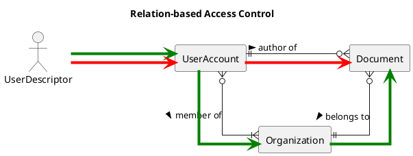

# 4. Database Querying and Access-Control - Kiwi Server

This chapter elaborates how to query entity data, and introduces the access-control features to manage data security.

## QuerySchemaService

Querying entity data with flexibility, filtering, pagination, access-control and high performance is a major feature
of the Kiwi-Server framework. This requirement is met by the `QuerySchemaService`, which allows the application to query
structured entity data using fieldsets
(see [Chapter 2: "Entity Schema and Fieldsets"](./02-domain-schema.md#entity-schema-and-fieldsets)).

The advantage of using the QuerySchemaService, as opposed to using JPA directly, is the use of dynamically created JPA
Criteria queries directly loading entity data-structures, without mapping them into intermediary entity objects.
Furthermore, the querying algorithm allows access to deeply nested entity structures containing `@OneToOne`,
`@OneToMany`, `@ManyToOne` and `@ManyToMany` relations without encountering
the [infamous N+1 problem](https://www.baeldung.com/cs/orm-n-plus-one-select-problem).

The QuerySchemaService offers three different methods to query entity data:

- `findOne` queries a single entity, or `null` if none was found.
- `findAll` queries all matching entities for the given filter, sorted by the given ordering.
- `findPage` queries one page of entities for the given filter and pagination, sorted by the given ordering.

Parameters for these query methods include:

- `fieldset: Fieldset<E>` is the fieldset that determines which columns and relations to select in the query.
- `specification: Specification<E>` is a function constructing the filter predicate used in the query `WHERE`-clause.
- `serializer: FieldsetSerializer<N>` is an interface for serializing entity data queried from the database into
  data-structures like JSON or Java collections. If omitted, Jackson serialization is used, returning the query result
  items as `JsonNode` instances.
- `sort: Sort` is an object representing an ordering of entities, used to sort the query with an `ORDER BY`-clause.
- `pagination: Pageable` is an object containing a page size and page number, used to paginate the query with a
  `LIMIT`/`OFFSET`-clause.
- `totalLimit: Long?` is a hard cap on the total number of entities returned by `findAll` and `findPage`.
- `user: UserDescriptor?` is the user for whom [field access control](#field-access-control) is evaluated. If omitted,
  the current user of the global `UserDescriptorProvider` is used.

The ordering of a query is chosen by priority: The `sort` parameter, if sorted, otherwise the sort of the `pagination`
parameter, otherwise the `defaultSort` of the entity schema. Sort properties refer to field names of the entity schema
(case-insensitive), and can navigate into to-one relations using dots, like `list.title`.

The `totalLimit` acts as a hard cap on the overall result set, also for paged queries: Pages are windows within the
first `totalLimit` entities. A page overlapping the cap is truncated, pages beyond the cap are empty (without executing
a query), and the total element count of the returned `Page` is capped to `totalLimit` as well.

For the example todo-application, the QuerySchemaService could be used in a query handler like this:

```kotlin
@Component
class OpenTodoItemsQueryHandler(
    private val querySchemaService: QuerySchemaService,
) {
    fun findOpenItems(listId: TodoListId, user: UserDescriptor): List<JsonNode> =
        querySchemaService.findAll(
            fieldset = TodoItemFieldsets.short,
            // Filter: FROM TodoItem i WHERE i.todoList.id = :listId AND i.status = 'Open'
            specification = where { item ->
                and(
                    equal(item[TodoItem_.todoList][BaseEntity_.id][EntityId_.idValue], listId.value),
                    equal(item[TodoItem_.status], TodoItemStatus.Open),
                )
            },
            sort = Sort.by("order"), // Sort by field "order" of the TodoItemSchema
            totalLimit = 100,        // Never return more than 100 items
            user = user,
        )
}
```

The `where { root -> ... }` function from the `de.kiwi.api.util` package is a convenience function for creating
Spring Data JPA `Specification`s, using a `CriteriaDsl` receiver which provides all functions of the JPA
`CriteriaBuilder`.

> Note: Since Spring Data JPA 4, `Specification.toPredicate(root, query, builder)` receives a non-null `CriteriaQuery`
> and may return a nullable `Predicate`. Kotlin implementations of `Specification` must declare the `query` parameter
> as non-nullable `CriteriaQuery<*>`.

See [Chapter 8: "Deep Dive into JpaQuerySchemaService"](./08-advanced.md#deep-dive-into-jpaqueryschemaservice) for an
in-depth look at the internal functioning of the JPA Criteria implementation of the QuerySchemaService.

## Generic Entity Querying

The most common entity querying scenarios, finding a single entity by ID or finding a page of entities using a filter
and sorting, are supported by the `GenericEntityQuery` class.
See [Chapter 3: "Generic Commands and Queries"](./03-application-command-query.md#generic-commands-and-queries) for
declaring generic entity queries for specific entity classes.
The `GenericEntityQueryHandler`, which is a shared handler for all query classes that inherit from GenericEntityQuery,
uses the QuerySchemaService to query entity data according to the incoming query.

The following properties can be assigned on a generic entity query to determine its behavior:

- Required `fieldset` property of type `Fieldset<E>`, determining which fieldset to use for entity data representation
- Optional `id` property of type `EntityId`, if a single entity should be queried by ID
- Optional `filter` property of type `GenericEntityFilter<E>`, which applies a `WHERE`-condition filter to queried
  entities (see ["Generic Entity Filters"](#generic-entity-filters))
- Optional `pagination` property of type `Pageable`, determines the pagination (limit, offset) and sorting of entities;
  unpaged by default
- Optional `totalLimit` property of type `Long`, a hard cap on the total number of entities, also when paginated

Subclasses of GenericEntityQuery define how the query is filtered:

- `filterById(id: EntityId): Specification<E>` must be implemented to find an entity by ID; the companion function
  `baseEntityFilter(id)` covers entities extending `BaseEntity`
- `customFilter(user: UserDescriptor): Specification<E>?` can be overridden to add a custom filter for the given user
- `accessControl` and `accessControlAllowAdmin` can be overridden to apply row-based access control,
  see ["Access Control in GenericEntityQuery"](#access-control-in-genericentityquery)

The handler combines the ID filter, the entity filter, the access-control filter and the custom filter in a
conjunction, and passes the result to `QuerySchemaService.findPage`.

Additionally, generic entity query classes are automatically mapped to HTTP GET endpoints.
See [Chapter 6: "Generic Entity Endpoints"](./06-web-mvc-endpoints.md#generic-entity-endpoints) for generic query HTTP
endpoints.

### Generic Entity Filters

When querying pages of entities, a `GenericEntityFilter` can be applied to restrict which entities are queried. Classes
inheriting from GenericEntityFilter can declare filter properties, which add a condition to the filter when the property
is set to a non-null value.

A filter property is a mutable (`var`) property declared using the `by filter(...)` delegate.
The argument passed to the `filter`-function determines the filter predicate that is added when the property is set.

Kiwi discovers filter classes by classpath scanning, associating each filter class with the entity type of its type
argument (see [Chapter 8](./08-advanced.md#discovery-of-schemas-filters-and-generic-classes) for the scanned
packages). Declare at most one filter class per entity.

For the example todo-application, generic entity filter classes could be defined like this:

```kotlin
package de.kiwi.demo.domain.query

// (1) Declare GenericEntityFilter for TodoList entity queries
class TodoListFilter : GenericEntityFilter<TodoList>() {
    // When set, "searchTitle" will filter:
    // FROM TodoList l WHERE lower(l.title) like lower('%{{value}}%')
    var searchTitle by filter(likeIgnoreCase(attribute(TodoList_.title)) { "%$it%" })

    // When set, "hasItem" will filter lists containing at least one of the given item IDs:
    // FROM TodoList l WHERE EXISTS (SELECT 1 FROM l.items i WHERE i.id IN ({{value}}))
    var hasItem by filter(hasChild(TodoList_.items, childEntityId()))
}

// (2) Declare GenericEntityFilter for TodoItem entity queries
class TodoItemFilter : GenericEntityFilter<TodoItem>() {
    // When set, "listId" will filter:
    // FROM TodoItem i WHERE i.todoList.id = {{value}}
    var listId by filter(equalTo(attribute(TodoItem_.todoList, entityIdAttribute<TodoList, TodoListId>())))

    // When set, "searchContent" will filter:
    // FROM TodoItem i WHERE lower(i.content) like lower('%{{value}}%')
    var searchContent by filter(likeIgnoreCase(attribute(TodoItem_.content)) { "%$it%" })

    // Custom filter logic can be built using `where { root, value -> ... }`
    var minOrder by filter<Int>(where { item, minOrder ->
        greaterThanOrEqualTo(item[TodoItem_.order], minOrder)
    })
}
```

When using the REST API to execute entity queries, URL query parameters will be converted and assigned to filter
properties by parameter name.

For example, with the above entity filters, the HTTP request `GET /TodoList?searchTitle=something` is equivalent to
assigning the following GenericEntityFilter instance:

```kotlin
// Create an entity filter for a TodoList query
val filter = TodoListFilter()
filter.searchTitle = "something"

// Create a TodoList query, assign the entity filter
val query = TodoListQuery()
query.filter = filter // Assign filter with "searchTitle" = "something"
query.fieldset = TodoListFieldsets.default // Use "default" TodoList fieldset
query.pagination = PageRequest.of(0, 50) // Load 50 items of first page

// Resolve the query to get a page of results
val user = userDescriptorProvider.currentUser()
val resultPage = queryBus.resolve(query, user)
```

Since a GenericEntityFilter is itself a `Specification<E>`, a filter instance can also be passed directly to the
QuerySchemaService or to a Spring Data `JpaSpecificationExecutor`.

See [Chapter 6: "Generic Entity Endpoints"](./06-web-mvc-endpoints.md#generic-entity-endpoints) for more information on
mapping entity queries and filters to HTTP endpoints.

#### GenericEntityFilter Properties

Filter properties of a `GenericEntityFilter<E>` subclass are defined using the `by filter<T>(CreateFilter<E, T>)`
delegate. This delegate returns a `FilterProperty<T>` instance, which is used by the filter to instantiate a
`Specification<E>` for the assigned value of type `T`. Setting the property to `null` removes the condition again.

The `CreateFilter<E, T>` is a _functional interface_ defining how a given filter-value of type `T` is used to
build a `Specification<E>` for filtering the entity.
The most flexible way to instantiate a `CreateFilter<E, T>` is using the
`where<E, T> { root: Root<E>, value: T -> ... }` function, which allows a JPA `Predicate` to be created by a lambda
function with an available `CriteriaBuilder` context.

For more common ways to define filter property behavior, the GenericEntityFilter companion offers a number of
convenience functions to define `CreateFilter<E, T>` instances.
These filter definition functions commonly use `CreateExpression<E, T>`, which is another _functional interface_
defining how entity value expressions are selected from the entity that is currently being filtered.

**CreateExpression** functions:

- `fun <E, T> attribute(SingularAttribute<in E, T>)` selects an expression from an entity attribute
    - This function has variants with up to five attributes, which allow a nested attribute chain to be used; joins
      along the chain are reused within the query
    - The helper function `fun <E : BaseEntity<ID>, ID : EntityId> entityIdAttribute(): SingularAttribute<E, ID>`
      returns the `BaseEntity_.id` attribute cast into a specific EntityId subclass
- An expression can be created using an inline lambda implementation of the functional interface, like
  `CreateExpression<E, T> { root -> ... }`
- `CreateExpression.isNull()` and `CreateExpression.isNotNull()` create a `Specification<E>` testing the expression for
  null, for use with `ifTrue(...)`

**CreateFilter** functions:

- `fun <E, T> equalTo(CreateExpression<E, T>)` creates a filter testing equality between the expression and the given
  filter value
- `fun <E, T> notEqualTo(CreateExpression<E, T>)` is an inverse `equalTo` filter
- `fun <E, T> greaterThan(CreateExpression<E, T>)`, as well as `lessThan`, `greaterOrEqual`, and `lessOrEqual`, compare
  the value of the expression (left-hand side) to the given filter value (right-hand side)
- `fun <E, T> between(CreateExpression<E, T>)` creates a filter with a `Pair<T, T>` value, testing if the expression
  value is between the first and second value (inclusive)
- `fun <E, T> inList(CreateExpression<E, T>)` creates a filter testing if the given filter value, which must be a
  collection of items, contains the expression value
- `fun <E : BaseEntity<ID>, ID> entityId()` creates a filter with a `Set<ID>` value, testing if the entity ID is
  contained in the given set
- `fun <E> equalIgnoreCase(expr = CreateExpression<E, String>)` creates a string-specific filter, testing if the given
  filter value is equal to the expression value ignoring case-sensitivity by applying `lower(...)` to the expression and
  `String.lowercase()` to the filter value
    - The first parameter of this function is an optional `toLowercase` function, so pass the expression as named
      argument `expr`
- `fun <E> like(CreateExpression<E, String>, ...)`, as well as `likeIgnoreCase`, create a filter testing if the
  expression value matches a given filter value pattern using the SQL `like` operator
    - Be careful to define appropriate indexes in your database when using this operator
    - Parameters that can be passed to the `like`/`likeIgnoreCase`-functions include:
        - `likeOperator` (i.e., `LikeOperator.Verbatim` or `LikeOperator.IgnoreCase`), to change the behavior of the
          operator when the `like` function is used
        - `escapeCharacter` to use an escape character within the pattern value, uses backslash `'\'` by default
        - `escapeValue` to escape the given filter value before using it as a pattern, `true` by default
            - Setting this parameter to `false` allows the client to specify _arbitrary_ like-operator patterns
        - `valueToPattern` function converting the filter value into a pattern string, `{ it }` (identity mapping) by
          default; this parameter should be used to specify how placeholders are added to the filter value
            - For example, using `{ "%${it}%" }` will search if the given filter value occurs anywhere within the
              expression
            - Using `{ "${it}%" }` will search for expressions starting with the given filter value (i.e., "prefix
              search")
            - If the default `{ it }` is used or not specified, and `escapeValue` is `true`, then this operator is
              functionally equivalent to `equalTo`, since patterns within the filter value will be escaped and no
              patterns will be added
- `fun <E> ifTrue(then: Specification<E>)` creates a `CreateFilter<E, Boolean>` that applies the given specification to
  the filter if, and only if, the filter value is set to `true`; a variant accepts a `{ root -> ... }` lambda
- `fun <E, C, T> hasChild(PluralAttribute<E, *, C>, childFilter)` creates an `EXISTS` subquery testing if the entity has
  a child matching the given child filter, for example `childEntityId()` with a `Set<ID>` filter value
- `fun <E, T> existsSubquery { subquery, correlatedRoot, value -> ... }` creates a custom `EXISTS` subquery filter
- `parseInt(...)`, `parseLong(...)`, `parseDouble(...)` and `parseValue(parse, ...)` convert a filter value before
  passing it to a downstream filter; if the conversion returns `null`, the filter is not applied

**CreateFilter composition**

- `fun <E, T> and(vararg CreateFilter<E, T>)` conjugates the given filters using a logical-and operator
    - The `CreateFilter<E, T>` interface itself provides an equivalent `and` infix function
- `fun <E, T> or(vararg CreateFilter<E, T>)` disjuncts the given filters using a logical-or operator
    - The `CreateFilter<E, T>` interface itself offers an equivalent `or` infix function
- `fun <E, T> not(CreateFilter<E, T>)` negates the given filter using a logical-not operator
    - The `CreateFilter<E, T>` interface itself offers an equivalent `not` operator function, which can be invoked using
      the `!` prefix operator
- `fun <E, T> onlyWhen(requirement: (T) -> Boolean, then: CreateFilter<E, T>)` creates a `CreateFilter<E, T>` with
  a precondition, which is only applied if the requirement predicate returns `true` for the given filter value;
  otherwise, the filter is disabled as if it applied `WHERE 1 = 1`
- `fun <E, T> nothingUnless(precondition: (T) -> Boolean, then: CreateFilter<E, T>)` creates a
  `CreateFilter<E, T>` with a precondition, which is only applied if the precondition predicate returns `true` for the
  given value; otherwise, the filter is set to return no results as if it applied `WHERE 1 = 0`

For example, a search filter that only applies when at least three characters were entered can be declared as
`var titleLike by filter(onlyWhen({ it.length >= 3 }, likeIgnoreCase(attribute(TodoList_.title)) { "%$it%" }))`.

### Column Filters

The `ColumnField` properties of an `EntitySchema` object can be used for simple column-based filtering of entity
queries, without having to declare an explicit filter property in a `GenericEntityFilter`.
A column filter consists of the field name of the column, a filter operator, and a list of filter-values. Depending on
the operator, only a single filter-value may be given.

When querying generic entity endpoints over HTTP, column filters are passed as URL query parameters of the form
`<field>:<operator>=<value>`, or `<field>=<value>` to use the default operator of the column.
See [Chapter 6: "Column Filter Parameters"](./06-web-mvc-endpoints.md#column-filter-parameters) for the HTTP syntax.
For the example todo-application, the request `GET /TodoItem?status=Open,Done&order:lt=3` filters for TodoItems with
status "Open" or "Done", and an order index less than 3.

The operators available for a column are determined by the `ColumnFilterSet` of its `ColumnType`:

- `StandardColumnFilters.empty` contains no operators, disallowing filtering on the column; it is used by
  multi-select columns
- `StandardColumnFilters.basic` contains the `eq` (equal), `ne` (not equal), `in` (in list), `not` (not in list), and
  `null` (value is null) operators, with `in` being the default operator; it is used by `EntityIdColumnType`,
  `EnumColumnType`, `UriType`, `UuidType`, and entity type and discriminator columns
- `StandardColumnFilters.default` extends the basic operators with `gt` (greater than), `lt` (less than), `ge` (greater
  or equal), and `le` (less or equal); it is used by all other column types, unless specified otherwise
- `StandardColumnFilters.patternMatching` extends the default operators with `contains` and `startsWith`; it is used by
  `LikeStringColumnType`, and by column types derived using `withFilters(StandardColumnFilters.patternMatching)`

The operators behave as follows:

- `eq`, `ne`, `gt`, `lt`, `ge`, `le`, `contains` and `startsWith` accept exactly one filter value
- `in` and `not` accept multiple values; a single value is split at commas, which can be escaped using a backslash
- `null` accepts `true` (value is null) or `false` (value is not null)
- `contains` and `startsWith` use the SQL `like` operator, so case-sensitivity depends on the database collation

Filter values are converted into the formatted value type of the column using the Spring `ConversionService`, and then
parsed into the attribute type using `ColumnType.parse`. Columns whose type does not support parsing can't be filtered.
All column filters are combined with the filter properties of the entity filter in a conjunction. A column can't be
filtered implicitly if the entity filter class declares a filter property of the same name.

To enable pattern-matching operators for the title of a TodoItem, the schema column can use the `LikeStringColumnType`:

```kotlin
object TodoItemSchema : EntitySchema<TodoItem>() {
    // ...
    val title by column(TodoItem::title, LikeStringColumnType) // Enables "title:contains=..."
}
```

See [Chapter 8: "Custom ColumnFilterOperators"](./08-advanced.md#custom-columnfilteroperators) for defining custom
filter operators and filter sets.

## Analytical Report Query

Entity querying and filtering is designed to support so-called "_online transaction processing_" ("OLTP") use-cases.
For analysis and reporting of business data, "_online analytical processing_" ("OLAP") poses a different set of
requirements to the application framework.

In OLAP use-cases, complex reporting queries are used to analyze a dataset using a model based on _dimensions_ and
_metrics_. Reports are constructed as [OLAP cubes](https://en.wikipedia.org/wiki/OLAP_cube), allowing insights into
aggregated data.
The Kiwi-Server Framework supports generic analytical report queries, analog to generic entity queries, defining
dimension-fields and metric-fields that can be queried in an analytical report.

For the example todo-application, an analytical report query for analyzing todo-items is defined like this:

```kotlin
// (1) Declare an analytical-report query class
class TodoItemReportQuery : AnalyticalReportQuery<TodoItem>() {
    // (2) Select the root entity type to query data from
    // NOTE: The final report can only reference metrics related one-to-one to this root type,
    //   and only reference dimensions related one-to-one or many-to-one to this root type.
    //   Using one-to-many relations within a report will result in a wrong cardinality of the result-set,
    //   which can generate nonsensical metric aggregations in the resulting report.
    override val root get() = TodoItem_.class_!!

    // (3) Define dimensions and metrics available for this report
    override val fields by defineFields {
        // (3.1) Define dimensions: Field name and dimension selector expression
        dimension("listId", attribute(TodoItem_.todoList, TodoList_.id))

        // (3.2) Define metrics: Field name and metric aggregator expression
        metric("total", count())
        metric("completed", countWhere { equal(it[TodoItem_.status], TodoItemStatus.Done) })
        metric("incomplete", countWhere { equal(it[TodoItem_.status], TodoItemStatus.Open) })
    }

    // Define pre-authorization
    override fun preAuthorize(user: UserDescriptor) = Unit // Authorization omitted
}
```

The above analytical-report query allows querying a report with one dimension (parent TodoList ID) and up to three
metrics (total number of TodoItems, number of done TodoItems, and number of open TodoItems).
Dimensions can be sliced, which means specific values of the dimension are filtered to be included or excluded from the
report and its aggregated metrics.

A report query is executed by assigning the names of the requested `dimensions` and `metrics`, optional `slices`, and
an optional `sort` (by dimension or metric names). Field names are matched case-insensitively; unknown field names fail
with an `UnknownReportField` exception. The result is an `AnalyticalReport` containing a header row of field names, and
one row of values per combination of dimension values. Entity IDs, enums, and SQL date/time values are converted into
strings in the report.

Like generic entity queries, report queries can override the `accessControl` and `accessControlAllowAdmin` properties to
apply [row-based access control](#access-control) to the aggregated entities. Report queries are executed outside a
transactional context by default.

When declared, an analytical-report query is automatically mapped to an HTTP endpoint.
The above report query will be mapped to HTTP `GET /TodoItem/_report`.
See [Chapter 6: "Analytical Report Endpoints"](./06-web-mvc-endpoints.md#analytical-report-endpoints) for more
information on Web MVC endpoint mapping.

### Dimension selectors

Dimensions are defined as fields with a specific selector, retrieving the value of the dimension from the underlying
entity data. These selectors are represented using the `CriteriaSelect<E, T>` functional interface.
An instance of this interface can select an expression from a given entity root.

The following functions are provided to create selectors:

- `select { root -> ... }` wraps the given `CriteriaSelect` lambda function, reifying its selected class as a
  `TypedSelector` (which is required for defining dimensions). This is the most flexible method of selecting values,
  although it is also the most verbose.
- `column(ColumnField<E, T, *>)` creates a selector based on an EntitySchema column property
- `attribute(SingularAttribute<E, T>)` creates a selector based on a JPA metamodel attribute
    - This function has variants with up to five attributes, which allow a nested attribute chain to be used
    - The helper function `fun <E : BaseEntity<ID>, ID : EntityId> entityIdAttribute(): SingularAttribute<E, ID>`
      returns the `BaseEntity_.id` attribute cast into a specific EntityId subclass
- `cast(KClass<X>, CriteriaSelect<X, T>)` treats the root as the given subtype `X`, and applies a selector on it
- `date(CriteriaSelect<E, T>)` selects the date of another selector, i.e., extracts the date-part of a datetime or
  timestamp expression
- `dateFormat(String, CriteriaSelect<E, T>)` formats the datetime-expression of another selector, according to the given
  date-format string
    - This uses the SQL `DATE_FORMAT` function, so the exact syntax of the date-format string, and whether the function
      is available at all, depends on the underlying database
- `dayOfMonth(CriteriaSelect<E, T>)` selects the day-of-month number from the datetime-expression of another selector
- `month(CriteriaSelect<E, T>)` selects the month number from the datetime-expression of another selector
- `year(CriteriaSelect<E, T>)` selects the year number from the datetime-expression of another selector
- `yearMonth(CriteriaSelect<E, T>)` selects a number representing the year and month from the datetime-expression of
  another selector
    - This number is calculated as `(year * 100) + month`, e.g., the date `2025-03-28` results in `202503`
- `buckets(CriteriaSelect<E, T>) { ... }` selects a bucket according to the value of another selector
    - Buckets are defined in the lambda parameter of the `buckets` function, where a `BucketBuilder` receiver is applied
    - `range(name: String, OpenEndRange<T>)` declares a named bucket with a specific open-end range of expression values
    - `otherwise(name: String)` declares a fallback-bucket used when the expression value does not match any given range
- `entityType()` selects the specific class of the entity, which can be useful if the entity has multiple subclasses
- `subquery(PluralAttribute<E, *, C>, ...)` selects an aggregated value of the children of a to-many relation in a
  correlated subquery, optionally filtered

Selectors can be combined with each other, or with literals, if the appropriate type is selected, using arithmetic
(`+`, `-`, `*`, `/`), string (`concat`) or logical (`not`, `and`, `or`) operators.
Selector expressions can be mapped using `.map { expr -> ... }` or combined with other selectors using
`.combine(other) { left, right -> ... }`.

### Metric aggregators

Metrics are defined as fields with a specific aggregator, retrieving and aggregating the value of the metric from the
underlying entity data.

Aggregators are defined as an aggregation function (count, sum, min, max, average) applied to a `CriteriaSelect<E, T>`
expression. Optionally, a filter can be applied to only include matching values in the aggregation.

These aggregators are represented using the `CriteriaAggregate<E, T>` functional interface.
Aggregators are specializations of `CriteriaSelect` selectors which must return a numeric expression.
Filters for aggregators are represented using the `CriteriaFilter<E>` functional interface.
Aggregators and filters can be combined using
`infix fun <E, T> CriteriaSelect<E, T>.filter(CriteriaFilter<E>): CriteriaSelectAndFilter<E, T>`.

The following functions are provided to create simple aggregators:

- `aggregate { root -> ... }` wraps the given `CriteriaAggregate` lambda function, reifying its selected class as a
  `TypedAggregator` (which is required for defining metrics). This is the most flexible method of selecting values,
  although it is also the most verbose.
- `count()` counts the total number of entities
- `count(CriteriaSelect<E, *>)` counts the total number of entities where the selected value is not null
- `countDistinct(CriteriaSelect<E, *>)` counts the number of distinct selected values (excluding null)
- `sum(CriteriaSelect<E, N>)` calculates the sum of all selected values (excluding null)
- `average(CriteriaSelect<E, out Number>)` calculates the average of all selected values (excluding null)
- `min(CriteriaSelect<E, Number>)` returns the lowest selected value
- `max(CriteriaSelect<E, Number>)` returns the greatest selected value

The following functions accept a selector and a filter to determine which values are evaluated in the aggregation:

- `countWhere(CriteriaFilter<E>)` counts the total number of entities where the given filter applies, for example
  `countWhere { root -> equal(root[TodoItem_.status], TodoItemStatus.Done) }`
- `countWhere(value: T, CriteriaSelect<E, T>)` counts the total number of entities where the given value matches the
  given selection
- `countOfType(type: KClass<out E>)` counts the total number of entities matching the specified entity class
- `sumWhere(CriteriaSelectAndFilter<E, N>)` calculates the sum of all selected values where the given filter applies
- `averageWhere(CriteriaSelectAndFilter<E, N>)` calculates the average of all selected values where the given filter
  applies
- `minWhere(CriteriaSelectAndFilter<E, Number>)` returns the lowest selected value for which the given filter applies
- `maxWhere(CriteriaSelectAndFilter<E, Number>)` returns the greatest selected value for which the given filter applies

Selectors can be turned into filters using `.isNull()` and `.isNotNull()`, for example
`countWhere(attribute(TodoList_.author).isNotNull())`.
Aggregators can be combined with each other, or with literal values, using arithmetic (`+`, `-`, `*`, `/`) operators.

Report query subclasses can reuse the fields of a base report using `extends(super.fields)` within `defineFields`, and
remove inherited fields using `remove(name)`.

### Slice Filters

For each dimension of an analytical report query, a `Slice` can be assigned to filter the values of the dimension.
A slice is a data structure defining which dimension values are included in the filter, using one of the following
fields:

- `eq: Any?` defines a value the dimension value must be _equal to_
- `gt: Any?` defines a minimum value the dimension value must be _greater than_
- `lt: Any?` defines a maximum value the dimension value must be _less than_
- `ge: Any?` defines a minimum value the dimension value must be _greater than or equal to_
- `le: Any?` defines a maximum value the dimension value must be _less than or equal to_
- `in: Set<Any>?` defines a _set of_ values, one of which the dimension value must be _equal to_
- `null: Boolean?` defines that the dimension value _must be null_ if true, or _must not be null_ if false
- `and: List<Slice>?` recursively defines multiple slices, _all of which_ the dimension value must satisfy
- `or: List<Slice>?` recursively defines multiple slices, _at least one of which_ the dimension value must satisfy
- `not: Slice?` recursively defines an _inverted_ slice, which the dimension value _must not_ satisfy

Slice values are converted into the value type of the dimension selector using the Spring `ConversionService`, so
values given as strings (e.g., entity IDs or enum names) are accepted as well.

For the example todo-application, using the report query defined above, slices could be applied like this:

```kotlin
// Instantiate TodoItem report query, include dimensions and metrics
val reportQuery = TodoItemReportQuery()
reportQuery.dimensions.add("listId")
reportQuery.metrics.add("total")
reportQuery.metrics.add("completed")

// Apply slice to filter dimensions: Only specific lists
reportQuery.slices["listId"] = Slice(`in` = setOf(firstListId, secondListId))

// Sort by number of completed items, descending
reportQuery.sort = Sort.by(Sort.Direction.DESC, "completed")

val report = queryBus.resolve(reportQuery, user)
```

## Access Control

In most applications, access to entities is restricted based on the currently authenticated user. While an administrator
might have access to all data in the system, other users must only see content they are allowed to access.

This section discusses _row-based access control_, where access to entities is restricted based on criteria that are
applied as dynamic SQL filters.
For specifying which fields and relations of an entity a user is allowed to view,
see ["Field Access Control"](#field-access-control) down below.

### Defining Access Control Rules

The Kiwi-Server Framework provides `AccessControl`, a system to define row-level predicates for entity access.
As such, Kiwi-Server supports and promotes the concept
of [Relationship-based Access Control](https://en.wikipedia.org/wiki/Relationship-based_access_control), a paradigm
where permission to access entities is defined by the relationship between the authenticated user and the entity being
accessed, by providing the `AccessControlBuilder` interface.

The AccessControl interface is a functional interface, instances of which represent rules for accessing entities. Given
a specific `UserDescriptor` representing the authenticated user (see
[Chapter 3](./03-application-command-query.md) and
[Chapter 5: "Spring Security Integration"](./05-infrastructure-integration.md#spring-security-integration)),
an AccessControl returns an `AccessControlSpecification<E>`, a Spring Data `Specification` filtering which entities the
given user is allowed to access.

AccessControl rules can be defined using the factory functions of the AccessControl companion object. For the example
todo-application, which stores the username of the author of each TodoList, a simple access rule only allows authors
to read their own lists. This `readTodoList` rule is used throughout the rest of this chapter:

```kotlin
// (1) Define a rule from a predicate, given an entity root and a UserDescriptor:
// Allow access to a TodoList for its author
val readTodoList = AccessControl.where<TodoList> { list, user ->
    // Generate a predicate that returns `true` when access is allowed
    equal(list[TodoList_.author], user.username)
}

// (2) Define a rule from a query-independent PredicateSpecification for a given UserDescriptor:
// Allow access to all TodoLists for users with the "EDITOR" role
val editorAccess = AccessControl.ofPredicate<TodoList> { user ->
    PredicateSpecification<TodoList> { _, builder ->
        if (user.hasRole("EDITOR")) builder.conjunction() else builder.disjunction()
    }
}

// (3) Combine the two rules into a new rule,
// allowing access using either the first or second rule
val readOrEditTodoList = readTodoList or editorAccess
```

The available factory functions are:

- `AccessControl.where { root, user -> ... }` creates a rule from a predicate lambda with a `CriteriaDsl` receiver
- `AccessControl.ofPredicate { user -> ... }` creates a rule from a Spring Data JPA `PredicateSpecification`
- `AccessControl.of { user -> ... }` creates a rule from a Spring Data JPA `Specification`; see the note on
  ["Specifications within access-control subqueries"](#specifications-within-access-control-subqueries) below
- `AccessControlBuilder.byUserRelation { ... }` creates relation-based rules, see below

AccessControl rules can also be composed and combined with each other:

- Instances of AccessControl can be combined using logical `and`, `or`, and `not` operators, or using the
  `AccessControl.allOf(...)` and `AccessControl.anyOf(...)` functions.
- An AccessControl can be combined with a precondition using the `and(...)` infix function, accepting a
  `PredicateSpecification<E>` or a `Specification<E>`. The precondition must be satisfied in addition to the access
  rule. For example, an entity may have a "locked" attribute which must be false in order to allow access.
- An AccessControl can be combined with an alternative access condition using the `or(...)` infix function, accepting a
  `PredicateSpecification<E>` or a `Specification<E>`. When the condition is satisfied, access is granted without
  checking the access rule. For example, an entity may have a "public" attribute which, when set, grants access without
  further access control.
- `childAccess { child -> ... }` derives the access rule of a child entity from the rule of its parent entity,
  see ["Access Control in GenericEntityQuery"](#access-control-in-genericentityquery) below.
- `withSideEffect { root -> ... }` derives a rule that additionally modifies the query root before the access-control
  predicate is created, for example to add fetch joins.

#### Specifications within access-control subqueries

Some access-control rules are evaluated within an SQL subquery instead of the top-level query. Most notably, a rule
derived using `childAccess` applies the access rule of the parent entity within an `EXISTS` subquery.

Since Spring Data JPA 4, a plain `Specification` requires a `CriteriaQuery`, which is not available within a subquery.
Therefore, a plain `Specification` composed into an access control (using `and(Specification)`, `or(Specification)` or
`AccessControl.of`) works within the top-level query, but fails with an `IllegalStateException` when it is applied
within a subquery:

```
Specification <class> cannot be applied within a subquery, use a PredicateSpecification,
an AccessControlSpecification or de.kiwi.api.util.where instead
```

Use one of the following, which can be applied to queries and subqueries alike:

- A query-independent `PredicateSpecification`, passed directly to `AccessControl.and(...)`, `AccessControl.or(...)` or
  `AccessControl.ofPredicate { ... }`. Don't wrap it using `Specification.where(...)`, which returns a plain
  `Specification` again.
- A specification created using `de.kiwi.api.util.where { root -> ... }` or `AccessControl.where { root, user -> ... }`.
  Within a subquery, `CriteriaDsl.queryOrNull` is `null`, and accessing `CriteriaDsl.query` fails.

For example, extending a parent access rule with an alternative condition that remains valid for derived child access:

```kotlin
// Alternative access condition as query-independent PredicateSpecification:
// TodoLists without an author can be read by everyone
val withoutAuthor = PredicateSpecification<TodoList> { list, builder ->
    builder.isNull(list[TodoList_.author])
}

// Works for TodoList queries, and within the subquery of the derived TodoItem access
val readOwnOrUnownedTodoList = readTodoList or withoutAuthor
val readOwnOrUnownedTodoItem = readOwnOrUnownedTodoList.childAccess { item -> item[TodoItem_.todoList] }
```

Declaring `withoutAuthor` as a plain `Specification<TodoList> { list, _, builder -> ... }` instead would work for
TodoList queries, but TodoItem queries using the derived access rule would fail with the above exception.

#### Relation-based Access Control

While the AccessControl interface offers full flexibility for defining predicates, the most common scenario when using
relation-based access control is to check if the authenticated user has a specific relation to the entity being queried.
In an example scenario where users access documents, access control would check for rules like:

- A user is the author of a document
- A user has been granted read-access to a document
- A user is a member of the organization that the document belongs to

All these rules check for the existence of a relation between the entity being queried (i.e., the document)
and the entity representing the currently authenticated user.

In a relational SQL database, such a predicate can be expressed using a correlated subquery.
For example, a query with relation-based access control could look like this:

```sql
-- Root entity in query is "document"
-- => Access control subqueries are correlated to outer query
SELECT *
FROM document
-- 1. Predicate filters access to document by checking for author identity
-- => Rule for "Authenticated user is author of the document"
WHERE EXISTS(SELECT 1
             FROM user_account
             WHERE user_account.username = :authenticated_username
               AND document.author_id = user_account.id)
-- 2. Predicate filters access to document by checking for organization membership
-- => Rule for "Authenticated user is member of the organization the document belongs to"
   OR EXISTS(SELECT 1
             FROM user_account,
                  organization_member
             WHERE user_account.username = :authenticated_username
               AND document.organization_id = organization_member.organization_id
               AND user_account.id = organization_member.user_id)
```

Kiwi-Server supports the construction of correlated subqueries, checking for the existence of a relation between a
user and an entity by providing the AccessControlBuilder interface.

An AccessControlBuilder is instantiated using `AccessControlBuilder.byUserRelation`, with a function that matches the
given UserDescriptor to an entity representing the currently authenticated user.
This AccessControlBuilder can then be invoked with a function that matches the authenticated user entity
with the correlated entity being queried. Both functions have an `AccessControlContext` receiver, which extends the
JPA `CriteriaBuilder`.

```kotlin
// For the following example, assume the following entity classes exist:
@Entity
class UserAccount(@Id val id: Int, @Column val username: String) {
    @ManyToMany
    val organizations = mutableSetOf<Organization>()
}

@Entity
class Organization(@Id val id: Int) {
    @ManyToMany(mappedBy = "organizations")
    val members = mutableSetOf<UserAccount>()

    @OneToMany(mappedBy = "organization")
    val documents = mutableSetOf<Document>()
}

@Entity
class Document(@Id val id: Int) {
    @ManyToOne
    lateinit var author: UserAccount

    @ManyToOne
    lateinit var organization: Organization
}

// ---

// (1) Create AccessControlBuilder<UserAccount> by matching UserAccount and UserDescriptor username
val userAccessControl = AccessControlBuilder.byUserRelation<UserAccount> { account, user ->
    equal(account[UserAccount_.username], user.username)
}

// (2) Create AccessControl<Document> that matches the Document to the UserAccount by its author
val documentAuthorRule = userAccessControl<Document> { document, account ->
    val documentAuthor = document.join(Document_.author)
    equal(documentAuthor, account)
}

// (3) Create AccessControl<Document> that matches the Document to the UserAccount by Organization membership
val documentOrganizationMemberRule = userAccessControl<Document> { document, account ->
    val documentOrganization = document.join(Document_.organization)
    val memberOrganization = account.join(UserAccount_.organizations)
    equal(documentOrganization, memberOrganization)
}

// (4) Create combined AccessControl<Document>, allowing access for both the author and organization members
val readDocumentPermission = documentAuthorRule or documentOrganizationMemberRule
```

Viewed as a graph, the above relation-based access control can be depicted like this:

- The red line follows the relation of the user as the document's author
- The green line follows the relations of the user as a member of the organization the document belongs to



The module `demo/access-control-tests` of the Kiwi-Server repository contains a complete example of relation-based
access control, including derived child access and field access control, with integration tests.
See [Chapter 8: "Cross-Correlated Joins in Access-Control"](./08-advanced.md#cross-correlated-joins-in-access-control)
for optimizing joins within access-control subqueries.

### Using Access Control in Queries

Access control rules can be applied to entity queries in several ways: Through `GenericEntityQuery` and
`AnalyticalReportQuery` for generic query handlers, through the `JpaAccessControlExecutor` repository fragment for
custom queries, or through creating a `Specification` to use with `JpaSpecificationExecutor`.
The following examples use the `readTodoList` rule defined in
["Defining Access Control Rules"](#defining-access-control-rules).

#### Access Control in GenericEntityQuery

Override the `accessControl` property in a `GenericEntityQuery` subclass to apply row-based access control
automatically when the query is executed by the `GenericEntityQueryHandler`:

```kotlin
class TodoListQuery : GenericEntityQuery<TodoList>() {
    // Override accessControl to restrict which TodoList entities are visible
    override val accessControl = readTodoList

    // When true (default), users with isAdmin == true bypass access control
    override val accessControlAllowAdmin = true

    override fun filterById(id: EntityId): Specification<TodoList> = baseEntityFilter(id, TodoList_.id)
    override fun preAuthorize(user: UserDescriptor) = Unit
}
```

When `accessControl` is set, the handler applies it as an additional filter on all queries — both single-entity lookups
by ID and paged list queries. The access control is applied transparently before the query result is returned.
To customize how the access-control filter is created, override `accessControlFilter(user)`.

To also apply access control for the `TodoItemQuery`, using the parent list's access as derived access for items:

```kotlin
// Derive access to TodoItems from access to their parent TodoList
val readTodoItem = readTodoList.childAccess { item -> item[TodoItem_.todoList] }

class TodoItemQuery : GenericEntityQuery<TodoItem>() {
    override val accessControl = readTodoItem
    override val accessControlAllowAdmin = true

    override fun filterById(id: EntityId): Specification<TodoItem> = baseEntityFilter(id, TodoItem_.id)
    override fun preAuthorize(user: UserDescriptor) = Unit
}
```

The derived access rule checks the parent access rule within a correlated subquery:
`FROM TodoItem i WHERE EXISTS (SELECT 1 FROM TodoList l WHERE i.todoList = l AND <readTodoList for l>)`.
A second variant `childAccess { parent, child -> ... }` accepts a predicate matching parent and child entities.

#### JpaAccessControlExecutor

For custom repository operations outside of generic entity queries, add `JpaAccessControlExecutor<T, ID>` as an
additional interface to a Spring Data JPA repository. Kiwi registers its implementation as a Spring Data repository
fragment, so no further configuration is required:

```kotlin
@Repository
interface TodoListRepository
    : JpaRepository<TodoList, TodoListId>,
      JpaAccessControlExecutor<TodoList, TodoListId>
```

The `JpaAccessControlExecutor` interface provides access-controlled query methods:

- `findAuthorized(accessControl, user?, allowAdmin?)`: returns all entities accessible to the given user
- `findAuthorized(sort, accessControl, user?, allowAdmin?)`: same with result ordering applied
- `findAuthorized(pageable, accessControl, user?, allowAdmin?)`: same with pagination applied
- `findAuthorizedByIds(ids, accessControl, user?, allowAdmin?)`: filters a list of IDs to only accessible entities
- `findAuthorizedById(id, accessControl, user?, allowAdmin?)`: finds a single entity by ID if accessible,
  returning `Optional.empty()` if not found or not accessible
- `existsAuthorizedById(id, accessControl, user?, allowAdmin?)`: returns `true` if the entity exists and is accessible
- `countAuthorized(accessControl, user?, allowAdmin?)`: counts entities accessible to the given user
- Extension function `requireAuthorizedById(id, accessControl, user, allowAdmin?)`: like `findAuthorizedById`, but
  throws `AccessDenied` (HTTP status 403) if the entity is not found or not accessible

The `allowAdmin` parameter (default `true`) controls whether users with `UserDescriptor.isAdmin == true` bypass the
access control filter and see all entities. If `user` is `null`, the `UserDescriptorProvider` bean of the current
Spring application context is consulted for the currently authenticated user (e.g., from the Spring Security context).
If no provider is available, the access control is evaluated for `UserDescriptor.ANONYMOUS`.

Example using `requireAuthorizedById` in a command handler:

```kotlin
@Component
class SomeTodoListThingy(
    private val repository: TodoListRepository,
) {
    // ...

    fun requireAuthorized(listId: TodoListId, user: UserDescriptor): TodoList {
        return repository.requireAuthorizedById(
            id = listId,
            accessControl = readTodoList,
            user = user,
        )
    }
}
```

#### Access Control with JpaSpecificationExecutor

`AccessControl.checkAuthorized(user)` and `AccessControl.adminOrCheckAuthorized(user)` each return an
`AccessControlSpecification<E>` representing the access-control filter for the given user. This specification can be
combined with other `Specification` instances and passed to any Spring Data JPA repository extending
`JpaSpecificationExecutor<T>`:

```kotlin
@Repository
interface TodoListRepository
    : JpaRepository<TodoList, TodoListId>,
      JpaSpecificationExecutor<TodoList>
```

```kotlin
@Component
class TodoListQueryService(
    private val repository: TodoListRepository,
) {
    fun findAuthorizedByTitle(title: String, user: UserDescriptor): List<TodoList> {
        // Build a specification for the title filter
        val titleFilter = Specification<TodoList> { root, _, builder ->
            builder.like(builder.lower(root[TodoList_.title]), "%${title.lowercase()}%")
        }

        // Combine with access control: admin users see all, others only see authorized lists
        val accessFilter = readTodoList.adminOrCheckAuthorized(user)

        return repository.findAll(titleFilter.and(accessFilter))
    }
}
```

Use `checkAuthorized(user)` to always apply the access control predicate regardless of admin status, or
`adminOrCheckAuthorized(user)` to grant unrestricted access to admin users.

## Field Access Control

In most applications, not all fields of an entity should be visible to all users. Field access control allows specific
columns and relations to be conditionally hidden based on the currently authenticated user.
Unlike row-based access control (which hides entire entities), field access control hides specific fields within the
entity's data representation when querying using a fieldset: A denied column or to-one relation is returned as `null`,
and a denied to-many relation is returned as an empty list.

Field access control rules are defined in the `EntitySchema` by overriding the `fieldAccessControl(field)` function.
This function is called for each field included in a queried fieldset, and returns a `FieldAccessControl<E>` rule for
the field, or `null` if no access restriction applies:

```kotlin
object LocationOccupantSchema : EntitySchema<LocationOccupant>() {
    val id by entityId()
    val name by column<String?>(LocationOccupant::name)
    val email by column<String?>(LocationOccupant::email)
    val phoneNumber by column<String?>(LocationOccupant::phoneNumber)
    val locationUnit by toOne(LocationOccupant::locationUnit, LocationUnitSchema)
    val electricityContract by toOne(LocationOccupant::electricityContract, ElectricityContractSchema)

    // Override fieldAccessControl to restrict access to specific fields
    override fun fieldAccessControl(field: EntitySchemaField<LocationOccupant>) = when (field) {
        // email and phoneNumber are only accessible to certain users
        email, phoneNumber -> allowCustomerFieldAccess or allowOperatorFieldAccess
        else -> null // No restriction on other fields
    }
}
```

Field access control is evaluated by the QuerySchemaService, as well as when extracting entity data in memory using a
fieldset (see [Chapter 2: "Entity Schema and Fieldsets"](./02-domain-schema.md#entity-schema-and-fieldsets)).
The examples in this section are based on the `demo/access-control-tests` module.

### Defining FieldAccessControl Rules

A `FieldAccessControl<E>` rule evaluates whether the current user is allowed to view a specific field value,
given the values of other fields on the same entity instance as context.
This is different from row-based access control, which uses database subqueries — field access control is evaluated
in memory after entity data has been loaded. The fields required to evaluate the rule are selected in addition to the
queried fieldset.

The `FieldAccessControl(require) { context, user -> ... }` factory function accepts an explicit requirements builder
and a check predicate:

```kotlin
val allowCustomerFieldAccess = FieldAccessControl<LocationOccupant>(
    require = {
        // Declare which fields are needed to evaluate the rule
        add(LocationOccupantSchema.electricityContract) {
            add(ElectricityContractSchema.id)
        }
    }
) { context, user ->
    // Return true if the user is allowed to see the field
    val contractId = context[LocationOccupantSchema.electricityContract][ElectricityContractSchema.id]
    contractId != null && user.hasRole("customer:$contractId")
}
```

If the check predicate always accesses all required fields (no short-circuit evaluation prevents some accesses),
requirements can be gathered automatically using `FieldAccessControl.withRequirementsFromContext`:

```kotlin
val allowCustomerFieldAccess = FieldAccessControl.withRequirementsFromContext<LocationOccupant> { context, user ->
    val contractId = context[LocationOccupantSchema.electricityContract][ElectricityContractSchema.id]
    contractId != null && user.hasRole("customer:$contractId")
}
```

> Note: `withRequirementsFromContext` works by executing the predicate once with a dummy context that records every
> field access, but returns `null` for all column values. If the predicate uses short-circuit evaluation (e.g., `&&` or
> `||`) that prevents some `context[...]` accesses from running during collection, those fields will not be included in
> the requirements. In such cases, use the explicit requirements builder instead.

### Navigating Relations in the Field Access Context

The `FieldAccessControl.Context<E>` interface allows reading column values and navigating to related entity contexts:

- `context[column: ColumnField<E, T, *>]: T?` — reads the value of a column
- `context[toOne: ToOneField<E, R>]: Context<R>` — navigates to the context of a to-one related entity;
  returns a context with all values `null` if the relation is null
- `context.getOrNull(toOne: ToOneField<E, R>): Context<R>?` — same, but returns `null` if the relation is null
- `context.downcast(subtype: SubtypeField<E, C, C>): Context<C>` — navigates to the context of an entity subtype

Navigation can be chained across multiple relations:

```kotlin
val allowOperatorFieldAccess = FieldAccessControl<LocationOccupant>(
    require = {
        add(LocationOccupantSchema.locationUnit) {
            add(LocationUnitSchema.solarSystem) {
                add(SolarSystemSchema.operatorId)
            }
        }
    }
) { context, user ->
    val solarSystem = context[LocationOccupantSchema.locationUnit][LocationUnitSchema.solarSystem]
    val operatorId = solarSystem[SolarSystemSchema.operatorId]
    operatorId != null && user.hasRole("operator:$operatorId")
}
```

### Combining FieldAccessControl Rules

Like `AccessControl`, `FieldAccessControl` instances can be composed using logical operators:

- `ruleA and ruleB` — access allowed only if both rules grant access (conjunction)
- `ruleA or ruleB` — access allowed if either rule grants access (disjunction)
- `!rule` — access allowed only if the rule denies access (negation)
- `FieldAccessControl.allOf(vararg rules)` — conjunction of multiple rules
- `FieldAccessControl.anyOf(vararg rules)` — disjunction of multiple rules
- `FieldAccessControl.permitAll<E>()` — always grants access (useful as a placeholder or default)

---

Next up, [Chapter 5: "Infrastructure and Integration"](./05-infrastructure-integration.md) is about integrating external
systems and infrastructure services into the application.
