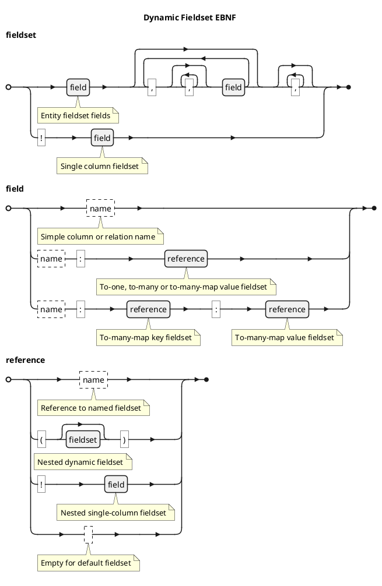
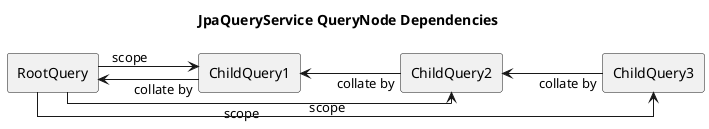
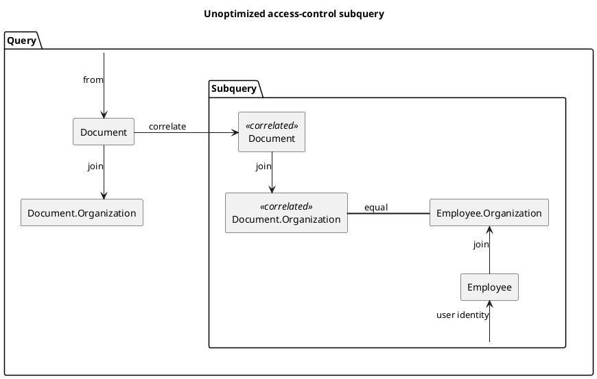
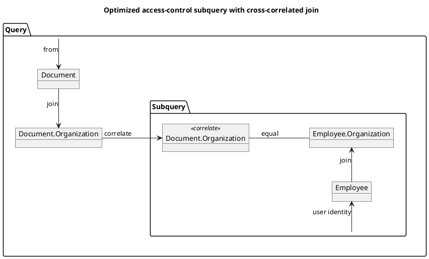

# 8. Advanced Features - Kiwi Server

This chapter is about some of the advanced features provided by Kiwi-Server that are required to build applications that
go beyond basic and standard use-cases, and about some internals of the framework.

## Custom ColumnTypes

A `ColumnType<T, M>` determines how an entity attribute value of type `T` is formatted into an API value of type `M`
(`format`), how API values are parsed back into attribute values (`parse`), and which filter operators are available for
the column (`filterSet`),
see [Chapter 2: "Entity Schema and Fieldsets"](./02-domain-schema.md#entity-schema-and-fieldsets).
Parsing is used when generic create- and update-commands write column values, and when column filter values are
converted (see [Chapter 4: "Column Filters"](./04-querying-access-control.md#column-filters)).

### Implementing a ColumnType

The simplest way to implement a new column type is extending the abstract `BasicColumnType<T, M>` class, which derives
the `valueType` (the class of the formatted type `M`) from its type arguments. The built-in types `IsoLocalDateType`,
`UuidType` or `BigDecimalType` are implemented this way. For example, a column type representing `java.time.Duration`
attributes as ISO-8601 strings (like `"PT1H30M"`) can be implemented like this:

```kotlin
object IsoDurationType : BasicColumnType<Duration, String>() {
    override fun format(value: Duration): String = value.toString()
    override fun parse(value: String): Duration = Duration.parse(value)
}
```

By default, a column type uses the `StandardColumnFilters.default` filter set. Override the `filterSet` property to
change the available filter operators, like `override val filterSet = StandardColumnFilters.basic`.

Other ways to create column types are:

- `ColumnType<T, M>(filterSet, parse, format)`, an inline factory using a pair of parse- and format-functions; if no
  `parse` function is given, parsing throws `ColumnType.ParseNotSupported`
- `ColumnType.stringify(parseString)`, formatting values using `toString()`, with an optional parse function
- Implementing `ReadOnlyColumnType<T, M>`, which never supports parsing
- Implementing the `ColumnType<T, M>` interface directly

A column type is assigned to a column in the entity schema, for example
`val estimate by column(Task::estimate, IsoDurationType)`.

> Note: Columns whose type does not support parsing can neither be written by generic commands, nor filtered using
> column filters.

### Deriving ColumnTypes from existing ColumnTypes

New ColumnTypes can also be derived from existing ColumnTypes:

- `infix fun <T, M> ColumnType<T, M>.validate(validator: Validation<T>): ColumnType<T, M>` applies a `Validation` when
  values are parsed using the returned ColumnType; formatting is not validated,
  see [Chapter 2](./02-domain-schema.md) for validations.
  This function is used internally to apply validations when using auto column validation.
- `infix fun <T, M> ColumnType<T, M>.map(mapper: (M) -> M): ColumnType<T, M>` applies the given mapping function when
  formatting values using the returned ColumnType; parsing is not mapped
- `infix fun <T, M, R> ColumnType<T, M>.pipe(other: ColumnType<M, R>): ColumnType<T, R>` pipelines two ColumnTypes,
  returning a single ColumnType which applies the given component types consecutively; the filter set of the first
  column type is kept
- `infix fun <T, M> ColumnType<T, M>.withFilters(filters: ColumnFilterSet): ColumnType<T, M>` returns a copy of the
  given ColumnType with a different ColumnFilterSet, customizing which ColumnFilterOperators are supported by columns
  using the returned ColumnType, see ["Custom ColumnFilterOperators"](#custom-columnfilteroperators)
- `ColumnType.map<X> { ... }` and `ColumnType.validate<X>(validation)` are shortcuts deriving from
  `ColumnType.identity<X>()`

For the example todo-application, derived column types could be used in the `TodoItemSchema` like this:

```kotlin
// Titles are validated when parsed, and support the "contains" and "startsWith" filter operators
private val titleType = ColumnType.identity<String>()
    .validate(Validation.notBlank and Validation.maxLength(255))
    .withFilters(StandardColumnFilters.patternMatching)

// Status enum represented in lowercase, e.g. "done" instead of "Done"
private val lowercaseStatusType = ColumnType.enum<TodoItemStatus>() pipe ColumnType<String, String>(
    format = { it.lowercase() },
    parse = { it.replaceFirstChar(Char::uppercaseChar) },
)

object TodoItemSchema : EntitySchema<TodoItem>() {
    val id by entityId()
    val title by column(TodoItem::title, titleType)
    val status by column(TodoItem::status, lowercaseStatusType)

    // A second column on the same attribute, formatting a shortened preview of the content
    val contentPreview by column(TodoItem::content, ColumnType.map<String> { it.take(140) })
    // ...
}
```

Keep the following in mind when deriving column types:

- Filters on a column using a `map`-derived type compare the unmapped attribute value. In the example above, filtering
  `contentPreview` filters on the full content.
- A derived column type is a new object, which is no longer an instance of the original class. The OpenAPI
  documentation and the frontend code-generation only recognize `EntityIdColumnType` and `EnumColumnType` instances
  specifically, and describe all other column types by their `valueType`. In the example above, `status` is documented
  as a plain string instead of an enumeration of values.

## Custom ColumnFilterOperators

This section expands upon column filters, as seen
in [Chapter 4: "Column Filters"](./04-querying-access-control.md#column-filters).

A `ColumnFilterOperator` implements a specific filter operation associated with an operator symbol, which is used in
filter parameters like `title:contains=milk`. The `ColumnFilterSet` interface represents a collection of
ColumnFilterOperators with an optional default operator, used when no operator symbol is given.

For well-known filter operators, Kiwi pre-defines a set of common ColumnFilterSets in the `StandardColumnFilters`
object:

- `StandardColumnFilters.empty` contains no operators, disallowing filtering on columns using the associated column type
- `StandardColumnFilters.basic` contains `eq` (equal), `ne` (not equal), `in` (in list), `not` (not in list), and
  `null` (value is null) filter operators, with `in` being the default operator
- `StandardColumnFilters.default`, which is the default ColumnFilterSet for ColumnTypes, extends the basic operators
  and adds the `gt` (greater than), `lt` (less than), `ge` (greater or equal), and `le` (less or equal) operators
- `StandardColumnFilters.patternMatching` extends the default operators, and adds the `contains` (string contains) and
  `startsWith` (string starts with) operators

> Note: The top-level properties `emptyColumnFilters`, `basicColumnFilters`, `standardColumnFilters` and
> `patternMatchColumnFilters` are deprecated aliases of these filter sets.

### Implementing a ColumnFilterOperator

Operators extend the abstract `ColumnFilterOperator` class, or one of its specialized base classes:

- `SingleValueOperator` requires exactly one filter value, converts it to the column's attribute type, and passes it to
  `singleValueFilter(value, expression, builder)`; built-in examples are `EqualToOperator` and `CompareOperator`
- `MultiValueOperator` converts all filter values (splitting a single value at commas), and passes them to
  `multiValueFilter(values, expression, builder)`; a built-in example is `InListOperator`
- `StaticTypeValueOperator<S>` converts the first filter value using a fixed `staticType` independent of the column,
  and passes it to `valueFilter(value, expression, builder)`; a built-in example is `IsNullOperator`
- `NegateOperator` negates the predicate of a `delegate` operator; built-in examples are `NotEqualOperator` and
  `NotInListOperator`
- `LikePatternOperator` escapes a string value and turns it into a `like` pattern using `valueToPattern(value)`

If an operator can't be applied to the column or value type, it throws the `OperatorNotApplicable` exception, which is
answered with HTTP status 400. Operator symbols must not be blank and must not contain the `:` separator character.

For example, a case-insensitive "contains" operator and its negation can be implemented like this:

```kotlin
object ContainsIgnoreCaseOperator : SingleValueOperator("containsIgnoreCase") {
    private val escape = EscapeCharacter.DEFAULT

    override fun <T> singleValueFilter(value: T, expression: Expression<T>, builder: CriteriaBuilder): Predicate {
        // Only applicable to string values and string expressions
        val stringValue = value as? String ?: throw OperatorNotApplicable((value ?: Unit)::class.java)
        if (!String::class.java.isAssignableFrom(expression.javaType)) {
            throw OperatorNotApplicable(expression.javaType)
        }
        @Suppress("UNCHECKED_CAST")
        val stringExpression = expression as Expression<String>

        // WHERE lower(<column>) LIKE '%<escaped lowercase value>%'
        val pattern = "%" + (escape.escape(stringValue.lowercase()) ?: "") + "%"
        return builder.like(builder.lower(stringExpression), pattern, escape.escapeCharacter)
    }
}

object NotContainsIgnoreCaseOperator : NegateOperator("notContainsIgnoreCase") {
    override val delegate = ContainsIgnoreCaseOperator
}
```

The `EscapeCharacter` class is part of Spring Data JPA (`org.springframework.data.jpa.repository.query`).

### Defining a ColumnFilterSet

New filter sets are created using `defineColumnFilterSet`, or by extending an existing filter set using
`extendColumnFilterSet`. Within the builder lambda, operators are added using `add(operator)`, and removed using
`remove(operator)` or `remove(symbol)`:

```kotlin
// Extend the pattern-matching operators, remove the comparison operators
val textSearchFilters = StandardColumnFilters.patternMatching.extendColumnFilterSet {
    add(ContainsIgnoreCaseOperator)
    add(NotContainsIgnoreCaseOperator)
    remove(GreaterThanOperator)
    remove(GreaterOrEqualOperator)
    remove(LessThanOperator)
    remove(LessOrEqualOperator)
}

// Define a new filter set from scratch, with "containsIgnoreCase" as default operator
val searchOnlyFilters = defineColumnFilterSet(defaultOperator = ContainsIgnoreCaseOperator) {
    add(ContainsIgnoreCaseOperator)
    add(IsNullOperator)
}
```

> Note: The default operator is not added to the filter set implicitly. Add it explicitly, if it should also be
> available using its symbol. `extendColumnFilterSet` keeps the default operator of the extended set, unless a
> `defaultOperator` argument is given.

### Attaching a ColumnFilterSet to a ColumnType

Filter sets are attached to column types, either by overriding `filterSet` in a custom column type, or by deriving a
column type using `withFilters`:

```kotlin
val searchableTextType = ColumnType.identity<String>() withFilters textSearchFilters

object TodoItemSchema : EntitySchema<TodoItem>() {
    // ...
    val title by column(TodoItem::title, searchableTextType)
}
```

With this schema, the request `GET /TodoItem?title:containsIgnoreCase=milk` returns all TodoItems with a title
containing "milk", ignoring case. Requests using an operator symbol that is not part of the column's filter set fail
with HTTP status 400 and the error code `unknown-column-filter-operator`.

## Dynamic Fieldset Syntax

This section expands upon dynamic ad-hoc fieldsets (see
[Chapter 2: "Dynamic fieldsets"](./02-domain-schema.md#dynamic-fieldsets)), which are passed to generic entity
endpoints using the `_fields` parameter
(see [Chapter 6: "Generic Entity Endpoints"](./06-web-mvc-endpoints.md#generic-entity-endpoints)).
If the `_fields` parameter is given and not empty, it takes precedence over the `_fieldset` parameter.

At the top level, a dynamic fieldset expression is a comma-separated list of fields.
Whitespace between symbols or field names is ignored, as are repeated or trailing commas.
Field names start with a letter or underscore, followed by letters, digits or underscores, and are matched against the
field names of the entity schema ignoring case. Field names that don't exist in the schema are ignored.

Each field is specified by its name, and an optional fieldset-reference if the given field is a to-one, to-many, or
to-many-map relation field. As a special syntax, a field prefixed by a bang ("!") character specifies a single-column
fieldset, only returning the value of a single column without a surrounding object.

- Fieldset with fields "a", "b", and "c": `"a,b,c"`
- Single-column fieldset of column "a": `"!a"`

Relation fields like to-one, to-many, or to-many-map references use the default fieldset of the referenced entity by
default. This can be customized by appending a colon (":") character, followed by a fieldset reference. In the case of a
to-many-map relation, both the key- and value-fieldset can be specified using two fieldset references separated using
another colon (":") character; if only one reference is given, it refers to the value-fieldset.

A fieldset reference can be the name of a named fieldset (matched ignoring case), a single-column fieldset as a bang
("!") character followed by the field, or a nested dynamic fieldset within parentheses. An empty reference, as well as
empty parentheses, refer to the default fieldset.

- Fieldset with columns "a" and "b", and to-one reference "parent" with default fieldset: `"a,b,parent"`
- Fieldset with column "a" and to-one reference "parent" with short fieldset: `"a,parent:short"`
- Fieldset with column "a", and to-one reference "parent" with single-column fieldset of field "x": `"a,parent:!x"`
- Fieldset with column "a", and to-one reference "parent" with nested dynamic fieldset: `"a,parent:(x,y)"`
- Fieldset with to-many-map reference "qux" with "idOnly" key- and "nameOnly" value-fieldset: `"qux:idOnly:nameOnly"`

For deeply nested relations, dynamic fieldset references can be similarly nested.

- Very deeply nested fieldsets: `"a,b,foo:(id,bar:(id,name,baz:short,qux:!id),x,y)"`, resolves to:
    - Field "a"
    - Field "b"
    - Field "foo", with dynamic fieldset reference:
        - Field "id"
        - Field "bar", with dynamic fieldset reference:
            - Field "id"
            - Field "name"
            - Field "baz" with named fieldset reference to "short" fieldset
            - Field "qux" with single-column fieldset reference to field "id"
        - Field "x"
        - Field "y"

The default fieldset of a referenced entity is the `default` fieldset of its `FieldsetsAvailable` object, or an
implicit default fieldset if the entity declares no available fieldsets. A referenced entity must have an entity schema.
Syntax errors are answered with HTTP status 400 and the error code `parse-dynamic-fieldset`. Like named fieldsets,
the resulting fieldset is validated before querying.

A complete graph of the dynamic fieldset expression grammar is shown here. The grammar is implemented using ANTLR, see
`bundle/src/main/antlr/de/kiwi/framework/grammar/DynamicFieldsetGrammar.g4`.



## Deep Dive into JpaQuerySchemaService

The `QuerySchemaService` interface provides methods to load serialized representations of one, all of, or a page of
entities matching a given specification. The entity data structure, and data of related entities, is determined using a
fieldset parameter. The serialization of the entity data structure is determined by an optional fieldset-serializer
parameter. By default, the entity is serialized as a JSON data structure, represented by a Jackson `JsonNode`.

### JPA QuerySchemaService Algorithm

The `JpaQuerySchemaService` implementation uses a recursive tree-based algorithm to query entity data and relations
according to the given fieldset using JPA Criteria tuple queries, without hydrating entity objects.

- For the root entity, a `RootQueryNode` is created
    - The root query is selected from the root entity type
    - The selections of the root fieldset are added to the root query
        - The primary key of the root entity is added to the selections
        - For each `column` of the root fieldset, a selection is added to the root query
        - For each `toOne` relation of the root fieldset, an SQL join is added and the selections of the relation are
          added recursively; joins of optional relations are left joins, other joins are inner joins
        - Columns required to evaluate field access control of to-many relations are selected additionally
    - The predicate of the root query is applied using the given `Specification`
    - The ordering of the root query is applied using the given `Sort`, resolving sort properties by the field names of
      the entity schema
- For each `toMany`/`toManyMap` relation, a `ChildQueryNode` is created
    - The child query is selected from the root entity type, joining down to the child entity type using inner joins
    - The selections of the child fieldset are added to the child query
        - The primary key of the child entity and its immediate parent entity are added to the selection
        - Selection of `column`s and `toOne` relations are added in the same way as the root query
    - The predicate of the child query restricts the child results to the *root scope*, using
      `WHERE <root primary key> IN (:rootScope)`; the specification of the root query is not repeated
        - The root scope, determined during execution, is the set of primary key values found in the *root query*
          result-set
    - If the relation is a list with an `@OrderColumn`, the child query is ordered by the list index
    - Recursive `ChildQueryNode`s are created for `toMany`/`toManyMap` relations within the child fieldset
- Limit and offset are applied to the `RootQueryNode`, according to the pagination and the total limit
- The `RootQueryNode` is executed, retrieving the root query result-set
    - The *root scope* of the query is determined by collecting a set of all root primary key values in the result-set
    - Each `ChildQueryNode` is executed within the root scope, grouping their results by their parent primary key values
        - Recursive `ChildQueryNode`s are executed recursively as "grandchild queries"
    - The selected rows within the result-set are mapped and serialized into entity fieldset data structures
        - `toOne` relations are grouped into nested objects
        - `toMany` relations are grouped into lists obtained from child query executions and looked up by the parent's
          primary-key value
        - Field access control is evaluated for each row, replacing denied values with `null` or empty lists
- The resulting serialized data structures represent entity data using the given fieldset
- If a page is queried, a count query with the same root predicate determines the total number of items, unless
  Spring Data's `PageableExecutionUtils` can determine it from the page itself; the total is capped by the total limit

The recursive scoping and grouping of root- and child-queries is illustrated in the following figure:
A root-query has a child, which in turn has a grandchild, and in turn a great-grandchild. Each child is scoped by the
root-query, and groups its results by its immediate parent.
This way, child-queries query all relevant data from the database, while avoiding the N+1 problem as well as allowing to
load multiple to-many relations with linear performance: The number of executed queries only depends on the number of
to-many relations in the fieldset, not on the number of queried entities.



For example, querying entities `Example` with a to-one relation `parent`, a to-many relation `child`, and a to-many
relation `grandchild` of each child, executes the following queries:

```sql
-- 1. Query root entity, including the to-one relation
SELECT e.id, e.name, p.id, p.parentName FROM Example e JOIN e.parent p WHERE <specification> ORDER BY <sort> LIMIT <n>;

-- 2. Query child entities within the root scope
SELECT c.id, e.id, c.childName FROM Example e JOIN e.child c WHERE e.id IN (:rootScope);

-- 3. Query grandchild entities within the root scope
SELECT g.id, c.id, g.grandchildName FROM Example e JOIN e.child c JOIN c.grandchild g WHERE e.id IN (:rootScope);
```

> Note: Child queries require the root entity to have a single primary key column. Entities without a primary key can
> be queried, as long as the fieldset contains no to-many relations.

The JpaQuerySchemaService implementation also incorporates evaluation and field-filtering based on FieldAccessControl
directives, as discussed in [Chapter 4: "Field Access Control"](./04-querying-access-control.md#field-access-control).

## Cross-Correlated Joins in Access-Control

The cross-correlated join is a special extension of access-control predicate subqueries.
They can be used to optimize exists-subqueries used to declare access-control rules by reusing joined tables from the
outer query, instead of repeating the same join within the subquery.

As a practical example, a simple model is defined with the following entities:

- Employee: Linked to UserDescriptor identity, belongs to one or more organizations, owns many documents
- Organization: Contains many employees, contains many documents
- Document: Owned by one or more employees, belongs to one organization

A read-only access-control rule could be defined like this:

> An employee, when matched with the current user identity, may access a document
> when the document belongs to the same organization as the employee.

This rule could be implemented like this:

```kotlin
// AccessControlBuilder matching UserDescriptor.identity to Employee.identity
val employeeAccessControl = AccessControlBuilder.byUserRelation<Employee> { employee, user ->
    equal(employee[Employee_.identity], user.identity.toString())
}

// AccessControl checking that document organization equals employee organization
val readDocumentPermission = employeeAccessControl<Document> { document, employee ->
    // document -> organization == organization >- employee
    val documentOrganization = document.join(Document_.organization)
    val employeeOrganization = employee.join(Employee_.organizations)
    equal(documentOrganization, employeeOrganization)
}
```

The query generated by the above `readDocumentPermission` rule would generate an SQL predicate that correlates the root
`document` entity, and may perform the `document.organization` join twice: Once in the top-level query, and a second
time in the predicate subquery. This suboptimal query graph is visualized here:



This redundant join can be optimized by correlating the `document.organization` table of the top-level query within the
predicate subquery, and only performing the join within the subquery if the top-level query does not already perform it.
The `crossCorrelatedJoin` function of the `AccessControlContext` is provided to perform this operation:

```kotlin
val readDocumentPermissionOptimized = employeeAccessControl<Document> { document, employee ->
    // Optimized version of "document.join(Document_.organization)"
    val documentOrganization = document.crossCorrelatedJoin(Document_.organization)
    val employeeOrganization = employee.join(Employee_.organizations)
    equal(documentOrganization, employeeOrganization)
}
```

> Note: This optimization is only useful when joining from a correlated root of the top-level query.
> Tables exclusive to the subquery, such as Employee in the example above, don't profit from this optimization.

The query generated by this `readDocumentPermissionOptimized` rule would generate an SQL query that is able to use the
top-level joined table for correlation within the subquery. This optimized query graph is visualized here:



A cross-correlated join only reuses a join of the top-level query if that join already exists when the access-control
predicate is created, and if it joins the same attribute using the same join type (`JoinType.INNER` by default, which
can be passed as second argument). Otherwise, a new join exclusive to the subquery is created, which is equivalent to
`join(...)`. For example, the `JpaQuerySchemaService` adds the joins of to-one relations within the queried fieldset
before applying the specification; relations declared optional are joined using `JoinType.LEFT`.

The module `demo/access-control-tests` uses a cross-correlated join in its `locationOccupantOperatorAccess` rule.

## Discovery of Schemas, Filters and Generic Classes

Kiwi discovers several kinds of classes by scanning the application classpath when the application context starts:

- Entity schemas (`EntitySchema` subclasses), available fieldsets (`FieldsetsAvailable` subclasses) and entity filters
  (`GenericEntityFilter` subclasses), registered by the `QuerySchemaProvider`
- Generic entity queries (`GenericEntityQuery` subclasses), generic commands (`GenericCreate`, `GenericUpdate`,
  `GenericDelete` subclasses), and custom commands annotated with `@CreateCommand`, `@UpdateCommand` or
  `@DeleteCommand`, registered by the `GenericHandlerProvider`
- Analytical report queries (`AnalyticalReportQuery` subclasses), registered by the `AnalyticalReportProvider`

Each discovered class is associated with the entity type of its type argument (or of its annotation, for custom
commands). Abstract classes are ignored. Generic create and update commands are instantiated once at startup, which
validates their body property declarations.

### Scanned packages

The internal `ClassPathScannerUtil` determines the packages to scan as the union of:

- The entity-scan packages, as declared by `@EntityScan` (from `org.springframework.boot.persistence.autoconfigure`)
  or registered by Kiwi auto-configurations
- The auto-configuration packages, as declared by `@SpringBootApplication` (the package of the application class and
  its sub-packages) or registered by Kiwi auto-configurations
- The packages of beans annotated with `@ComponentScan`

In a typical application, the package of the `@SpringBootApplication` class covers all application classes. Schemas,
filters, queries and commands declared outside of these packages are not discovered.

Kiwi modules declaring JPA entities, i.e. file storage and audit log, register their entity package from a dedicated
packages auto-configuration (`KiwiStoragePackagesAutoConfiguration`, `KiwiAuditLogPackagesAutoConfiguration`). The
entity package is registered as auto-configuration package, and additionally as entity-scan package if the application
declares `@EntityScan` (which replaces the auto-configuration packages for entity scanning). These auto-configurations
are ordered before the Hibernate and Spring Data JPA auto-configurations, since those resolve the packages while
registering their beans. The repositories of Kiwi modules are registered by the module auto-configurations using
`@EnableJpaRepositories`, unless a repository bean of the same type already exists. This way, Kiwi module entities,
repositories and schemas (e.g., `FileSchema`) are available whether or not the application declares its own
`@EntityScan` or `@EnableJpaRepositories`.

> Note: Slice tests like `@DataJpaTest` disable `@EnableAutoConfiguration`, so the Kiwi auto-configurations must be
> imported explicitly using `@ImportAutoConfiguration`, see `AccessControlTest` in `demo/access-control-tests`.

### Registration rules

- Only public classes are discovered, since Kiwi creates the singleton instances of schemas and fieldsets, and the
  instances of generic commands and queries. Non-public classes (e.g., a `private object` schema or a private nested
  command class in a test) are skipped.
- Schema, fieldsets and filter classes are associated with their entity type by type argument. Declare at most one of
  each per entity type: Duplicates fail the application startup with an `IllegalStateException`, like
  `Duplicate entity schema classes found for entity types: ...`.
- Each entity type may only have a single create command, update command, delete command and generic query class.
  Generic and custom commands count alike, so a `GenericCreate<TodoList>` subclass and a class annotated with
  `@CreateCommand(TodoList::class)` conflict. Duplicates fail the application startup with an `IllegalStateException`
  listing the conflicting classes, like `Duplicate generic create command classes found for entity types: ...`.
- The discovered classes are logged at startup, grouped by entity type, which helps to verify the scanned packages.

---

Next up, [Chapter 9: "Troubleshooting"](./09-troubleshooting.md) lists known issues and their solutions.
