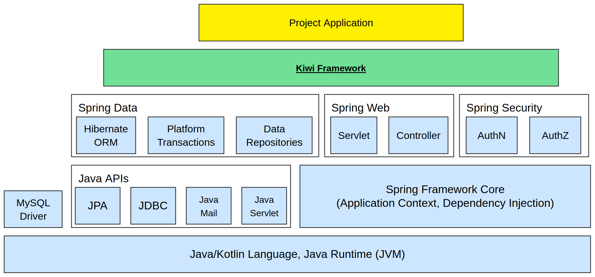
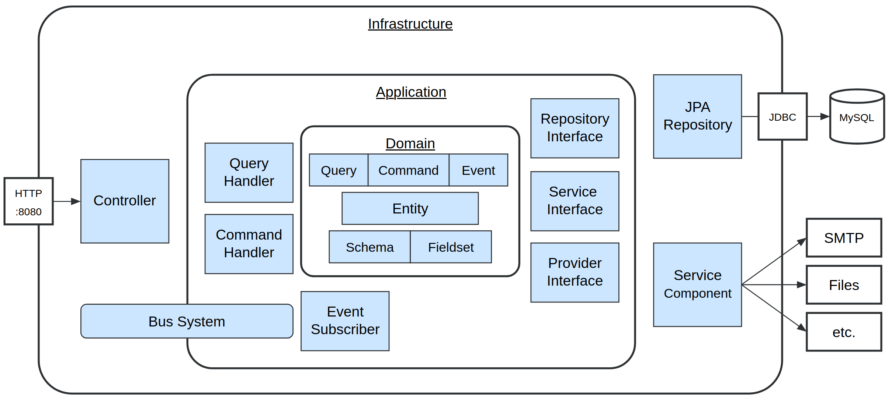
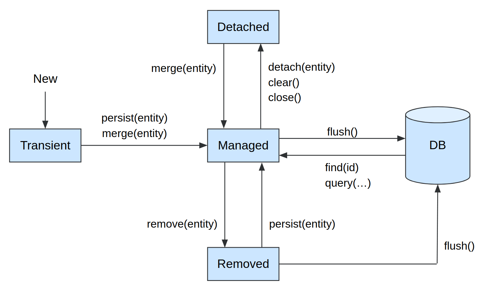
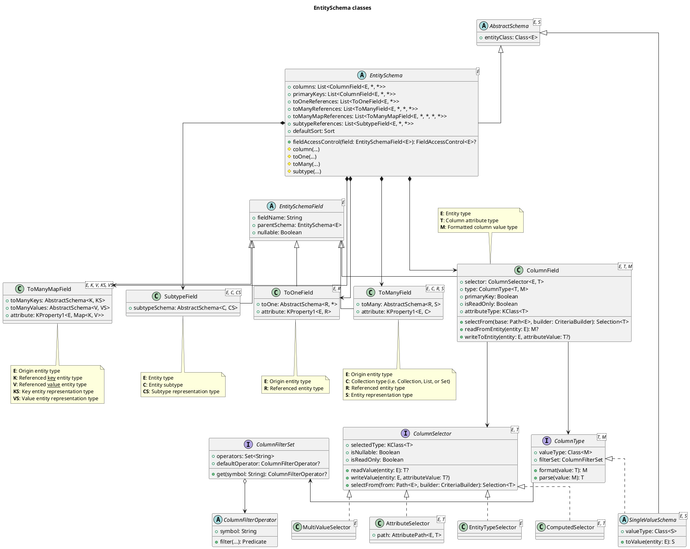

# Appendix - Kiwi Server

This chapter contains extended material on the Kiwi Server framework, which may be referenced and supplement other
chapters.

## Glossary

### Bean

- A bean is an instance of a class managed by the Spring application context (see
  ["Introduction to the Spring IoC Container and Beans"](https://docs.spring.io/spring-framework/reference/core/beans/introduction.html))
- Beans can have dependencies to, or be used as dependencies by, other beans (see
  ["Dependency Injection"](https://docs.spring.io/spring-framework/reference/core/beans/dependencies/factory-collaborators.html))
- Bean instances can be programmatically created, configured and provided on application startup
  using [@Configuration](https://docs.spring.io/spring-framework/reference/core/beans/java/configuration-annotation.html)
  classes with @Bean methods

### Auto-Configuration

- Autoconfiguration is the mechanism of Spring Boot to configure beans based on the libraries on the classpath and
  the application configuration properties (see
  ["Auto-configuration"](https://docs.spring.io/spring-boot/reference/using/auto-configuration.html))
- Each Kiwi module (except the API module) provides autoconfiguration classes, e.g.
  `KiwiFrameworkAutoConfiguration`, so adding a module to the classpath is enough to use it
- Most beans provided by autoconfiguration back off if the application declares its own bean of the same type

### Entity

- An entity represents a persistent object within the business domain of the application
- An entity type is typically represented as a class annotated with @Entity inheriting from BaseEntity,
  with an associated ID class inheriting from EntityId
- Each managed instance of an entity corresponds to one row in its associated database table
- Entity class attributes are mapped to database table columns using @Column or @JoinColumn annotations
- Entity classes can refer to each other with relations using @OneToOne, @OneToMany, @ManyToOne or @ManyToMany
- Entity objects are managed by an EntityManager of the application Persistence Unit

### EntitySchema

- An entity schema is an object extending EntitySchema, which defines the fields of an entity that are available to
  the API: columns, to-one references, and to-many references
- Entity schemas are used to query entities, to read and write entity fields, and to define field-access-control

### Fieldset

- A fieldset is a named subset of the fields of an entity schema, defining the representation of an entity in a query
  result, e.g. a short representation for lists and a detailed representation for a single entity
- Fieldsets of an entity are aggregated in an object extending FieldsetsAvailable

### Command

- A command is an object of a command class, which is submitted to a [CommandBus](#commandbus) in order to modify the
  application state and emit DomainEvents when handled by a [CommandHandler](#commandhandler)

### CommandBus

- The command-bus is a service interface providing functionality to interact with the application core using commands
- Implementations of the command-bus decorate the basic bus, implementing shared concerns such as transactions, command
  authorization, relaying events to the event-bus, and automatically registering command-handler beans to the bus

### CommandHandler

- A command-handler is a bean implementing CommandHandler, which executes commands of one specific command class
- Only a single handler must exist for any given command class
- Handling a command returns a DomainResult, containing the command result and the domain events emitted by the command

### DomainEvent

- A domain event is an object of a class extending DomainEvent, which describes something that happened in the
  application domain, e.g. that an entity has been created
- Domain events are emitted by command-handlers and event-subscribers, and are published to the
  [EventBus](#eventbus)
- Domain events are auditable, so they can appear in the audit-log

### EventBus

- The event-bus is a service interface publishing domain events to all [EventSubscribers](#eventsubscriber) that are
  subscribed to them
- Events emitted while handling an event are published recursively, up to a configurable maximum recursion depth

### EventSubscriber

- An event-subscriber is a bean implementing EventSubscriber, which handles domain events of one specific event class
- Multiple subscribers can listen to the same event class, and are executed in the order of their `order` attribute

### Query

- Query, within the context of applications, is a highly ambiguous word used by multiple aspects of the framework
- In Kiwi specifically, a query is an object of a query class, which is resolved by a [QueryBus](#querybus) in order to
  read data from the application state when handled by a [QueryHandler](#queryhandler)

### QueryBus

- The query-bus is a service interface providing functionality to access data from the application core using queries
- Implementations of the query-bus decorate the basic bus, implementing shared concerns such as read-only
  transactions, query authorization, and automatically registering query-handler beans to the bus

### QueryHandler

- A query-handler is a bean implementing QueryHandler, which resolves queries of one specific query class and returns
  the query result
- Only a single handler must exist for any given query class

### Service Interface

- A service interface, sometimes just referred to as a service, abstracts functionality required by the application
  that depends on external or infrastructure-dependent implementation details
- Implementations of service interfaces are provided as beans, such that applications can depend on it without
  having to know the details hidden behind the service interface
  (see ["Dependency inversion principle"](https://en.wikipedia.org/wiki/Dependency_inversion_principle))

### Repository

- A repository is an interface for interacting with persistent entities in a database
- Repositories can be used to query, save (store/update), and delete entities

## Snowflake IDs

The Kiwi-Server Framework uses a type of [Snowflake IDs](https://en.wikipedia.org/wiki/Snowflake_ID) to universally
uniquely identify entities within the system using a single key.

Snowflake IDs are universally unique 60-bit integers upon being generated.
These 60 bits, made to fit neatly into a 12-character base32 string, are composed of the following components:

- 42 bit timestamp in milliseconds, offset from 2024-01-01 00:00:00 UTC.
- 10 bit machine ID, identifying the machine or application instance generating the ID.
- 8 bit sequence ID, used in case multiple IDs are generated at the same millisecond on the same machine.

The binary representation is `0000ttttttttttttttttttttttttttttttttttttttttttmmmmmmmmmmssssssss`
(`t` = Timestamp bit, `m` = Machine ID bit, `s` = Sequence ID bit).

The machine ID (0-1023) is determined in the following order:

1. The system property `kiwi.snowflake.machine.id`, if set.
2. The environment variable `KIWI_SNOWFLAKE_MACHINE_ID`, if set.
3. Otherwise, a hash of the local hostname.

If you run multiple application instances, e.g. in a cluster, you can assign each instance a distinct machine ID to
rule out ID collisions between instances caused by hostname hash collisions.

When serialized as a string, Snowflake IDs are encoded as a base32 string.
Base32 encoded IDs can contain the following characters:

- Numeric characters (0-9).
- Alphabetic characters (A-Z), case-insensitive, excluding the ambiguous letters `I`, `O`, `S` and `Z`.
- When decoding, erroneous characters are treated as their respective similar number: I => 1, O => 0, S => 5, and
  Z => 2.

The source code for generating these Snowflake IDs can be found
in [Snowflake.kt](../api/src/main/kotlin/de/kiwi/api/domain/Snowflake.kt)

### Advantages of Snowflake IDs

- Snowflake IDs are sortable by their time of creation, the timestamp of which can be extracted from the ID itself.
- Since the timestamp bits are assigned to the most significant bits of a Snowflake ID, the values of the ID are
  monotonically rising over time, which is advantageous for using them in database indexes.
- Snowflake IDs are smaller (60 bits, represented using 64 bit `Long`/`BIGINT` type) than UUIDs (128 bits) and can be
  saved in a single numeric database column.
- Variations of Snowflake IDs are widely used by various services, such as Discord, Instagram, Twitter and Mastodon.

## Architecture diagrams

This section contains diagrams relevant to framework- and application-architecture

### Kiwi-Server Framework Stack

This diagram shows an overview of the technology stack powering the Kiwi-Server Framework

### Application Module Architecture

This diagram shows an overview of the architecture within a project application module

### JPA Entity Lifecycle

This diagram shows the lifecycle states of a JPA entity object, and the EntityManager operations transitioning
between them

## Class Diagrams

This section contains class diagrams for various components of the Kiwi-Server framework.

<!--
These diagrams are written in [PlantUML](https://plantuml.com/en-dark/class-diagram), and can be viewed in Markdown
renderers that support inline PlantUML diagrams.

If you do not see the below diagrams, go to the
[PlantUML online editor](https://editor.plantuml.com/uml/SoWkIImgAStDuL9NyCmhJYqgKGZ8ISmh2VNrKKZ9J4mlIinLo4WjIkLoICrB0Ie30000)
and copy-paste the diagram code.
-->

### EntitySchema class diagram

## Example application project

The example Todo-List application built throughout this guide is available as the demo application
[`demo/todo-app`](../demo/todo-app) in the Kiwi-Server repository. It is a Gradle subproject of the repository, so the
Gradle wrapper, the settings file and the version catalog are located in the repository root directory. Its base
package is `de.kiwi.demo`, while the examples in this guide use `com.example`.

Here is a list of the relevant files and directories of the demo application, relative to `demo/todo-app`, along with
a short description of what each file or directory contains:

| File                                                                    | Description                                      |
|-------------------------------------------------------------------------|--------------------------------------------------|
| build.gradle.kts                                                        | Gradle build file                                |
| compose.yaml                                                            | Docker Compose services: MySQL, mail-catcher     |
| .gitignore                                                              | Excludes the local file storage directory        |
| build/                                                                  | Build artifacts generated by Gradle tasks        |
| build/demo.model.ts                                                     | TypeScript fieldset sources, generated by a test |
| src/main/kotlin/de/kiwi/demo/                                           | Base package directory of the application        |
| src/main/kotlin/de/kiwi/demo/DemoApplication.kt                         | Main class, annotated @SpringBootApplication     |
| src/main/kotlin/de/kiwi/demo/DemoSecurityConfig.kt                      | Spring Security configuration, demo users        |
| src/main/kotlin/de/kiwi/demo/domain/TodoList.kt                         | `TodoList` entity and `TodoListId` classes       |
| src/main/kotlin/de/kiwi/demo/domain/TodoItem.kt                         | `TodoItem` entity and `TodoItemId` classes       |
| src/main/kotlin/de/kiwi/demo/domain/command/TodoCommands.kt             | Command classes, incl. generic commands          |
| src/main/kotlin/de/kiwi/demo/domain/command/TodoEvents.kt               | Domain event classes                             |
| src/main/kotlin/de/kiwi/demo/domain/query/TodoQueries.kt                | Generic entity and report queries                |
| src/main/kotlin/de/kiwi/demo/domain/schema/TodoSchema.kt                | Entity schema and fieldsets objects              |
| src/main/kotlin/de/kiwi/demo/application/TodoListCommandHandlers.kt     | Command handlers for todo-lists                  |
| src/main/kotlin/de/kiwi/demo/application/TodoItemCommandHandlers.kt     | Command handlers for todo-items                  |
| src/main/kotlin/de/kiwi/demo/application/TodoListRepository.kt          | Repository interface for todo-lists              |
| src/main/kotlin/de/kiwi/demo/application/TodoItemRepository.kt          | Repository interface for todo-items              |
| src/main/kotlin/de/kiwi/demo/web/IndexController.kt                     | Index controller mapped to "/"                   |
| src/main/kotlin/de/kiwi/demo/web/TodoItemController.kt                  | Custom endpoints, mapped to "/TodoItem"          |
| src/main/resources/application.yml                                      | Main application configuration file              |
| src/main/resources/banner.txt                                           | Spring Boot startup banner                       |
| src/main/resources/db/changelog/db.changelog-master.yaml                | Liquibase master changelog                       |
| src/main/resources/db/changelog/db.demo-001.yaml                        | Liquibase changelog of the todo-app schema       |
| src/test/kotlin/de/kiwi/demo/DemoApplicationTests.kt                    | Integration tests, source generation             |
| src/test/kotlin/de/kiwi/demo/application/DemoDataJpaTest.kt             | Configuration of the JPA slice tests             |
| src/test/kotlin/de/kiwi/demo/application/TodoListCommandHandlersTest.kt | Tests of the todo-list command handlers          |
| src/test/kotlin/de/kiwi/demo/application/TodoItemCommandHandlersTest.kt | Tests of the todo-item command handlers          |

The demo application [`demo/access-control-tests`](../demo/access-control-tests) contains a more complex domain, with
tests of entity- and field-access-control
(see [Chapter 4: "Access Control"](./04-querying-access-control.md#access-control)).
